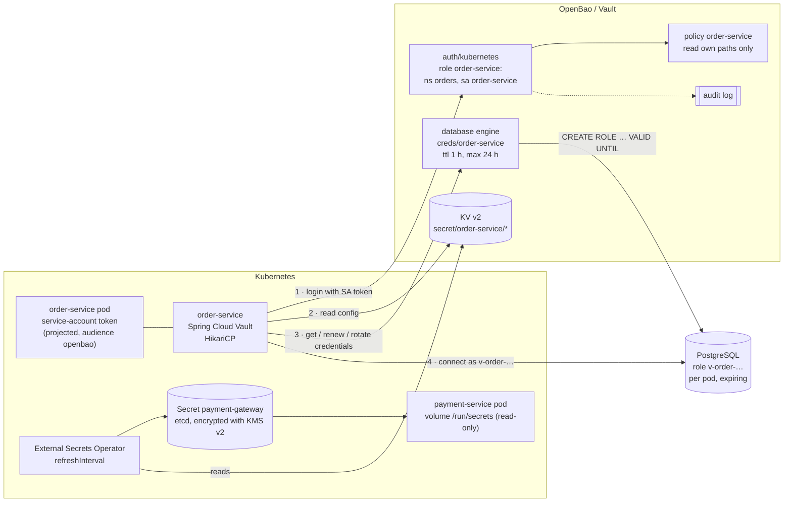

# 39. Secrets Management

<div class="badges" markdown><span class="badge badge-l2">L2 · Practitioner</span><span class="badge badge-l3">L3 · Senior/Lead</span><span class="badge badge-l4">L4 · Architect</span><span class="badge badge-meta">OpenBao/Vault · dynamic credentials · Kubernetes Secrets · External Secrets · rotation</span></div>

<div class="grid two" markdown>

!!! info "Prerequisites"
    - [Chapter 35](ch35-security-fundamentals.md): least privilege, threat modelling
    - [Chapter 38](ch38-service-to-service-security.md): workload identity, short-lived credentials
    - [Chapter 33](../data/ch33-database-scaling.md): connection pools and their lifetimes

!!! abstract "What you'll learn"
    - **Where secrets leak**: an environment variable was **inherited by a child process and readable in `/proc/<pid>/environ`**; a password kept as a `String` was in every heap dump; a wiped `char[]` in none
    - **Identity instead of a secret to get secrets**: services log in to OpenBao/Vault with their Kubernetes service account; a policy lets order-service read its own paths and nothing else (checked live)
    - **Rotation without outages**: changing a shared password in place failed **14–16% of database logins** while the new secret propagated; two alternating accounts failed **none**
    - **Dynamic credentials that outlive max_ttl**: renew-only clients (what Spring Cloud Vault does for database secrets) **failed from 18.1 s into an 18 s max_ttl**; renew-then-rotate failed **0 of 7,559–7,591** queries
    - **Revocation does less than you think**: after a password change, an expiry or `NOLOGIN`, **the open session kept working**; OpenBao's default revocation left sessions connected; adding `pg_terminate_backend` ended them

</div>

---

## 1 · Introduction & Context

### Three ways FoodFleet's secrets got out

- **The password in the crash report.** order-service ran out of memory; the heap dump went into a ticket so a vendor could look at it. It held the database password, the payment gateway key and every user's session token.
- **The password in the debug container.** A support engineer ran `env` in a pod to check a setting. The payment gateway key was an environment variable, so it went into the terminal recording.
- **The password nobody could change.** The orders database password had been the same for three years: eleven services used it, and every attempt to change it caused an outage, so it was never changed. When an ex-contractor's laptop went missing, it still worked.

Each is a different failure: secrets stored where they spread, secrets that are permanent, and secrets shared so widely that nobody can change them. This chapter fixes them for FoodFleet with OpenBao (the open-source fork of HashiCorp Vault; the same API), Kubernetes Secrets used carefully, and Spring. It measures leakage, rotation and revocation against real OpenBao 2.7.1 and PostgreSQL 16 servers.

### Where it comes from

<ul class="mh-timeline">
<li><span class="when">2000s · Config files and env vars</span><span class="what">Passwords in properties files, then the twelve-factor "config in the environment"; long-lived, shared, rarely rotated.</span></li>
<li><span class="when">2015 · HashiCorp Vault</span><span class="what">A secrets service with policies, audit logs, leases, and <em>dynamic secrets</em>: database credentials created per client, expiring on their own.</span></li>
<li><span class="when">2015–2019 · Kubernetes Secrets</span><span class="what">Secrets as API objects, base64-encoded and stored unencrypted in etcd unless encryption at rest is configured (KMS v2 later).</span></li>
<li><span class="when">2019–2021 · External Secrets, CSI driver</span><span class="what">Operators sync secrets from Vault and cloud secret managers into Kubernetes; the Secrets Store CSI driver mounts them directly.</span></li>
<li><span class="when">2023 · OpenBao</span><span class="what">After Vault's licence change, the Linux Foundation forks it as OpenBao under MPL 2.0, API-compatible.</span></li>
<li><span class="when">2025–2026 · HikariCP 7, OpenBao 2.7</span><span class="what">HikariCP adds a credentials provider asked on every new connection; the versions used here: OpenBao 2.7.1, Spring Cloud Vault 5.0.2, Spring Boot 4.1.1.</span></li>
</ul>

---

## 2 · Core Concepts & Terminology



Secret
:   Anything that grants access: database passwords, API keys, signing keys, client secrets, TLS private keys. A secret's risk is its **reach** (what it opens) × its **lifetime** × the **number of places** it is stored.

Static secret
:   Created once and stored (KV, Kubernetes Secret). Must be rotated deliberately.

Dynamic secret
:   Created on request for one client, with a lease: OpenBao's database engine creates a PostgreSQL role per pod, valid until the lease ends, and drops it on revocation.

Lease, TTL, max_ttl
:   Every dynamic secret has a lease: renewable up to `max_ttl`, after which it ends regardless. Renewal extends; it never extends past max_ttl.

Secret zero
:   The credential needed to fetch the other secrets. Platform identity removes it: the pod's Kubernetes service-account token is exchanged for an OpenBao token (chapter 38's idea, for secrets).

Encryption at rest (Kubernetes)
:   An `EncryptionConfiguration` for the API server; without it, Secrets are stored unencrypted in etcd. With KMS v2, the key-encryption key stays in a cloud KMS.

---

## 3 · How It Works Internally

### No secret to get secrets: Kubernetes auth and a narrow policy

order-service logs in by presenting its projected service-account token; OpenBao asks the Kubernetes API to verify it and returns a token bound to the role's policies. The policy names order-service's paths, and nothing else:

```hcl
--8<-- "code/chapters/ch39-secrets-management/src/main/resources/openbao/order-service-policy.hcl"
```

### A secret value that doesn't spread by accident

Most leaks are accidental copies: a log line, an exception message, a `toString()` in a debugger, a `Map` key. A small value type stops those; it can't stop a JDBC driver (which takes a `String`) or a heap dump of live memory, so heap dumps are treated as secrets too:

```java
--8<-- "code/chapters/ch39-secrets-management/src/main/java/dev/foodfleet/ch39/secret/Secret.java:78:92"
```

### Kubernetes Secrets: volume, not environment, not subPath

The kubelet writes each version of a mounted Secret into a new directory and swaps a `..data` symlink to it, so readers see a consistent version. The Kubernetes documentation states the consequences: volume contents update eventually; **a `subPath` mount never updates**; environment variables are fixed when the container starts. Spring Boot's `configtree:` import reads each file once (it doesn't use the `ALWAYS_READ` option), which is fine for values read at start-up and wrong for anything that rotates. `MountedSecrets` follows the swap and reads every key from one version:

```java
--8<-- "code/chapters/ch39-secrets-management/src/main/java/dev/foodfleet/ch39/secret/MountedSecrets.java:106:122"
```

```yaml
--8<-- "code/chapters/ch39-secrets-management/src/main/resources/k8s/payment-service-pod.yaml:20:37"
```

And the Secret must be encrypted in etcd:

```yaml
--8<-- "code/chapters/ch39-secrets-management/src/main/resources/k8s/encryption-config.yaml"
```

### Static secrets in Kubernetes from OpenBao: External Secrets Operator

ESO copies OpenBao KV entries into Kubernetes Secrets. Its `refreshInterval` **defaults to one hour** (2.12.0 API): a rotation in OpenBao reaches the Kubernetes Secret up to an hour later, then the kubelet updates the volume. Rotations of ESO-delivered secrets must allow for that whole chain:

```yaml
--8<-- "code/chapters/ch39-secrets-management/src/main/resources/eso/external-secret.yaml"
```

### Dynamic database credentials that keep working

A lease can be renewed only up to max_ttl, so a long-running service must eventually switch to *new* credentials. Reading Spring Cloud Vault 5.0.2 shows its `spring.cloud.vault.database` support requests a **renewable** secret (`RequestedSecret.renewable`), not a rotating one: renewed until max_ttl, then expired. `DatabaseCredentials` shows the loop that works, renew until a renewal is granted less than asked for, then rotate:

```java
--8<-- "code/chapters/ch39-secrets-management/src/main/java/dev/foodfleet/ch39/vault/DatabaseCredentials.java:78:114"
```

In Spring, the same loop is Spring Vault's rotating lease feeding HikariCP 7's `HikariCredentialsProvider`, which the pool asks for credentials on every new connection; on rotation the pool soft-evicts its connections:

```java
--8<-- "code/chapters/ch39-secrets-management/src/main/java/dev/foodfleet/ch39/web/VaultDatabaseCredentials.java:34:67"
```

```java
--8<-- "code/chapters/ch39-secrets-management/src/main/java/dev/foodfleet/ch39/web/DataSourceConfig.java:17:29"
```

```yaml
--8<-- "code/chapters/ch39-secrets-management/src/main/resources/order-service.yml"
```

### Revocation that ends sessions

OpenBao's default PostgreSQL revocation (2.7.1 source) revokes privileges and `CONNECT`, then drops the role, but never terminates sessions. FoodFleet's revocation SQL does (the OpenBao admin role needs `pg_signal_backend`):

```sql
--8<-- "code/chapters/ch39-secrets-management/src/main/resources/openbao/revocation.sql"
```

---

## 4 · Design Considerations & Trade-offs

All measurements ran against **OpenBao 2.7.1** (release binary, checksum verified) in dev mode and **PostgreSQL 16.13** with SCRAM-SHA-256, through a tiny JDK PostgreSQL client (`verify/tools/Pg.java`). Lifetimes are scaled down to seconds. The Spring application was not started (no Maven access); `check_apis.sh` checks **41 APIs, properties and defaults** against Spring Boot 4.1.1, Spring Cloud Vault 5.0.2, Spring Vault 4.0.3, HikariCP 7.0.2, OpenBao 2.7.1, External Secrets 2.12.0 and Kubernetes 1.37.1 (all found). Two runs; ranges show both.

### Checked live: the policy

A token with only `order-service-policy.hcl`:

| Operation | Result |
|---|---|
| `kv get secret/order-service/gateway` | allowed |
| `kv get secret/payment-service/gateway` | **denied** |
| `read database/creds/order-service` | allowed |
| `read database/creds/payment-service` | **denied** |
| `secrets list` | **denied** |

### Measured: where a secret ends up

| Where the secret was | Found? |
|---|---|
| Environment variable → a child process's environment | **inherited** |
| Environment variable → `/proc/<pid>/environ` (same user) | **readable** |
| Mounted file → a child process's environment | absent |
| `Secret` wrapper → `toString` / string concatenation | `Secret[****]` |

| Heap dump contains the value? | Dump of all objects | Dump of live objects |
|---|---|---|
| `String` field (a bound configuration property) | **yes** | **yes** |
| `String` used once, then unreachable | **yes** | no |
| `Secret` (`char[]`) still in use | yes | yes |
| `Secret` (`char[]`) after `destroy()` | no | no |

- **Environment variables spread** to every child process (shell-outs, crash handlers, debug tools) and are readable by the same user through `/proc`. Mount secrets as files.
- **Heap dumps contain secrets in use**, whatever the type: protect them like secrets (encrypted storage, never in tickets). Wiping helps for secrets no longer in use; dumps of all objects still contain discarded `String`s.

### Measured: a mounted secret changing five times

| Reader | Sees the new value? |
|---|---|
| Read once at start-up (`configtree:`, environment variables) | never: kept `v0` |
| Pinned to one version's file (as a `subPath` mount is) | never: kept `v0` |
| `MountedSecrets` (directory watch + 1 s poll) | every version, **2–6 ms** after the swap |

### Measured: rotating a shared static password

6 pods with pools of 3, connections replaced every 2 s; the new secret reaches each pod at a random moment within 6 s (ESO refresh + kubelet sync, scaled down); 16 s.

| Rotation | OK | Failed | First failure |
|---|---:|---:|---:|
| One account, password changed in place | 3,381–3,396 | **568–621** (all login failures) | 4.2 s |
| **Two accounts**: the idle one changed, pods switch to it | 4,497–4,507 | **0** | — |

- **In-place rotation fails for as long as propagation takes**: every pod that hasn't received the new password fails to open connections (14–16% of attempts here).
- **Two accounts make it safe**: change the account no one uses, roll it out, and only then change the other. The cost is two database roles and a rotation procedure that takes two propagation windows.

### Measured: dynamic credentials

Issuing credentials took **14.7–17.2 ms (p50)**, 24.5–29.8 ms (p99): OpenBao creates a PostgreSQL role with grants per request. Revoking took 25.8–27.8 ms (p50).

Role with `default_ttl` 6 s and `max_ttl` 18 s (for 1 h / 24 h); 4 pods with pools of 3; 40 s:

| Client | OK | Failed | First failure | Renewals | Credentials issued |
|---|---:|---:|---:|---:|---:|
| Renew-only (Spring Cloud Vault's mode for database secrets) | 3,357–3,367 | **2,706–2,790** | **18.1 s** | 32 | 4 |
| **Renew, then rotate before max_ttl** (`DatabaseCredentials`) | **7,559–7,591** | **0** | — | 76 | 12 |

Database roles left behind afterwards: 0 in both cases (OpenBao revokes expired leases; `DatabaseCredentials` revokes replaced and closed ones).

- **Renewal alone fails at exactly max_ttl.** With the real 24 h max_ttl, a service using `spring.cloud.vault.database` loses its database a day after start-up, unless it restarts first (which hides the problem until a quiet weekend).
- **Rotation is cheap**: one role creation per pod per rotation.

### Measured: what revoking a credential does to open sessions

| Action | New login | The open session's next query |
|---|---|---|
| OpenBao lease revoked (default revocation SQL) | refused | **still connected**; queries on `orders` fail (permission denied) |
| OpenBao lease revoked (revocation SQL + `pg_terminate_backend`) | refused | **session terminated** |
| Static password changed (`ALTER ROLE … PASSWORD`) | refused | **query works** |
| Password expired (`VALID UNTIL` in the past) | refused | **query works** |
| Login disabled (`ALTER ROLE … NOLOGIN`) | refused | **query works** |

Revoking all 50 leases of a role with `revoke-prefix` took **1.19–1.37 s**; none of the 50 logins worked afterwards.

- **PostgreSQL checks credentials at login only.** Rotating a compromised password does nothing to the attacker's open session: terminate sessions as part of revocation.
- With the default revocation SQL the session survives without privileges on the schema; anything granted to `PUBLIC` still works. Terminate it.

### Choosing

| Secret | FoodFleet's choice |
|---|---|
| Database credentials | OpenBao dynamic credentials per pod, rotated before max_ttl, revocation terminates sessions |
| Third-party API keys (payment gateway) | OpenBao KV v2, synced by ESO into a Secret mounted as a volume; rotated with two keys active at once where the provider allows |
| Service-to-service credentials | None: workload identity and mTLS (chapter 38), tokens from the identity provider |
| OAuth client secrets | Replaced by `private_key_jwt` or mTLS client authentication; otherwise KV v2 |
| Signing and encryption keys | OpenBao transit or cloud KMS: the key never leaves; services ask for signatures |
| Configuration that isn't secret | Plain configuration ([Configuration Management](../components-tools/configuration-management.md)), not OpenBao |

---

## 5 · Hands-on Implementation

```text
ch39-secrets-management/
├── src/main/java/dev/foodfleet/ch39/
│   ├── secret/   Secret, MountedSecrets
│   ├── vault/    VaultClient, DatabaseCredentials
│   └── web/      VaultDatabaseCredentials, DataSourceConfig, OrderServiceApplication
├── src/main/resources/   order-service.yml, openbao/ (policy, setup, SQL), eso/, k8s/
├── src/test/java/…       15 JDK tests (a stand-in OpenBao API, a fake database engine, kubelet-style volumes)
└── verify/               run.sh, tools/Measure.java, tools/Pg.java, check_apis.sh
```

### 🟢 Level 1: get secrets out of code and environment variables

<div class="badges" markdown><span class="badge badge-l1">L1 · Foundation</span></div>

- No secrets in Git, images, `application.yml` or environment variables. Scan repositories (chapter 41) and rotate anything found.
- Kubernetes Secrets as read-only volumes, encryption at rest turned on, RBAC that keeps `get secrets` to the few who need it.
- `management.endpoint.env.show-values: never` (the default); no secrets in logs.

### 🔵 Level 2: one place for secrets, one identity per service

<div class="badges" markdown><span class="badge badge-l2">L2 · Practitioner</span></div>

Run OpenBao (or Vault, or a cloud secret manager), Kubernetes auth per service, a policy per service, the audit log on. Then check the policy the way an attacker would:

```bash
SVC_TOKEN=$(bao token create -policy=order-service -field=token)
BAO_TOKEN=$SVC_TOKEN bao kv get secret/payment-service/gateway    # must fail
```

### 🟣 Level 3: credentials that rotate themselves

<div class="badges" markdown><span class="badge badge-l3">L3 · Senior/Lead</span></div>

- Dynamic database credentials with renew-then-rotate (`VaultDatabaseCredentials`) and a pool max lifetime under the lease TTL.
- `database/rotate-root` right after configuring the engine: afterwards only OpenBao knows the admin password.
- Revocation SQL that terminates sessions; `pg_signal_backend` for the OpenBao admin role.
- Static secrets rotated with two valid versions at once, timed to the propagation chain (ESO refresh + kubelet sync + application reload).

```bash
# the experiments: a JDK, the OpenBao binary, PostgreSQL 16
PGHOST=/var/run/postgresql PGUSER=postgres BAO_BIN=$(command -v bao) verify/run.sh
```

### 🔴 Level 4: secrets as a platform

<div class="badges" markdown><span class="badge badge-l4">L4 · Architect</span></div>

- **Highly available OpenBao** (integrated Raft storage, auto-unseal with a cloud KMS), monitored, with tested disaster recovery: if it is down, new pods can't start and leases can't renew.
- **Blast-radius design**: per-service policies, per-pod database users, short TTLs; one compromised pod exposes one service's secrets for hours, not every service's for years.
- **Incident runbook**: `bao lease revoke -prefix database/creds/<role>` (seconds), rotate static secrets with the two-version procedure, check the audit log for what the compromised identity read.
- **Inventory and age**: every static secret has an owner, a rotation interval and an alert when it is overdue.

### Run and verify

```text
$ verify/run.sh revocation
== revocation
a session is open and working; then the credential is revoked, rotated or disabled
action                                                       new login                the open session, next query
OpenBao lease revoked (default revocation SQL)               refused (28P01)          still connected; query fails: 42501 permission denied for schema orders
OpenBao lease revoked (revocation SQL + pg_terminate_backend) refused (28P01)          session terminated by the server
static password changed (ALTER ROLE ... PASSWORD)            refused (28P01)          query works
password expired (VALID UNTIL in the past)                   refused (28P01)          query works
login disabled (ALTER ROLE ... NOLOGIN)                      refused (28000)          query works

revoke-prefix of 50 leases: API call 1374 ms; logins still working afterwards: 0 of 50
```

!!! question "Try it"
    1. In `Measure.staticRotation`, set the propagation window to 1 s and to 30 s. How do the in-place failures change, and what does that say about ESO's default `refreshInterval` of one hour?
    2. Remove `pg_terminate_backend` from `order-service-strict` in `run.sh`. Which row of the revocation table changes?
    3. Run `verify/run.sh dynamic` with `max_ttl` equal to `default_ttl`. How often does `DatabaseCredentials` rotate?
    4. Grant `SELECT` on `orders.orders` to `PUBLIC` and repeat the revocation experiment with the default SQL. What can the surviving session still do?

---

## 6 · Production Readiness

- [x] **No secrets in code, images, environment variables or plain configuration**; repository and image scanning in CI
- [x] **Kubernetes Secrets encrypted at rest** (KMS v2), mounted as read-only volumes, no `subPath`, RBAC on `get secrets`
- [x] **Workload identity to reach the secrets store**: Kubernetes auth, one role and one policy per service
- [x] **Dynamic database credentials** per pod, renewed and rotated before max_ttl, pool max lifetime below the lease TTL
- [x] **Revocation ends sessions** (`pg_terminate_backend`), tested; `revoke-prefix` in the incident runbook
- [x] **Static secrets rotated with two valid versions** and a schedule that covers the propagation chain
- [x] **Secrets kept out of logs, error messages, actuator endpoints and heap dumps** shared outside the team
- [x] **OpenBao/Vault highly available, auto-unsealed, audited, backed up**, with alerting on lease renewal failures
- [x] **Inventory**: owner, rotation interval and age for every static secret

---

## 7 · Anti-patterns & Pitfalls

!!! pitfall "Incident 1: the heap dump in the ticket"
    **Context.** An out-of-memory heap dump was attached to a vendor support ticket.
    **Symptoms.** A security review found the orders database password and payment gateway key in the ticket system.
    **Root cause.** Secrets in use are in memory; a heap dump contains them. Measured: a `String` configuration value was in every dump; even a `Secret` still in use was.
    **Fix.** Heap dumps classified as secret: written to encrypted storage, analysed in place, never attached; credentials rotated after any dump leaves the cluster.

!!! pitfall "Incident 2: the database that disappeared on day two"
    **Context.** order-service moved to `spring.cloud.vault.database` dynamic credentials with `max_ttl=24h`.
    **Symptoms.** A day after the release, every new database connection failed with `password authentication failed`; pods that had restarted in the meantime were fine.
    **Root cause.** Spring Cloud Vault 5.0.2 requests database credentials as a renewable secret: renewed until max_ttl, never replaced. Measured: renew-only clients failed from 18.1 s with an 18 s max_ttl.
    **Fix.** A rotating Spring Vault lease feeding HikariCP's credentials provider; 0 failures.

!!! pitfall "Incident 3: the rotated password that didn't lock anyone out"
    **Context.** After a laptop was stolen, the team rotated the shared orders database password.
    **Symptoms.** Audit logs later showed queries from the stolen credential's sessions for hours after the rotation.
    **Root cause.** PostgreSQL checks passwords at login; open sessions continue. Measured: after a password change, an expiry or `NOLOGIN`, the open session's next query worked.
    **Fix.** Revocation terminates sessions; per-pod dynamic credentials so one compromised credential is one role to revoke.

| Anti-pattern | Symptom | Fix |
|---|---|---|
| Secrets in environment variables | Inherited by child processes, visible in `/proc` and debug sessions | Read-only volume mounts |
| Base64 in Git ("it's encoded") | Anyone with the repository has the secret | Secrets store; sealed or external secrets |
| Secrets unencrypted in etcd | Backups and etcd access expose every Secret | EncryptionConfiguration with KMS v2 |
| `subPath` secret mounts | Rotations never arrive | Mount the directory |
| One shared password for many services | Can't be rotated without an outage | Per-service, per-pod credentials |
| In-place rotation | Failures while the new secret propagates | Two valid versions |
| Renew-only dynamic credentials | Outage at max_ttl | Renew, then rotate |
| Rotation as revocation | Open sessions keep working | Terminate sessions |
| A root token in CI | Total compromise from one pipeline | Short-lived, scoped tokens; workload identity |

---

## 8 · Enterprise Case Study

### FoodFleet: OpenBao for every secret, identity to reach it

!!! decision "ADR-039: OpenBao as FoodFleet's secrets store; Kubernetes auth per service; dynamic, rotating database credentials; static secrets via External Secrets as volumes; revocation terminates sessions"
    **Status:** Accepted · **Date:** 2025-06-30

    **Context.** A heap dump and a debug session exposed secrets; the shared orders password was three years old because rotating it caused outages. Measured against OpenBao 2.7.1 and PostgreSQL 16: environment variables were inherited and readable through `/proc`; in-place password rotation failed 14–16% of logins while the change propagated, two accounts 0%; renew-only dynamic credentials failed at max_ttl, renew-then-rotate never; password changes, expiry and `NOLOGIN` left open sessions working.

    **Decision.** OpenBao (highly available, auto-unsealed with KMS, audited) holds every secret. Services authenticate with their Kubernetes service accounts; one role and one policy per service. Database access uses dynamic credentials per pod (`default_ttl` 1 h, `max_ttl` 24 h) through a rotating Spring Vault lease and HikariCP's credentials provider; revocation SQL terminates sessions; the engine's root credential is rotated by OpenBao. Third-party API keys live in KV v2, synced by ESO (`refreshInterval` 5 m) into Secrets mounted read-only, rotated with two valid versions. Kubernetes Secrets are encrypted with KMS v2. Heap dumps are classified secret.

    **Consequences.** ✅ No long-lived shared database password; a compromised pod's credentials expire within the hour and can be revoked in seconds. ✅ Every secret read is audited. ⚠️ OpenBao is on the critical path for start-up and renewal: highly available, with alerting. ⚠️ One PostgreSQL role per pod: role churn monitored. ⚠️ Two-version rotation needs provider support or a procedure per secret.

### Fintech analogue: HSMs and dual control 🔴

Banks keep the most sensitive keys (payment PINs, card data encryption, signing keys) in HSMs: the key never leaves, and applications call the HSM (or OpenBao transit backed by one) to encrypt or sign. Changes to secrets need dual control (two people approve), rotations follow PCI DSS key-management requirements with documented key ceremonies, and access is reviewed on a schedule. Secrets for card data environments live in a separate store and network segment.

### E-commerce analogue: cloud secret managers at scale

A large retailer on one cloud uses the provider's secret manager and IAM instead of running Vault: each service's workload identity (IRSA, Workload Identity) can read its own secrets; databases use IAM authentication tokens that expire in minutes instead of passwords; the Secrets Store CSI driver mounts secrets as files with rotation. A central inventory tracks owners and age, and leaked-credential scanning runs on every repository and image.

---

## 9 · Interview Q&A + Summary

#### Q1. Why not keep secrets in environment variables? · <span class="badge badge-l2">L2</span> · Cognizant · SAP

**Short answer:** They are inherited by every child process, readable in `/proc/<pid>/environ` by the same user, shown by debug tools, often logged by crash reporters, and never updated without a restart. Measured: inherited by a child process and readable through `/proc`. Mount secrets as files instead.

#### Q2. Are Kubernetes Secrets secure? · <span class="badge badge-l2">L2</span> · Flipkart · Amazon

**Short answer:** Not by default: they are base64-encoded and stored unencrypted in etcd, and anyone who can create pods in a namespace can read its Secrets. Turn on encryption at rest (KMS v2), restrict RBAC, mount them as read-only volumes, and keep the source of truth in a secrets store.

#### Q3. What is "secret zero", and how do you avoid it? · <span class="badge badge-l3">L3</span> · Amazon · SAP

**Short answer:** The credential needed to fetch other secrets. Use platform identity: the pod's Kubernetes service-account token (or cloud workload identity) authenticates to Vault/OpenBao, which issues a scoped, short-lived token. Nothing is delivered to the pod.

#### Q4. Static vs dynamic secrets? · <span class="badge badge-l3">L3</span> · Goldman Sachs · JP Morgan

**Short answer:** Static secrets are created once and must be rotated deliberately; dynamic secrets are created per client on request with a lease, and expire or are revoked automatically. Dynamic database credentials give each pod its own role, so one leak is one role, and revoking it is one call. Measured: issuing took about 15 ms.

#### Q5. How do you rotate a database password without downtime? · <span class="badge badge-l3">L3</span> · Amazon · Flipkart

**Short answer:** Two valid credentials at once: change the account (or key) not in use, roll it out, switch, then change the other. In-place rotation fails until every instance has the new value. Measured: 14–16% of logins failed in place, 0 with two accounts. Dynamic credentials do this automatically.

#### Q6. Your Vault-backed service fails a day after deployment. Why? · <span class="badge badge-l3">L3</span><span class="badge badge-l4">L4</span> · SAP · Goldman Sachs

**Short answer:** Dynamic credentials renewed but never rotated: renewal stops at max_ttl. Spring Cloud Vault 5.0.2 requests database credentials as renewable secrets. Request a rotating secret and update the pool (HikariCP 7's credentials provider), or set max_ttl longer than any pod lives. Measured: renew-only failed exactly at max_ttl.

#### Q7. You rotated a leaked password. Is the attacker out? · <span class="badge badge-l4">L4</span> · JP Morgan · Goldman Sachs

**Short answer:** Not necessarily. PostgreSQL (like most databases) checks credentials at login; open sessions continue. Measured: after a password change, expiry or `NOLOGIN`, the open session still worked. Terminate sessions (`pg_terminate_backend`) as part of revocation, and use per-pod credentials so you know which to terminate.

#### Q8. How do secrets reach a Spring Boot application? · <span class="badge badge-l2">L2</span> · Cognizant · SAP

**Short answer:** `spring.config.import` with `configtree:` for mounted files (read once at start-up) or `vault://` for Spring Cloud Vault (Kubernetes auth, KV v2 as properties, leases managed by Spring Vault). Rotating values need code that reacts: a lease listener or a file watcher.

#### Q9. How do you keep secrets out of logs and dumps? · <span class="badge badge-l2">L2</span><span class="badge badge-l3">L3</span> · Flipkart · any

**Short answer:** A value type that masks itself, structured logging that never logs headers or credentials, actuator's `show-values: never`, and treating heap dumps as secrets. Measured: a `String` password was in every heap dump; only wiped `char[]`s were absent.

#### Q10. External Secrets Operator or the CSI driver or reading Vault directly? · <span class="badge badge-l3">L3</span> · Amazon · SAP

**Short answer:** ESO syncs into Kubernetes Secrets (works with anything that reads Secrets; adds a copy in etcd and a refresh delay, one hour by default). The CSI driver mounts directly without a Secret object. Reading Vault directly (Spring Cloud Vault) gives leases and rotation in the application but couples it to Vault. FoodFleet: Vault directly for dynamic credentials, ESO for static third-party keys.

#### Q11. What happens when Vault/OpenBao is down? · <span class="badge badge-l3">L3</span> · JP Morgan · Flipkart

**Short answer:** Running services keep working with their current credentials until their leases end; new pods can't start and renewals fail. Run it highly available with auto-unseal, alert on renewal failures, size lease TTLs to cover a realistic outage, and test the failure.

#### Q12. Design secrets management for FoodFleet. · <span class="badge badge-l4">L4</span> · Swiggy-/Zomato-style system design rounds

**Short answer:** OpenBao, HA and audited; Kubernetes auth with a role and policy per service; dynamic per-pod database credentials that renew and rotate, revocation that terminates sessions; third-party keys in KV v2, synced by ESO to Secrets mounted read-only and rotated with two versions; KMS v2 encryption at rest; no secrets in env vars, logs or dumps; an inventory with owners and ages; `revoke-prefix` in the incident runbook.

### Key takeaways

- **Shorten every secret's life and reach**: per-service, per-pod, expiring credentials beat shared, permanent ones.
- **Identity gets you the secrets**: no secret zero.
- **Volumes, not environment variables**; encryption at rest; heap dumps are secrets.
- **Rotation needs two valid versions** (or dynamic credentials) and an application that picks up the new one.
- **Revocation must end sessions**: databases check credentials only at login.

### Further reading

- OpenBao documentation, [Database secrets engine](https://openbao.org/docs/secrets/databases/) and [Kubernetes auth](https://openbao.org/docs/auth/kubernetes/)
- Kubernetes documentation, [Secrets](https://kubernetes.io/docs/concepts/configuration/secret/), [Good practices for Kubernetes Secrets](https://kubernetes.io/docs/concepts/security/secrets-good-practices/) and [Encrypting data at rest](https://kubernetes.io/docs/tasks/administer-cluster/encrypt-data/)
- External Secrets Operator, [documentation](https://external-secrets.io/latest/)
- Spring Cloud Vault, [reference](https://docs.spring.io/spring-cloud-vault/reference/)
- OWASP Cheat Sheet Series, [Secrets Management](https://cheatsheetseries.owasp.org/cheatsheets/Secrets_Management_Cheat_Sheet.html)

---

**Previous:** [← 38. Service-to-Service Security](ch38-service-to-service-security.md) · **Next:** [40. API Security Hardening →](ch40-api-security.md)
