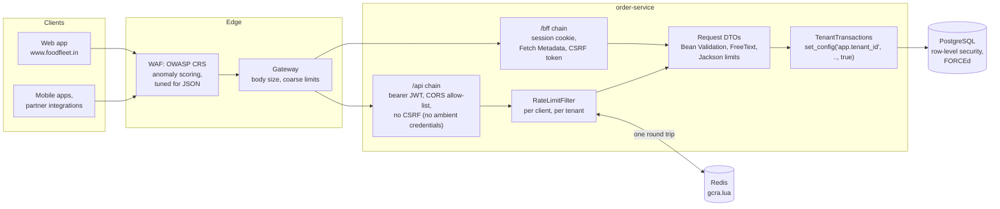

# 40. API Security Hardening

<div class="badges" markdown><span class="badge badge-l2">L2 · Practitioner</span><span class="badge badge-l3">L3 · Senior/Lead</span><span class="badge badge-l4">L4 · Architect</span><span class="badge badge-meta">rate limiting · input validation · ReDoS · CORS · CSRF · WAF · tenant isolation</span></div>

<div class="grid two" markdown>

!!! info "Prerequisites"
    - [Chapter 35](ch35-security-fundamentals.md): threat modelling, the OWASP API Security Top 10
    - [Chapter 37](ch37-spring-security-7.md): Spring Security filter chains, resource servers
    - [Chapter 10](../architecture-patterns/ch10-api-gateway-bff.md): API gateways and the backend-for-frontend
    - [Chapter 21](../communication/ch21-rest-api-design.md): REST API design, status codes, problem details

!!! abstract "What you'll learn"
    - **Rate limits that mean what they say**: a fixed window let one client make **200 requests in a minute against a limit of 100**; four instances with local limits let through **1,036 of a 260 budget**; a shared GCRA in Redis **258–260**
    - **Fairness between tenants**: with only a global limit, one tenant's runaway integration left the other tenants **0.2%** of their requests; per-tenant limits restored **100%**
    - **Validation without hangs**: JDK 21's regex engine shrugs off the textbook ReDoS pattern, but a **lazy quantifier or a backreference** switched its protection off (**>10 s** for 28 characters), and Stack Overflow's trailing-whitespace pattern took **9.5–9.8 s** on 20,000 spaces
    - **CORS and CSRF as Chromium enforces them**: a **sibling subdomain got even SameSite=Strict cookies** on a form post; a server that reflected any Origin handed a cross-site page the user's orders; Fetch Metadata and the CSRF token refused every forged write
    - **WAF and tenancy, measured**: the OWASP Core Rule Set as shipped blocked **6 of 41** legitimate FoodFleet requests at paranoia level 1 and **20 of 41** at level 2; tuned, **0 and 4**. PostgreSQL row-level security turned a query that forgot the tenant from **2,000 rows to 40**; a session-level `SET` leaked **4,000 rows** to the next tenant on a pooled connection

</div>

---

## 1 · Introduction & Context

### Four ways FoodFleet's API was abused

- **The integration that took everyone down.** A restaurant chain's point-of-sale sync went into a retry loop at 5,000 requests a second. The API had one global rate limit, and the loop used all of it: for twenty minutes, other restaurants' menu updates and customers' orders got `429`.
- **The limit that was six limits.** A script farming sign-up coupons was held to "100 requests a minute" per client, but the limit lived in each of six order-service pods, so the script got 600.
- **The marketing site that read order histories.** A campaign microsite on `offers.foodfleet.in` had a stored cross-site scripting bug. The API's CORS rule accepted any origin ending in `foodfleet.in`, and the session cookie was `SameSite=Lax`, so the injected script fetched visitors' order histories, addresses included.
- **The support screen that showed another restaurant's orders.** A new support query forgot `AND tenant_id = ?`. One restaurant group's staff saw orders from all fifty.

Each is a control that existed but did not hold: a limit that wasn't shared, a CORS rule that matched too much, a cookie attribute trusted to stop something it doesn't, an isolation rule that every query had to remember. This chapter hardens FoodFleet's public edge layer by layer and measures each layer for real: limiters against a real Redis, CORS and CSRF in Chromium 141, the OWASP Core Rule Set 4.30 in the Coraza WAF engine, and row-level security in PostgreSQL 16.

### Where it comes from

<ul class="mh-timeline">
<li><span class="when">1990s · Token buckets, GCRA</span><span class="what">Traffic shaping for networks; the generic cell rate algorithm polices ATM cells with one timestamp per connection.</span></li>
<li><span class="when">2002–2006 · ModSecurity, Core Rule Set</span><span class="what">An open-source web application firewall module for Apache, then OWASP's generic rule set for it: signatures for SQL injection, XSS, protocol abuse.</span></li>
<li><span class="when">2014 · CORS</span><span class="what">Cross-Origin Resource Sharing becomes a W3C Recommendation (later folded into the WHATWG Fetch standard): servers can let other origins read responses.</span></li>
<li><span class="when">2016 · SameSite cookies, row-level security</span><span class="what">Chrome ships the SameSite cookie attribute; PostgreSQL 9.5 adds row security policies.</span></li>
<li><span class="when">2019–2023 · OWASP API Top 10, Fetch Metadata</span><span class="what">An API-specific Top 10 (2019, updated 2023) led by broken object-level authorization; browsers send <code>Sec-Fetch-*</code> headers (Chrome 2019, Firefox 2021, Safari 2023).</span></li>
<li><span class="when">2020 · Lax by default</span><span class="what">Chrome treats cookies without a SameSite attribute as Lax, with a two-minute exception for top-level POSTs.</span></li>
<li><span class="when">2024–2026 · CRS 4, Coraza, RateLimit fields</span><span class="what">CRS 4 (now 4.30.0) and Coraza, an OWASP WAF engine in Go; the IETF RateLimit header fields reach draft 11 (May 2026); Spring Security 7 adds <code>csrf.spa()</code>.</span></li>
</ul>

---

## 2 · Core Concepts & Terminology



Rate limit, quota, throttling
:   A rate limit caps requests per unit of time for one key (a client, a tenant, an address) and answers `429 Too Many Requests` with `Retry-After`. A quota is a larger budget (a day, a month), often contractual. Throttling slows requests down instead of refusing them.

Token bucket and GCRA
:   A bucket of *burst* tokens refilled at the limit's rate; each request takes one. The generic cell rate algorithm (GCRA) is the same thing with one number per key, the time the next request is "due", so it fits in a single Redis key and a few lines of Lua.

Fixed and sliding windows
:   A fixed window counts requests per calendar minute and resets at the boundary; a sliding window counter blends the previous window's count into the current one.

Noisy neighbour
:   One tenant whose load degrades others on shared infrastructure. Limits keyed by tenant (and by client within a tenant) contain it.

WAF, CRS, anomaly scoring, paranoia level
:   A web application firewall inspects requests for generic attack signatures. The OWASP Core Rule Set adds up a score per request (5 for a critical match) and blocks at a threshold (5 by default). Paranoia levels 1–4 switch on progressively stricter rules: more detection, more false positives.

Input validation
:   Checking that each value is what the endpoint expects (type, length, range, format, allowed fields) before it is used. It prevents bad data and narrows the attack surface; it does not replace parameterised queries or output encoding.

ReDoS
:   Regular-expression denial of service: a pattern that backtracks exponentially or polynomially on crafted input, holding a thread for seconds or minutes.

Origin, same-origin, same-site
:   An origin is scheme + host + port (`https://www.foodfleet.in`). A *site* is the scheme and registrable domain (`https://foodfleet.in`), so `www.foodfleet.in` and `reviews.foodfleet.in` are different origins but the same site.

CORS
:   A browser mechanism that lets a server allow pages from other origins to read its responses (`Access-Control-Allow-Origin`), with a preflight `OPTIONS` request before non-simple requests. It relaxes the same-origin policy; it never protects the server from requests.

CSRF and ambient credentials
:   Cross-site request forgery makes a victim's browser send a state-changing request with credentials the browser attaches automatically (cookies). Bearer tokens in an `Authorization` header are not ambient, so APIs that use only them have nothing to forge.

SameSite, synchronizer token, Fetch Metadata
:   Three CSRF defences: a cookie attribute that withholds the cookie from cross-*site* requests; a secret token the page must echo in a header; and `Sec-Fetch-Site/Mode/Dest`, headers the browser sets to say where a request came from.

Tenant isolation, BOLA
:   Keeping one tenant's data and load away from another's: silo (separate databases), bridge (separate schemas) or pool (shared tables with a tenant column). Broken object-level authorization (BOLA, API1:2023) is reading or changing an object by its id without checking it belongs to the caller.

---

## 3 · How It Works Internally

### Rate limits: GCRA, in Redis, in layers

GCRA keeps one number per key, the theoretical arrival time (TAT) of the next request. A request is allowed if it is not earlier than TAT minus the burst tolerance; then TAT moves one interval forward. No timers, no token counts, no window boundaries:

```java
--8<-- "code/chapters/ch40-api-security/src/main/java/dev/foodfleet/ch40/ratelimit/GcraLimiter.java:36:57"
```

A limit kept in each instance multiplies by the number of instances. The shared version runs the same arithmetic in Redis, atomically (Redis runs a script without interleaving other commands) and with Redis's clock, so instances with skewed clocks agree:

```lua
--8<-- "code/chapters/ch40-api-security/src/main/resources/ratelimit/gcra.lua"
```

Limits come in layers: per client within a tenant, then per tenant. The first denial wins; an allowance reports the layer with the least left, which is what the client should see in its headers:

```java
--8<-- "code/chapters/ch40-api-security/src/main/java/dev/foodfleet/ch40/ratelimit/LayeredLimiter.java:30:43"
```

The filter runs after authentication, so the key is the tenant and client from the verified token, not a header the client wrote. Anonymous calls are keyed by address; that address is only trustworthy if the server takes `X-Forwarded-For` from its own load balancer and nobody else (Spring Boot 4.1.1's default `internal-proxies` trusts all of `10.0.0.0/8`, `100.64.0.0/10` and the other private ranges, which in Kubernetes includes every pod; `order-service.yml` narrows it). When Redis is unreachable, the filter falls back to per-instance limits (the shared limit divided by the number of instances) rather than letting everything through:

```java
--8<-- "code/chapters/ch40-api-security/src/main/java/dev/foodfleet/ch40/web/RateLimitFilter.java:43:71"
```

A `429` carries `Retry-After` and the fields from the IETF draft *RateLimit header fields for HTTP* (draft 11, May 2026; still a draft, so many APIs send `X-RateLimit-*` instead):

```http
HTTP/1.1 429 Too Many Requests
RateLimit-Policy: "client";q=120;w=60
RateLimit: "client";r=0;t=9
Retry-After: 1
Content-Type: application/problem+json
```

Spring Cloud Gateway has the same feature built in. Its `RedisRateLimiter` (5.0.2 source) is a token bucket in Redis with two keys per client, and three behaviours to know before relying on it: the script reads `redis.call('TIME')[1]`, **whole seconds**, so tokens arrive once a second in a lump; **any Redis error allows the request** (it logs and returns "allowed, -1 remaining"); and a missing key is refused with **403**, not 429:

```yaml
--8<-- "code/chapters/ch40-api-security/src/main/resources/gateway/gateway.yml"
```

### Input validation: a DTO that can't say too much

The request body binds to a record that contains what a customer may say, and nothing else. There is no price, customer, tenant or status field to set:

```java
--8<-- "code/chapters/ch40-api-security/src/main/java/dev/foodfleet/ch40/web/OrderRequest.java:11:27"
```

Two Jackson 3 defaults matter here. `FAIL_ON_UNKNOWN_PROPERTIES` is **off** in Jackson 3.1.5 (Jackson 2 had it on, though Spring's `Jackson2ObjectMapperBuilder` turned it off): `{"price": 1}` is silently dropped. Silently dropping is safe for this DTO, but turning the feature on makes probing visible as `400`s. And the parser's limits are generous: nesting depth 500, strings up to **100,000,000 characters**, documents of any length. Boot 4.1.1 exposes them as `spring.jackson.factory.constraints.read.*`; Tomcat's `max-http-form-post-size` (2 MB) applies to forms, not JSON bodies, so the body size limit belongs at the gateway.

Free text (order notes, reviews, addresses) is anything a person might type in any script, but only text. `FreeText` normalises to NFC, then rejects control characters, malformed UTF-16, noncharacters and the bidirectional overrides used to make text display differently from what it is, and counts length in code points. It does not reject apostrophes, `<`, `--` or "select": those are legal in an order note, and the defences against SQL injection and XSS are bind parameters and output encoding:

```java
--8<-- "code/chapters/ch40-api-security/src/main/java/dev/foodfleet/ch40/validation/FreeText.java:26:65"
```

### Regular expressions that can't hang

A backtracking regex engine tries every way to split the input between the parts of a pattern. With a group repeated inside a repetition, `(\w+\s?)*`, a string of 28 letters followed by `!` can be split about 2^27 ways, and each one fails. JDK 9 and later (checked in JDK 21's `Pattern.java`) defend against the textbook case: a greedy `Loop` remembers the positions where it has already failed and doesn't retry them. The same source states the limits of that defence: it is **turned off when the pattern contains a backreference**, and it covers greedy loops only. Polynomial patterns are outside it too. `EmailAddress` checks length first, splits at the last `@`, and matches each part with possessive quantifiers that never give characters back.

### CORS: who may read, not who may call

A cross-origin page can always *send* a form post or a "simple" `fetch` (GET/POST with a text/plain, form or multipart body); the browser just won't let it read the answer unless the server says so. For anything else (JSON bodies, an `Authorization` header) the browser sends a preflight first and skips the request if the preflight is refused. `CorsPolicy` is an allow-list of exact origins, compared after normalising both sides, that always sends `Vary: Origin` so a cache never hands one origin's answer to another:

```java
--8<-- "code/chapters/ch40-api-security/src/main/java/dev/foodfleet/ch40/cors/CorsPolicy.java:66:112"
```

Spring's `CorsConfiguration` rejects `allowedOrigins("*")` together with credentials, and compares `allowedOrigins` exactly (ignoring case). `allowedOriginPatterns` is looser than it looks: Spring 7.0.9 quotes the pattern and replaces every `*` with `.*`, so the star matches any characters, dots included. `https://*foodfleet.in` matches `https://evilfoodfleet.in`. FoodFleet validates its list through `CorsPolicy` and hands Spring exact origins:

```java
--8<-- "code/chapters/ch40-api-security/src/main/java/dev/foodfleet/ch40/web/EdgeConfig.java:31:43"
```

### CSRF: only where credentials are ambient

order-service has two kinds of client and a filter chain for each. The web app uses a backend-for-frontend: the browser holds only a session cookie, and the BFF keeps the tokens. Cookies are sent automatically, so `/bff` stops cross-site requests twice: Fetch Metadata first, then Spring Security's synchronizer token in the variant for single-page apps (`csrf.spa()`, since 7.0: an `XSRF-TOKEN` cookie the app copies into an `X-XSRF-TOKEN` header). `/api` takes bearer tokens only, which browsers never attach by themselves, so there is nothing to forge and the CSRF filter is off:

```java
--8<-- "code/chapters/ch40-api-security/src/main/java/dev/foodfleet/ch40/web/ApiSecurityConfig.java:31:57"
```

`FetchMetadataPolicy` lets through same-origin requests and things the user typed or bookmarked, refuses same-*site* requests from origins not on the trusted list (a sibling subdomain is same-site), and refuses cross-site requests except top-level GET navigations, so links from other sites keep working:

```java
--8<-- "code/chapters/ch40-api-security/src/main/java/dev/foodfleet/ch40/csrf/FetchMetadataPolicy.java:35:67"
```

### The WAF: the Core Rule Set, tuned for a JSON API

CRS 4.30.0 scores each request; a total of 5 (one critical match) blocks at the default threshold. As shipped it assumes a website: the allowed methods are `GET HEAD POST OPTIONS`, so every `PUT`, `PATCH` and `DELETE` scores as a violation. FoodFleet's setup allows its methods and content types:

```apache
--8<-- "code/chapters/ch40-api-security/src/main/resources/waf/api-setup.conf"
```

Rule exclusions are where tuning becomes risky. Each one names the endpoint, the field and the rule family, never a blanket "remove rule 942xxx", and each is justified by a control behind it:

```apache
--8<-- "code/chapters/ch40-api-security/src/main/resources/waf/exclusions.conf"
```

### Tenant isolation down to the rows

The tenant comes from a claim the authorization server sets in the access token, never from a header or path segment. Every query then runs in a transaction that tells PostgreSQL which tenant it serves, with `set_config(..., true)`, the function form of `SET LOCAL`: the setting ends with the transaction, so a pooled connection can't carry it to the next borrower:

```java
--8<-- "code/chapters/ch40-api-security/src/main/java/dev/foodfleet/ch40/tenancy/TenantTransactions.java:31:50"
```

Row-level security makes the database apply the tenant predicate to every query, including the one somebody forgets to write. Policies don't apply to superusers, roles with `BYPASSRLS`, or the table's owner unless the table is `FORCE`d, so the application connects as a role that owns nothing:

```sql
--8<-- "code/chapters/ch40-api-security/src/main/resources/tenancy/schema.sql"
```

Row-level security separates tenants, not customers within a tenant: `OrderController` still checks `customer_id` and answers 404 for "not yours" as well as "doesn't exist".

The service configuration that ties it together:

```yaml
--8<-- "code/chapters/ch40-api-security/src/main/resources/order-service.yml"
```

---

## 4 · Design Considerations & Trade-offs

Everything below ran on JDK 21.0.10 in one 2-vCPU container: the limiters in simulated time and against **Redis 7.0.15**; regular expressions in `java.util.regex`, Python 3.11 and Node 22; CORS and CSRF in **Chromium 141** driven by Playwright against a local HTTPS lab (`verify/tools/BrowserLab.java`) serving four sites; the WAF corpus through **Coraza 3.8.1 with OWASP CRS 4.30.0** (Go 1.26); tenancy against **PostgreSQL 16.13**. The Spring application was not started (no Maven access); `check_apis.sh` checks **48 APIs, properties and defaults** against Spring Boot 4.1.1, Spring Framework 7.0.9, Spring Security 7.1.1, Spring Cloud Gateway 5.0.2, Jackson 3.1.5 and CRS 4.30.0 (all found). Two runs; counts were identical, timings show both.

### Measured: limiter algorithms

Policy: 100 requests a minute for one client. One client retries every 10 ms for ten minutes; another sends bursts of 200 in the 200 ms around each minute boundary.

| Limiter | Allowed in 10 min | Most in any 60 s | Most in any 1 s | Boundary bursts: most in any 1 s |
|---|---:|---:|---:|---:|
| Fixed window | 1,100 | **200** | 100 | **200** |
| Sliding window counter | 1,041 | 149 | 100 | 100 |
| Token bucket (GCRA), burst 100 | 1,099 | 199 | 100 | 100 |
| **Token bucket (GCRA), burst 10** | **1,009** | **109** | **11** | **10** |

Each decision took 61–133 ns and about 65–74 bytes of memory per tracked key.

- **A fixed window allows twice the limit** in any 60 seconds that span a boundary.
- **The burst is part of the limit.** A token bucket the size of the whole window is almost as loose as a fixed window (199 in 60 s); a burst of 10 keeps any minute within 109 and any second within 11.

### Measured: one tenant's runaway integration

10 simulated seconds; the platform serves 1,000 requests a second; spice-route's POS sync loops at 5,000 a second; four other tenants send 100 a second each.

| Limits | Other tenants' requests served | spice-route's served |
|---|---:|---:|
| Global limit only | **0.2%** (9 of 4,000) | 20.2% |
| Per tenant (250/s), then global | **100%** | 5.1% |
| Per client (100/s), per tenant, then global | **100%** | 2.0% |

- **A global limit protects the servers, not the tenants**: the loudest client gets the capacity.

### Measured: limits across instances, and when Redis fails

50 requests a second per client, burst 10: at most 260 should pass in 5 s. The client sends 400 a second through 4 instances, spread evenly or 70/10/10/10.

| Where the limit lives | Allowed (even) | Allowed (70/10/10/10) | Decision p50 | p99 |
|---|---:|---:|---:|---:|
| In each instance, 50/s each | **1,036** | 859 | 13 µs | 203–331 µs |
| In each instance, divided by 4 (the fallback) | 244 | 244 | 9–10 µs | 58–75 µs |
| **Redis, shared (`gcra.lua`)** | **258–259** | **259–260** | 428–446 µs | 3.7–4.3 ms |
| Redis, back to back on one connection | | | 84–103 µs | 238–347 µs |

With Redis unreachable, a decision took **94–207 µs** when the connection was refused (Redis down) and **50.8–50.9 ms** when nothing answered (a partition, 50 ms connect timeout).

Spring Cloud Gateway's script against `gcra.lua`, 10 requests a second with a burst of 10; the client sends 100 a second for 5 s (counted after the first second):

| Limiter | Allowed | Most allowed in any 100 ms | Allowed in the first 100 ms of a second |
|---|---:|---:|---:|
| Spring Cloud Gateway `RedisRateLimiter` | 50 | **10** | **50 of 50** |
| `gcra.lua` | 50 | 2 | 5 of 50 |

- **Local limits multiply**: four instances, four times the limit. The per-instance fallback keeps a bound while Redis is away.
- **A shared limit costs a round trip**: about 0.1 ms back to back, 0.4 ms under paced load, on loopback.
- **A partitioned Redis is worse than a dead one**: each decision waits for the timeout. Keep the timeout short and trip a circuit breaker to the fallback.
- **Second-granularity refills arrive in lumps**: the gateway's limiter let all 10 of each second's requests through in its first 100 ms.

### Measured: regular expressions

Time to reject one input of *n* word characters followed by `!` (cut off at 10 s), two runs:

| Pattern (engine) | n = 16 | n = 20 | n = 24 | n = 28 |
|---|---:|---:|---:|---:|
| `^(\w+\s?)*$` (JDK 21) | 1.0–1.4 ms | 0.6 ms | 0.6–0.8 ms | 0.5 ms |
| `^(\w+?\s?)*?$`, lazy (JDK 21) | 35–37 ms | 161–221 ms | 2.5–2.8 s | **> 10 s** |
| `^(['"])(?:\w+\s?)*\1$`, backreference (JDK 21) | 23–24 ms | 211–222 ms | 3.1–4.3 s | **> 10 s** |
| `^['"](?:\w+\s?)*['"]$`, no backreference (JDK 21) | 0.4–1.4 ms | 0.2–0.3 ms | 0.1–0.3 ms | 0.1–0.3 ms |
| A widely copied email regex (JDK 21) | 0.1–0.2 ms | 0.15–0.25 ms | 0.2–0.4 ms | 0.2–0.5 ms |
| `EmailAddress.parse` (JDK 21) | 4–6 ms (first call) | 0.07–0.1 ms | 0.01–0.02 ms | 0.01 ms |
| `^(\w+\s?)*$` (Python 3.11 `re`) | 7–15 ms | 108–141 ms | 2.0 s | **32–36 s** |
| `^(\w+\s?)*$` (Node 22) | 4–8 ms | 8–10 ms | 130–159 ms | 2.4–2.5 s |

| Polynomial case (JDK 21), *n* characters | 1,000 | 5,000 | 10,000 | 20,000 |
|---|---:|---:|---:|---:|
| Trailing whitespace `[\s‌]+$` (find) | 23–38 ms | 0.5–0.8 s | 2.5–2.7 s | **9.5–9.8 s** |
| `String.strip()` | 0.04–0.1 ms | 0.01 ms | 0.01 ms | 0.01 ms |
| CSV with 12 fields `^(.*?,){11}P` | **> 10 s** | | | |

- **JDK 9+ defuses the textbook pattern, and only that**: making the loop lazy, or adding a backreference to match the closing quote, put it back to exponential. The same pattern in a Node BFF or a Python service is exponential anyway.
- **Polynomial patterns are not covered**: the trailing-whitespace pattern behind Stack Overflow's 2016 outage needed almost 10 s for 20,000 spaces. Use `strip()`.
- **Limit length before matching**, avoid nested and lazy quantifiers and backreferences in validation patterns, prefer possessive quantifiers, or use a linear-time engine (RE2/RE2J) for patterns you don't control.

### Measured: CORS matchers

Which `Origin` values each matcher accepts (✔ = that page gets the response, with the user's cookies):

| Matcher | www (ours) | partners (ours) | evilfoodfleet.in | www.foodfleet.in.attacker.example | foodfleet-in.attacker.example | wwwxfoodfleet.in | reviews (user content) | `http://` www | `null` | Not ours |
|---|:-:|:-:|:-:|:-:|:-:|:-:|:-:|:-:|:-:|---:|
| Reflect any Origin | ✔ | ✔ | ✔ | ✔ | ✔ | ✔ | ✔ | ✔ | ✔ | **7** |
| `endsWith("foodfleet.in")` | ✔ | ✔ | ✔ | · | · | ✔ | ✔ | ✔ | · | 4 |
| `contains("foodfleet.in")` | ✔ | ✔ | ✔ | ✔ | · | ✔ | ✔ | ✔ | · | 5 |
| Regex `https://.*.foodfleet.in` | ✔ | ✔ | ✔ | · | · | ✔ | ✔ | · | · | 3 |
| Spring pattern `https://*foodfleet.in` | ✔ | ✔ | ✔ | · | · | ✔ | ✔ | · | · | 3 |
| Spring pattern `https://*.foodfleet.in` | ✔ | ✔ | · | · | · | · | ✔ | · | · | 1 |
| Allow-list plus `"null"` | ✔ | ✔ | · | · | · | · | · | · | ✔ | 1 |
| **`CorsPolicy` (exact allow-list)** | ✔ | ✔ | · | · | · | · | · | · | · | **0** |

- **Every shortcut admits somebody**: a domain an attacker can register, a subdomain hosting user content, a downgraded `http://` origin, or `null` (sandboxed iframes and some redirects send it, and an attacker can produce it at will).

### Measured in Chromium 141: what other sites' pages can do

The user is logged in to `foodfleet.test`, which set four session cookies, one per SameSite value (`Lax`, `Strict`, `None`, unset), and an `XSRF-TOKEN` cookie. Pages on `evil.test` (another site) and `reviews.foodfleet.test` (the same site, user content) try to change the cart.

| Page | Request | Reached the server | Session cookies sent | `Sec-Fetch-Site` | CSRF token | Fetch Metadata |
|---|---|---|---|---|---|---|
| evil.test | form POST (top-level) | yes | None, unset¹ | cross-site | refused | refused |
| evil.test | `fetch` POST, `no-cors`, text/plain | yes | None | cross-site | refused | refused |
| evil.test | `fetch` POST, JSON | **no** (preflight refused) | | | | |
| evil.test | `fetch` POST, JSON, server reflects Origin | yes, after preflight | None | cross-site | refused | refused |
| **reviews.foodfleet.test** | form POST (top-level) | yes | **Lax, Strict, None, unset** | same-site | refused | refused |
| **reviews.foodfleet.test** | `fetch` POST, `no-cors` | yes | **Lax, Strict, None, unset** | same-site | refused | refused |
| evil.test | link to /bff/orders (GET) | yes | Lax, None, unset | cross-site | n/a | allowed (navigation) |
| foodfleet.test | the app's own `fetch`, token in header | yes | all | same-origin | **accepted** | **accepted** |

¹ The cookie without a SameSite attribute rode along on the cross-site form POST in the first two minutes after login; **125 s after login it was no longer sent** (Chrome's "Lax by default" with its two-minute POST exception).

The same pages trying to *read* the user's orders with `fetch(..., {credentials: 'include'})`:

| Page | Server's CORS | Session cookie | What the page got |
|---|---|---|---|
| evil.test | reflects any Origin + credentials | SameSite=Lax | an empty list (no cookie sent) |
| evil.test | reflects any Origin + credentials | SameSite=None | **the orders** |
| evil.test | `*` + credentials | SameSite=None | nothing: the browser refused |
| evil.test | exact allow-list | SameSite=None | nothing |
| evil.test, sandboxed iframe (`Origin: null`) | allow-list plus `"null"` | SameSite=None | **the orders** |
| evil.test, sandboxed iframe | exact allow-list | SameSite=None | nothing |
| **reviews.foodfleet.test** | reflects any Origin + credentials | SameSite=Lax | **the orders** |
| reviews.foodfleet.test | exact allow-list | SameSite=Lax | nothing |
| www.foodfleet.test | exact allow-list (www listed) | SameSite=Lax | the orders (intended) |

- **SameSite stops other sites, not other subdomains.** A page on a sibling subdomain got every cookie, `Strict` included, because it is the same site. Fetch Metadata and the CSRF token refused it.
- **A preflight protects JSON endpoints only while CORS is strict**: reflecting the Origin turned the refused preflight into a delivered forgery.
- **CORS misconfiguration needs a cookie to hurt**: with `SameSite=Lax`, a reflecting server leaked nothing cross-site, but leaked everything to the same-site user-content page.

### Measured: the Core Rule Set on FoodFleet's traffic

A corpus of 41 legitimate requests taken from FoodFleet's API (order notes like *"Please don't add onions; select the less spicy one"*, names like *O'Brien*, addresses with `;` and `'`, Kannada and Hindi text, a payment webhook, a restaurant's menu markup), 20 generic attacks (SQL injection, XSS, path traversal, command injection, Log4Shell lookups, Spring4Shell parameters, SSRF to cloud metadata, a scanner user agent), and 6 abuses of FoodFleet's own rules (mass assignment, negative quantity, a price in the request, another customer's order, another tenant's menu, a reused coupon).

| Configuration | Paranoia | Legitimate blocked | Attacks blocked | Abuses blocked | Per request, p50 / p99 |
|---|---|---:|---:|---:|---:|
| CRS 4.30.0 as shipped | PL1 | **6 of 41** | 19 of 20 | 2 of 6 | 2.8–3.0 / 8–10 ms |
| | PL2 | **20 of 41** | 20 of 20 | 2 of 6 | 4.8–5.4 / 12 ms |
| | PL3 | 24 of 41 | 20 of 20 | 2 of 6 | 6.0–6.3 / 13–14 ms |
| | PL4 | 36 of 41 | 20 of 20 | 2 of 6 | 5.5–6.5 / 13–14 ms |
| + FoodFleet's API settings | PL1 | 2 of 41 | 19 of 20 | **0 of 6** | 3.0 / 8–9 ms |
| | PL2 | 17 of 41 | 20 of 20 | 0 of 6 | 5.5–5.7 / 13–15 ms |
| + field exclusions for free text | PL1 | **0 of 41** | **17 of 20** | 0 of 6 | 2.4–2.8 / 7–10 ms |
| | **PL2** | **4 of 41** | **19 of 20** | 0 of 6 | 5.0–5.3 / 12 ms |
| | PL3 | 8 of 41 | 19 of 20 | 0 of 6 | 6.2–6.8 / 15–16 ms |

(Single-threaded Coraza in Go; ModSecurity and cloud WAFs have different costs.)

- **As shipped, the CRS is tuned for websites**: five of the six PL1 false positives were `PUT` or `PATCH` requests (rule 911100, methods not allowed), four of them for that alone. The 2 abuses "blocked" out of the box were also blocked for their method, not their content; with methods allowed, **no abuse of FoodFleet's rules was caught at any level**.
- **Free text is where false positives live**: at PL2 the order note *"Ring the bell twice -- the dog will bark"* scored as SQL injection, *"Exec lunch for the team"* as remote code execution.
- **Every exclusion is a hole**: excluding SQL-injection rules for the search parameter `q` stopped `' OR '1'='1` in `q` from being detected at PL1. That is acceptable only because search never reaches SQL.
- **A WAF is a filter for generic attacks, not authorization**: BOLA, mass assignment and business-rule abuse look like ordinary traffic. Those are the application's job.

### Measured: tenant isolation in PostgreSQL

200,000 orders across 50 tenants; customer ids repeat across tenants (`cust-1` exists in each). A query that forgets `AND tenant_id = ?`, run for tenant-07:

| Setup | Rows returned for cust-1 |
|---|---:|
| No row-level security | **2,000** (all 50 tenants) |
| Row-level security, as the application role | **40** |
| Row-level security, as the table owner, not `FORCE`d | **2,000** |
| Row-level security, as the owner, `FORCE`d | 40 |

| Situation | Result |
|---|---|
| Tenant never set; policy uses `current_setting('app.tenant_id')` | `ERROR 42704` (unrecognised parameter) |
| Tenant never set; policy uses `nullif(current_setting(.., true), '')` | 0 rows |
| After an earlier transaction set it locally (value now `''`) | 0 rows with either policy |
| Pooled connection: tenant-07's request used a session `SET`; tenant-12's next request forgot to set the tenant | **4,000 rows of tenant-07** |
| The same with `set_config(.., true)` in the transaction (`TenantTransactions`) | 0 rows |
| Scoped to tenant-07: `INSERT` a tenant-12 row, or `UPDATE` a row to tenant-12 | `ERROR 42501` (row-level security) |

Cost per query (one round trip, including `BEGIN`, the `set_config` call for RLS, and `COMMIT`):

| Query | Explicit tenant predicate, no RLS | Row-level security |
|---|---:|---:|
| One order by id | p50 150–167 µs | p50 186–202 µs |
| A customer's orders (about 40 rows) | p50 444–496 µs | p50 506–520 µs |
| Count a tenant's orders (4,000) | p50 689–858 µs | p50 826–1,222 µs |

The plan for the RLS lookup was the same index scan, with the policy folded into the index condition: `Index Cond: ((tenant_id = NULLIF(current_setting('app.tenant_id', true), '')) AND (id = 42))`.

- **Row-level security turns a forgotten predicate into an empty result**, for every query, written by anyone.
- **The table owner bypasses it unless forced**, and superusers and `BYPASSRLS` roles always do: connect as a role that owns nothing.
- **Session state on pooled connections leaks**: set the tenant transaction-locally.
- **The cost is small** where the tenant leads the index: tens of microseconds per query here.

### Choosing

| Concern | FoodFleet's choice |
|---|---|
| Rate limits | GCRA per client and per tenant in Redis, in the service after authentication; per-instance fallback when Redis is unreachable; coarse per-address limits at the edge |
| Request bodies | Typed DTOs with Bean Validation; `FreeText` for prose; body size limited at the gateway; Jackson read limits lowered |
| Patterns | Length first; no nested or lazy quantifiers or backreferences in validators; `strip()` instead of whitespace regexes |
| CORS | Exact allow-list of HTTPS origins on /api only; never `null`, never patterns |
| CSRF | Web app through a BFF: session cookie `SameSite=Lax`, Fetch Metadata, `csrf.spa()`. APIs: bearer tokens, CSRF off |
| WAF | CRS at PL2 with API settings and field-level exclusions, in front of everything; blocking mode after two weeks in detection-only mode |
| Tenant isolation | Pooled tables with row-level security (`FORCE`d, non-owner role, transaction-local tenant); silo databases for tenants whose contracts require it |
| Object-level authorization | In the query (`customer_id = ?`) and 404 for others' objects; [chapter 37](ch37-spring-security-7.md) for method security |

---

## 5 · Hands-on Implementation

```text
ch40-api-security/
├── src/main/java/dev/foodfleet/ch40/
│   ├── ratelimit/   FixedWindowLimiter, SlidingWindowLimiter, GcraLimiter, RedisGcraLimiter, LayeredLimiter, RateLimitHeaders
│   ├── validation/  FreeText, EmailAddress, InvalidInput
│   ├── cors/        CorsPolicy
│   ├── csrf/        FetchMetadataPolicy
│   ├── tenancy/     TenantId, TenantTransactions
│   └── web/         ApiSecurityConfig, RateLimitFilter, FetchMetadataFilter, EdgeConfig, OrderRequest, OrderController, …
├── src/main/resources/   order-service.yml, ratelimit/gcra.lua, tenancy/schema.sql, waf/, gateway/gateway.yml
├── src/test/java/…       40 tests (limiters in simulated time, a recording JDBC connection, the filter with mocks)
└── verify/               run.sh, check_apis.sh, tools/ (Measure, BrowserLab, browser.py, Pg, Resp), waf/ (Coraza harness, corpus)
```

### 🟢 Level 1: the basics every API needs

<div class="badges" markdown><span class="badge badge-l1">L1 · Foundation</span></div>

- Typed request DTOs with Bean Validation; never bind request bodies to entities. Reject, don't repair.
- Parameterised queries everywhere and output encoding in every view: these, not input filters, stop injection.
- Authentication on everything except what is deliberately public; a rate limit on login, sign-up, OTP and coupon endpoints at least.
- No CORS unless a browser on another origin needs it; then an exact list.

### 🔵 Level 2: limits and browser rules that hold

<div class="badges" markdown><span class="badge badge-l2">L2 · Practitioner</span></div>

- Rate limits keyed by authenticated client and tenant, shared through Redis, with `429`, `Retry-After` and the RateLimit fields.
- Two filter chains: bearer-token APIs without CSRF, cookie-session BFF with Fetch Metadata and `csrf.spa()`.
- Trusted proxies narrowed to the load balancer; body size limits at the gateway; Jackson limits lowered.
- Check the browser behaviour yourself:

```bash
verify/run.sh browser     # Chromium via Playwright: cookies, Fetch Metadata, CORS reads
```

### 🟣 Level 3: WAF tuning and tenant isolation

<div class="badges" markdown><span class="badge badge-l3">L3 · Senior/Lead</span></div>

- Run the CRS in detection-only mode on real traffic, write field-level exclusions with a reason each, then block; re-measure false positives on every rule-set upgrade (`verify/run.sh waf` with your own corpus).
- Row-level security on every shared table: a non-owner application role, `FORCE ROW LEVEL SECURITY`, transaction-local tenant, `nullif(current_setting(.., true), '')`.
- Validation patterns reviewed for backtracking; length limits before every regex.

```bash
# everything: a JDK, Redis, PostgreSQL 16, python3 with Playwright, node, Go
PGHOST=127.0.0.1 PGUSER=postgres verify/run.sh
```

### 🔴 Level 4: the edge as a platform

<div class="badges" markdown><span class="badge badge-l4">L4 · Architect</span></div>

- **Layered limits by design**: per address at the CDN/WAF (bots, credential stuffing), per client and tenant in the service, per tenant at the database (connection and statement limits), each with an owner and a dashboard.
- **Fail-mode decisions written down**: what the limiter does when Redis is down (bounded fallback, alert), what the WAF does when it is overloaded (fail open or closed, per route).
- **Tenant tiers**: pooled with row-level security by default, silo for regulated or very large tenants, with the same API and a routing layer that knows where each tenant lives.
- **Abuse that looks like traffic** (coupon farming, scraping, inventory hoarding) is a product problem: business limits (one coupon per customer and device), anomaly detection, and a bot-management layer, not more WAF rules.

### Run and verify

```text
$ verify/run.sh tenancy
== tenancy
PostgreSQL 16.13 (Ubuntu 16.13-0ubuntu0.24.04.1)
orders: 200000 rows, 50 tenants; cust-1 has 40 orders in tenant-07

a query that forgets "AND tenant_id = ?", run for tenant-07 (rows returned for cust-1):
  no row-level security, connected as the app                2000
  row-level security, connected as the app                   40
  row-level security, as the table owner, not FORCEd         2000
  row-level security, as the table owner, FORCEd             40

one pooled connection, two requests: tenant-07's, then tenant-12's on a code path that skips setting the tenant
  session SET app.tenant_id (stays on the connection)            tenant-12's request sees 4000 rows of tenant-07
  set_config(.., true) in the transaction (TenantTransactions)   tenant-12's request sees 0 rows of no tenant

writing another tenant's row while scoped to tenant-07:
  INSERT ... tenant_id = 'tenant-12'                         ERROR 42501 (row-level security)
  UPDATE orders SET tenant_id = 'tenant-12' (moving a row out) ERROR 42501 (row-level security)
```

!!! question "Try it"
    1. In `Measure.limiters`, give the fixed window a limit of 50 per 30 s instead of 100 per minute. What happens to "most in any 60 s"?
    2. Change `FetchMetadataPolicy` to allow `same-site` requests and rerun `verify/run.sh browser`. Which forged writes now reach the application, and what still stops them?
    3. Add `https://reviews.foodfleet.test:8443` to the lab's allow-list in `BrowserLab`. What can the user-content page read now, and why is "our own subdomain" not the same as "trusted"?
    4. Remove `FORCE ROW LEVEL SECURITY` from `orders` in `run.sh` and run a migration-style query as `c40_owner`. How many tenants' rows does it touch?

---

## 6 · Production Readiness

- [x] **Rate limits per client and per tenant**, shared across instances, `429` with `Retry-After`, a bounded fallback when the store is down, an alert on fallback decisions
- [x] **Anonymous limits keyed by the real client address**: trusted proxies narrowed to the load balancer, never a raw `X-Forwarded-For`
- [x] **Typed request DTOs** (no entity binding, no price/tenant/role fields), Bean Validation, body size limits at the gateway, Jackson read limits lowered
- [x] **Validation patterns free of nested or lazy quantifiers and backreferences**; length checked before matching
- [x] **CORS only where browsers need it**: exact HTTPS origins, `Vary: Origin`, no `null`, no patterns, no reflection
- [x] **Cookie-authenticated endpoints refuse cross-site writes**: Fetch Metadata plus a CSRF token; session cookies `Secure; HttpOnly; SameSite=Lax`; user content on a separate registrable domain
- [x] **WAF with the CRS tuned for the API**: allowed methods and content types, field-level exclusions with reasons, false positives tracked per release
- [x] **Tenant isolation in the database**: row-level security forced, non-owner role, transaction-local tenant, tested with a query that forgets the predicate
- [x] **Object-level authorization in every query**; 404 for other people's objects; BOLA tests in CI

---

## 7 · Anti-patterns & Pitfalls

!!! pitfall "Incident 1: the limit that was six limits"
    **Context.** order-service enforced "100 requests a minute per client" with an in-memory limiter in each of its six pods.
    **Symptoms.** A coupon-farming script kept 600 requests a minute flowing; the per-client dashboard, read per pod, showed every pod within limits.
    **Root cause.** A per-instance limit multiplies by the number of instances. Measured: four instances let 1,036 requests through a 260 budget.
    **Fix.** A shared GCRA in Redis (258–260 through), per-instance limits only as a fallback, and a one-per-customer business rule on the coupon itself.

!!! pitfall "Incident 2: the user-content subdomain"
    **Context.** Reviews with photos were served from `reviews.foodfleet.in`. The API's CORS configuration accepted any origin ending in `foodfleet.in`, and the session cookie was `SameSite=Lax`.
    **Symptoms.** Customers' order histories, with addresses, appeared on a paste site; the requests came from customers' own browsers.
    **Root cause.** A stored XSS on the review page ran with an origin the API trusted and on the same site as the session cookie. Measured in Chromium: the same-site page received even `SameSite=Strict` cookies and read the orders from a server that reflected its Origin.
    **Fix.** User content moved to a separate registrable domain; CORS to an exact allow-list; Fetch Metadata refusing same-site requests from untrusted origins.

!!! pitfall "Incident 3: the tenant that stayed on the connection"
    **Context.** A team added row-level security and set the tenant with `SET app.tenant_id = ...` in a request interceptor.
    **Symptoms.** Rarely, a restaurant's dashboard showed another restaurant's orders; never reproducible in tests.
    **Root cause.** A session-level `SET` stays on a pooled connection. A request on a code path that skipped the interceptor (an async export job) borrowed the connection and ran as the previous tenant. Measured: 4,000 rows of the previous tenant.
    **Fix.** `set_config('app.tenant_id', ?, true)` inside the transaction (`TenantTransactions`), and a policy that returns nothing when the tenant is unset: 0 rows.

| Anti-pattern | Symptom | Fix |
|---|---|---|
| Fixed-window or per-instance limits | Twice the limit at boundaries; limit × instances | GCRA with a small burst, shared in Redis |
| One global limit | One tenant's loop starves the rest | Per-client and per-tenant layers |
| Keying limits on `X-Forwarded-For` as sent | Attackers rotate the header, or frame someone else | Trusted proxies only; authenticated keys |
| Binding request bodies to entities | Mass assignment (`role`, `price`, `tenantId`) | Request DTOs with only the allowed fields |
| Blocking quotes and keywords in input | Real customers rejected; injection still possible elsewhere | Bind parameters, output encoding, `FreeText` for what isn't text |
| Nested/lazy quantifiers, backreferences in validators | Threads stuck for seconds | Length first; simple or possessive patterns; RE2 |
| Reflecting `Origin`, suffix matching, allowing `null` | Other origins read authenticated responses | Exact allow-list |
| Relying on SameSite alone | Sibling subdomains forge requests | Fetch Metadata + CSRF token; user content elsewhere |
| CSRF protection on bearer-token APIs (or none on cookie ones) | Friction without benefit (or forgery) | CSRF where credentials are ambient |
| A WAF as the security strategy | False positives, and BOLA untouched | Tuned CRS as one layer; authorization in the app |
| Tenant filter left to each query | One forgotten predicate leaks every tenant | Row-level security, forced, non-owner role |

---

## 8 · Enterprise Case Study

### FoodFleet: an edge that holds per tenant

!!! decision "ADR-040: Rate limits per client and tenant in Redis (GCRA) with a bounded fallback; typed DTOs and FreeText validation; exact-origin CORS on /api, Fetch Metadata and csrf.spa() on /bff; CRS at PL2 tuned for JSON; PostgreSQL row-level security for pooled tenants"
    **Status:** Accepted · **Date:** 2025-07-14

    **Context.** One tenant's integration loop starved the others; per-pod limits multiplied; a user-content subdomain read order histories through a suffix-matching CORS rule; a query without a tenant predicate exposed fifty tenants. Measured: a global limit left other tenants 0.2% of their requests, per-tenant limits 100%; local limits let four times the budget through, Redis-shared ones the budget; in Chromium, SameSite did not stop a sibling subdomain, Fetch Metadata and the CSRF token did; the CRS as shipped blocked 15% of legitimate requests at PL1 and 49% at PL2, tuned 0% and 10%; row-level security reduced a forgotten predicate's result from 2,000 rows to 40.

    **Decision.** Rate limits are GCRA in Redis, per client within a tenant and per tenant, enforced after authentication; when Redis is unreachable each instance enforces its share and an alert fires. Request bodies bind to DTOs with Bean Validation; free text goes through `FreeText`; the gateway caps bodies at 256 KB. `/api` accepts bearer tokens only, with CORS for an exact list of HTTPS origins; `/bff` uses a `SameSite=Lax` session cookie with Fetch Metadata and Spring Security's `csrf.spa()`. User content is served from a separate registrable domain. The WAF runs the CRS at PL2 with FoodFleet's API settings and field-level exclusions. Shared tables use row-level security, forced, with a non-owner application role and a transaction-local tenant; tenants that require it get their own database.

    **Consequences.** ✅ One tenant can't take the platform's capacity; a forgotten predicate returns nothing instead of everything. ✅ Forged writes from other sites, and from our own other subdomains, are refused before application code runs. ⚠️ Redis is on the request path (0.1–0.4 ms per decision), so it is highly available and its timeout is short. ⚠️ Four legitimate request types in the corpus still trip PL2; each needs an exclusion with a reason, or a change to the client. ⚠️ Row-level security doesn't apply to superusers, owners without `FORCE`, or `BYPASSRLS` roles: migrations and admin tools are reviewed for that.

### Fintech analogue: open banking APIs 🔴

Banks exposing open-banking APIs (PSD2 in Europe, account aggregation elsewhere) authenticate third-party providers with mutual TLS and certificate-bound tokens (the FAPI profiles), so there are no cookies and no CORS: the callers are servers. Rate limits are per provider and per customer consent, often written into the regulation or scheme rules, and published to providers. PCI DSS 4.0 requirement 6.4.2 requires public-facing web applications to be protected by an automated technical solution that continually detects and prevents web-based attacks, so a WAF is mandatory where card data is in scope; it is tuned and its alerts reviewed, not just switched on.

### E-commerce analogue: flash sales and bots

A large marketplace during a sale sees more automated traffic than human: inventory-hoarding bots, scalpers and credential stuffing. Its layers mirror FoodFleet's at larger scale: a CDN with bot management and per-address limits, a gateway with per-client limits, and business limits in the services (one unit per customer for a limited item, coupon redemption tied to account and device). Tenant isolation appears as seller isolation: sellers share tables, and every seller-facing query is scoped by the seller id from the token, with row-level security or an equivalent filter in the data access layer.

---

## 9 · Interview Q&A + Summary

#### Q1. Fixed window, sliding window or token bucket? · <span class="badge badge-l2">L2</span> · Amazon · Flipkart

**Short answer:** Fixed windows are cheap but allow twice the limit across a boundary (measured: 200 in a minute for a limit of 100). Sliding window counters fix most of that with two counters. A token bucket (GCRA) gives a steady rate plus a deliberate burst; the burst size is part of the limit (a bucket of 100 allowed 199 in a minute, a bucket of 10, 109).

#### Q2. How do you rate limit across 20 instances? · <span class="badge badge-l3">L3</span> · Amazon · Swiggy

**Short answer:** Keep the state in a shared store: one Redis key per client, updated atomically by a Lua script (GCRA), using Redis's clock. Local limits multiply by the instance count (measured: 1,036 through a 260 budget with four instances; Redis, 258–260). Decide the failure mode: a short timeout and a per-instance fallback of limit ÷ instances.

#### Q3. Where should rate limiting live: CDN, gateway or service? · <span class="badge badge-l3">L3</span> · SAP · Flipkart

**Short answer:** In layers. Per-address limits at the edge stop floods and credential stuffing cheaply; per-client and per-tenant limits need the authenticated identity, so they belong after authentication (gateway or service); business limits (one coupon per customer) belong in the service. Know your tools' behaviour: Spring Cloud Gateway's Redis limiter refills once a second and fails open.

#### Q4. One tenant is hurting all the others. What do you do? · <span class="badge badge-l3">L3</span><span class="badge badge-l4">L4</span> · Goldman Sachs · Swiggy

**Short answer:** Limits keyed by tenant (and client within a tenant) in front of the global one, then per-tenant resource limits further down (connection pools, queues, database statement timeouts). Measured: with only a global limit the other tenants got 0.2% of their requests; with per-tenant limits, 100%.

#### Q5. What does input validation protect against, and what doesn't it? · <span class="badge badge-l2">L2</span> · Cognizant · TCS

**Short answer:** It enforces the contract (types, lengths, ranges, allowed fields), which blocks mass assignment and nonsense values and limits what reaches the code. It doesn't stop SQL injection (bind parameters do) or XSS (output encoding does), and filtering quotes rejects real customers like O'Brien. Normalise, check, measure length in code points.

#### Q6. What is ReDoS, and is Java safe from it? · <span class="badge badge-l3">L3</span> · JP Morgan · Amazon

**Short answer:** A regex that backtracks exponentially or polynomially on crafted input. JDK 9+ memoises failed positions for greedy loops, so the textbook `(\w+\s?)*` is fast, but the protection is off for patterns with backreferences and doesn't cover lazy loops or polynomial patterns. Measured: a lazy or backreferencing variant took over 10 s for 28 characters; a trailing-whitespace pattern 9.5 s for 20,000 spaces. Limit length first, avoid nested quantifiers, use RE2 for untrusted patterns.

#### Q7. Does CORS protect my API? · <span class="badge badge-l2">L2</span> · Cognizant · Infosys

**Short answer:** No. CORS is the browser letting other origins *read* responses; it doesn't stop requests (form posts and simple fetches go out regardless) and means nothing to non-browser clients. Misconfigured, it hands other origins the user's data. Measured in Chromium: a server reflecting the Origin gave a cross-site page the user's orders when the cookie was `SameSite=None`.

#### Q8. When do you need CSRF protection? · <span class="badge badge-l2">L2</span><span class="badge badge-l3">L3</span> · SAP · Accenture

**Short answer:** When the browser attaches credentials automatically: cookies (and HTTP Basic, client certificates). An API that takes only bearer tokens in a header has nothing to forge. For cookie sessions use a CSRF token plus Fetch Metadata; SameSite is a useful extra but treats sibling subdomains as the same site (measured: they got even Strict cookies).

#### Q9. How do you configure CORS for an SPA on www calling api? · <span class="badge badge-l2">L2</span> · Flipkart · TCS

**Short answer:** An exact allow-list of origins (`https://www.foodfleet.in`), credentials only if cookies are needed, the methods and headers actually used, `Vary: Origin`, a preflight max age. Not `*` with credentials (browsers refuse it), not reflection, not suffix or pattern matching, never `null`. Better still, serve the SPA and its BFF from one origin and need no CORS.

#### Q10. WAF: worth it? How do you run it? · <span class="badge badge-l3">L3</span> · Goldman Sachs · Accenture

**Short answer:** As one layer against generic attacks and as a fast virtual patch (Log4Shell), yes, and PCI DSS 4.0 requires one for public-facing payment applications. Tune it: as shipped, the CRS blocked 15% of FoodFleet's legitimate requests at PL1 and 49% at PL2 (measured), mostly methods and free text. Run detection-only first, write narrow exclusions, and don't expect it to catch BOLA or business-logic abuse (0 of 6 caught).

#### Q11. How do you isolate tenants in a shared database? · <span class="badge badge-l3">L3</span><span class="badge badge-l4">L4</span> · SAP · Goldman Sachs

**Short answer:** Tenant from the token, never from the request; PostgreSQL row-level security on every shared table, `FORCE`d, with an application role that doesn't own the tables; the tenant set transaction-locally (`set_config(.., true)`) so pooled connections don't carry it. Measured: a forgotten predicate returned 40 rows instead of 2,000; a session-level `SET` leaked 4,000 rows to the next request. Silo databases for tenants that need them.

#### Q12. Harden FoodFleet's public API. · <span class="badge badge-l4">L4</span> · Swiggy-/Zomato-style system design rounds

**Short answer:** Edge: CDN with bot management and per-address limits; WAF with the CRS tuned for JSON. Service: two chains (bearer API without CSRF and with exact CORS; cookie BFF with Fetch Metadata and CSRF tokens); GCRA limits per client and tenant in Redis with a bounded fallback; typed DTOs, `FreeText`, body and parser limits. Data: row-level security per tenant, object checks in every query. Operations: false-positive tracking, limit dashboards per tenant, written fail modes.

### Key takeaways

- **A limit is only as real as its key and its scope**: per client and per tenant, shared across instances, with a small burst.
- **Validate the contract, not the characters**: typed DTOs and text normalisation; bind parameters and output encoding do the rest.
- **CORS controls reading, CSRF defences control writing**; both are about browsers, cookies, and which sites count as "same".
- **A WAF needs tuning and catches generic attacks only**; authorization bugs look like normal traffic.
- **Put tenant isolation in the database**, so one forgotten predicate returns nothing.

### Further reading

- OWASP, [API Security Top 10 (2023)](https://owasp.org/API-Security/editions/2023/en/0x11-t10/) and the [Cross-Site Request Forgery Prevention Cheat Sheet](https://cheatsheetseries.owasp.org/cheatsheets/Cross-Site_Request_Forgery_Prevention_Cheat_Sheet.html)
- IETF HTTPAPI, [RateLimit header fields for HTTP](https://datatracker.ietf.org/doc/draft-ietf-httpapi-ratelimit-headers/) (draft)
- web.dev, [Protect your resources from web attacks with Fetch Metadata](https://web.dev/articles/fetch-metadata)
- MDN, [Cross-Origin Resource Sharing (CORS)](https://developer.mozilla.org/en-US/docs/Web/HTTP/Guides/CORS)
- OWASP Core Rule Set, [documentation](https://coreruleset.org/docs/) (paranoia levels, false positives and tuning)
- PostgreSQL documentation, [Row Security Policies](https://www.postgresql.org/docs/16/ddl-rowsecurity.html)
- Spring Security reference, [CSRF](https://docs.spring.io/spring-security/reference/servlet/exploits/csrf.html) and [CORS](https://docs.spring.io/spring-security/reference/servlet/integrations/cors.html)

---

**Previous:** [← 39. Secrets Management](ch39-secrets-management.md) · **Next:** [41. Supply-Chain Security & Compliance →](ch41-supply-chain-compliance.md)
