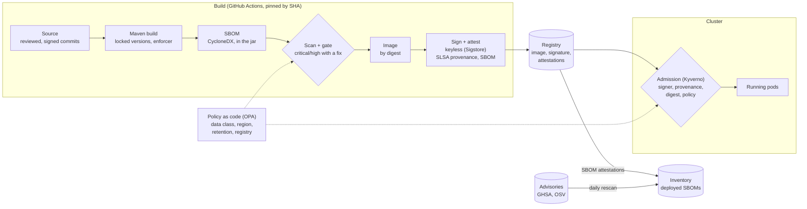

# 41. Supply-Chain Security & Compliance

<div class="badges" markdown><span class="badge badge-l3">L3 · Senior/Lead</span><span class="badge badge-l4">L4 · Architect</span><span class="badge badge-meta">SBOM · vulnerability scanning · Sigstore · SLSA · admission policy · PCI DSS · GDPR · DPDP · RBI</span></div>

<div class="grid two" markdown>

!!! info "Prerequisites"
    - [Chapter 35](ch35-security-fundamentals.md): threat modelling
    - [Chapter 38](ch38-service-to-service-security.md): workload identity, short-lived certificates
    - [Chapter 39](ch39-secrets-management.md): secrets and keys in OpenBao/KMS
    - Container images and Kubernetes admission (the Platform part covers them in depth)

!!! abstract "What you'll learn"
    - **An inventory before an incident**: Syft listed **421–519 Maven components** in each of four Keycloak releases in about **6–7 s**, 8–15% of them with coordinates guessed rather than read
    - **A clean scan expires**: Keycloak 24.0.0 had **0** known advisories on release day, **36** a year later and **196 (65 critical or high)** today; the current release had **3**
    - **Signatures prove nothing until you say whose**: offline verification caught a one-byte change and a wrong signer, but accepting **any GitHub Actions identity** verified a file from the wrong project
    - **Sign digests, check provenance**: moving a tag to an unsigned rebuild was refused; when the rebuild was signed with the leaked release key, **only the provenance policy refused it**
    - **Compliance as code**: an OPA policy found **9 violations in 2 of 4 deployments** (personal data in eu-west-1, payment data outside the PCI namespace, public images); crypto-shredding made **0 of 9,000** erased fields readable in backups and topics

</div>

---

## 1 · Introduction & Context

### Three weeks FoodFleet would rather forget

- **The week of "do we use it?".** When Log4Shell was published, nobody could say which of FoodFleet's 60 services and 200 images contained `log4j-core`. Teams grepped repositories, missed shaded copies inside fat jars, and the security team declared "done" on day nine. A vendor's image found in week three still had it.
- **The week the action changed.** The release workflow used a popular GitHub Action by tag. Its maintainers' account was compromised and the tag moved to a commit that printed the runner's secrets into the build log (the same thing happened to `tj-actions/changed-files` in March 2025). FoodFleet's registry token was in the logs of every build that ran that week.
- **The week of the erasure request.** A customer asked FoodFleet to delete their data, as the DPDP Act and the GDPR allow. Their name and phone number were also in a Kafka topic with seven days' retention, in three months of nightly backups and in an analytics export copied to a data team's cluster in Europe. Deleting the database rows took a minute; the rest could not be done at all.

Supply-chain security answers *what is in what we run, who built it, and from what*; compliance answers *can we prove it, and do we handle data the way the law requires*. This chapter does both for FoodFleet and measures each part with real tools: Syft on real Keycloak releases, the GitHub Advisory Database, cosign against Sigstore's trusted root and a local OCI registry, OPA, and the JDK's AES-GCM.

### Where it comes from

<ul class="mh-timeline">
<li><span class="when">2018 · event-stream; RBI data storage</span><span class="what">A new npm maintainer adds a wallet-stealing dependency; the RBI requires payment system data to be stored only in India.</span></li>
<li><span class="when">2020–2021 · SolarWinds, Codecov, EO 14028</span><span class="what">Attackers ship through a vendor's build system and a CI uploader script; a US executive order makes SBOMs a procurement requirement.</span></li>
<li><span class="when">2021 · Log4Shell, Sigstore</span><span class="what">A critical bug in a ubiquitous library shows who has an inventory; Sigstore offers free keyless signing with a public transparency log.</span></li>
<li><span class="when">2022–2023 · CERT-In directions, SLSA 1.0, DPDP Act</span><span class="what">India requires incident reports within 6 hours and 180 days of logs; SLSA defines build provenance levels; Parliament passes the Digital Personal Data Protection Act.</span></li>
<li><span class="when">2024 · xz backdoor, PCI DSS 4.0, CRA</span><span class="what">A patient attacker becomes a maintainer of a compression library; PCI DSS 4.0, which requires an inventory of third-party components, replaces 3.2.1; the EU Cyber Resilience Act enters into force.</span></li>
<li><span class="when">2025–2026 · DPDP Rules, CRA reporting</span><span class="what">India notifies the DPDP Rules (13 November 2025, most duties from May 2027); CRA vulnerability reporting applies from 11 September 2026, SBOMs from December 2027.</span></li>
</ul>

---

## 2 · Core Concepts & Terminology



SBOM
:   A software bill of materials: every component in an artifact with its version and identity. **CycloneDX** and **SPDX** are the two formats; both are accepted by regulators (the CRA names no format).

purl, CPE
:   Two ways to name a component. A package URL (`pkg:maven/org.apache.logging.log4j/log4j-core@2.14.1`) is exact and ecosystem-aware; a CPE is NVD's product identifier, coarser and often guessed, which makes CPE matching noisy.

Advisory database, OSV
:   Where vulnerabilities are described per package and version range. The GitHub Advisory Database (reviewed advisories, OSV format), OSV.dev and NVD are the main sources; scanners are only as good as their database and their version matching.

VEX
:   A Vulnerability Exploitability eXchange statement: "this product is not affected by CVE-X because…". The machine-readable form of a waiver.

Provenance, SLSA
:   A signed statement of how an artifact was built: by which builder, from which source and commit, with which parameters. SLSA's build track defines levels (L1 provenance exists, L2 signed by a hosted builder, L3 hardened builder whose provenance the build can't forge).

Sigstore (keyless signing)
:   The signer authenticates with OIDC (for CI, the workflow's token); Fulcio issues a certificate valid for about ten minutes naming that identity; the signature is recorded in the Rekor transparency log and/or timestamped. Verifiers check the certificate chain, the log or timestamp, and **the identity**.

Admission control
:   A Kubernetes webhook that checks every pod before it is created: here, Kyverno verifying signatures, provenance and digests.

Data classification, data residency
:   Labels that say what data a service holds (public, internal, personal, payment) and therefore where it may live and for how long.

Crypto-shredding
:   Encrypting each data subject's personal data with their own key, so deleting the key erases every copy, including copies that can't be edited.

---

## 3 · How It Works Internally

### An inventory you can query: SBOMs at build time

Spring Boot 4.1.1's parent POM already configures the CycloneDX Maven plugin (version 2.9.3) to write `META-INF/sbom/application.cdx.json` into the jar; declaring the plugin turns it on, and the actuator's `sbom` endpoint serves the file:

```xml
--8<-- "code/chapters/ch41-supply-chain-compliance/src/main/resources/maven/pom-supply-chain.xml"
```

```yaml
--8<-- "code/chapters/ch41-supply-chain-compliance/src/main/resources/order-service.yml"
```

An SBOM from the build lists what Maven resolved. One from scanning the finished image (Syft) also sees the base image's packages and anything copied in by hand, but has to infer identities from jar contents: where a jar has no `pom.properties`, its coordinates are a guess.

### How a scanner decides

A scanner is an inventory, an advisory database and a version comparison. The comparison is the subtle part: Maven orders `2.0-beta9` < `2.0-rc1` < `2.0` = `2.0.0` = `2.0.Final` < `2.0-sp1`, and `2.10` after `2.9`, which a string comparison gets wrong (`MavenVersion` implements Maven's algorithm). An OSV advisory gives each affected package ranges of `introduced`, `fixed` (exclusive) or `last_affected` (inclusive) versions, or an explicit version list:

```java
--8<-- "code/chapters/ch41-supply-chain-compliance/src/main/java/dev/foodfleet/ch41/vuln/Advisory.java:19:55"
```

Scanning matches each Maven component by `groupId:artifactId`. The optional `knownBy` date answers a different question, *what did we know then?*, which is how the drift table in section 4 was made:

```java
--8<-- "code/chapters/ch41-supply-chain-compliance/src/main/java/dev/foodfleet/ch41/vuln/Scanner.java:27:47"
```

The CI gate blocks only what a team can act on: a critical or high finding that has a fixed version. Findings without a fix are reported and tracked, and accepted risk is a **waiver** that names one advisory and one package, gives a reason, and expires:

```java
--8<-- "code/chapters/ch41-supply-chain-compliance/src/main/java/dev/foodfleet/ch41/vuln/Gate.java:35:53"
```

### Building, signing and attesting in CI

The release workflow pins every action to a commit SHA (a tag can be moved, as `tj-actions/changed-files` showed), gives each job only the permissions it needs, signs the image **digest** keylessly with the workflow's own identity, and attaches the SBOM and SLSA provenance as signed attestations:

```yaml
--8<-- "code/chapters/ch41-supply-chain-compliance/src/main/resources/ci/release.yml"
```

### Checking at the door: admission policy

Signatures matter only if something refuses unsigned or wrongly signed images. Kyverno's `verifyImages` checks the signer's identity (issuer and subject, so "signed by someone on GitHub" isn't enough), requires provenance from the release workflow, and rewrites tags to the verified digest (`mutateDigest`, default true in 1.19.1), so the node pulls exactly what was checked:

```yaml
--8<-- "code/chapters/ch41-supply-chain-compliance/src/main/resources/kyverno/verify-images.yaml"
```

The same provenance rule, as the Rego policy cosign evaluates in the measurements:

```rego
--8<-- "code/chapters/ch41-supply-chain-compliance/src/main/resources/cosign/provenance.rego"
```

### Compliance rules as code

Regulations become checkable once services declare what data they hold. FoodFleet labels every deployment with a data class and annotates its region and retention; the policy turns obligations into rules that run in CI and again at admission:

```rego
--8<-- "code/chapters/ch41-supply-chain-compliance/src/main/resources/policy/deploy.rego"
```

| Obligation | Source | FoodFleet's control |
|---|---|---|
| Payment system data stored only in India; data processed abroad deleted there and brought back within one business day or 24 hours, whichever is earlier | RBI, *Storage of Payment System Data* (2018) and its FAQ | `data-class: payment` must run in an Indian region; payment-service in the `cde` namespace only |
| Inventory of bespoke and third-party software components; critical patches within one month | PCI DSS 4.0.1, requirements 6.3.2 and 6.3.3 | SBOM in every jar, a daily rescan of deployed SBOMs, the CI gate |
| Protect public-facing web applications with an automated solution | PCI DSS 4.0.1, 6.4.2 | The WAF of [chapter 40](ch40-api-security.md) |
| Reasonable security safeguards; breach intimation to the Board without delay and a detailed report within 72 hours; erase personal data when the purpose is served (large e-commerce platforms: three years after last interaction); keep logs for one year | DPDP Act 2023 and DPDP Rules 2025 (most rules in force from 13 May 2027) | Retention annotation ≤ 1,095 days; crypto-shredding; log retention; breach runbook |
| Report cyber incidents to CERT-In within 6 hours; keep ICT logs for 180 days in India | CERT-In directions (28 April 2022) | Incident runbook with a 6-hour clock; log storage in Indian regions |
| Erasure without undue delay; breach notification to the authority within 72 hours | GDPR Articles 17 and 33 (EU customers) | Crypto-shredding; the same breach runbook |
| SBOMs for software in regulated financial entities | SEBI CSCRF (2024); CERT-In SBOM guidelines (2024, expanded 2025) | Build-time CycloneDX SBOMs, kept per release |

### Erasure that reaches backups: crypto-shredding

Some copies of personal data can't be edited: Kafka topics, event stores, backups, exports already taken. FoodFleet encrypts personal fields with a key per customer before they are written anywhere; erasing a customer deletes the key. Ciphertexts are bound to customer and field (AES-GCM associated data), and the key table holds keys wrapped by a key-encryption key in the KMS ([chapter 39](ch39-secrets-management.md)):

```java
--8<-- "code/chapters/ch41-supply-chain-compliance/src/main/java/dev/foodfleet/ch41/privacy/CryptoShredder.java:60:82"
```

---

## 4 · Design Considerations & Trade-offs

All measurements ran on JDK 21.0.10 in one 2-vCPU container, with release binaries of **cosign 3.1.3**, **Syft 1.54.1**, **crane 0.22.1**, the **distribution registry 3.1.2** and **OPA 1.21.2**, each checked against its published SHA-256; four **Keycloak** release archives (checked against their SHA-1 files); the **GitHub Advisory Database** as of 13 October 2026 (7,181 reviewed Maven advisories); and **Sigstore's trusted root** from the `sigstore/root-signing` repository, so signature checks ran fully offline. `check_apis.sh` checks **25 configuration keys, defaults and tool flags** against Spring Boot 4.1.1, Kyverno 1.19.1, the two GitHub Actions used, and the tool binaries (all found). Two runs; counts were identical, timings show both.

### Measured: verifying what you download

| Check (offline, against Sigstore's trusted root) | Result |
|---|---|
| cosign binary, signer pinned to cosign's release identity | verified |
| The same binary with one byte changed | **failed**: signature does not match |
| syft's checksums file, signer pinned to syft's release workflow | verified |
| syft's checksums file, but expecting grype's release workflow | **failed**: different identity |
| syft's checksums file, **any identity on GitHub Actions** (`--certificate-identity-regexp '.*'`) | **verified** |
| syft tarball against the verified checksums file | verified |

syft's signing certificate was valid for **ten minutes** (15:34–15:44 UTC on 6 October 2026) and still verified a week later: the bundle's timestamp and log entry prove it was used while valid. Offline verification took 55–61 ms per file, cosign's start-up included.

- **A checksum next to a download proves the download, not the publisher**: whoever can replace the file can replace the checksum. A signature from a pinned identity proves who released it.
- **An identity regexp of `.*` turns verification into "signed by somebody"**: any GitHub repository's workflow, including an attacker's, can get such a certificate.

### Measured: SBOMs of real releases

| Keycloak | Jar files | Maven components | Coordinates from `pom.properties` | Guessed | CPEs per component | CycloneDX / SPDX size | Syft time |
|---|---:|---:|---:|---:|---:|---|---:|
| 22.0.0 | 500 | 460 | 410 | 50 | 17.1 | 1.4 / 2.0 MB | 6.6–7.2 s |
| 24.0.0 | 378 | 421 | 387 | 34 | 17.0 | 1.3 / 1.8 MB | 6.9 s |
| 26.0.0 | 424 | 446 | 382 | 64 | 17.7 | 1.4 / 2.0 MB | 5.8–6.8 s |
| 26.8.1 | 486 | 519 | 443 | 76 | 17.4 | 1.6 / 2.3 MB | 6.5–6.8 s |

- **Image scanning infers**: 8–15% of components had guessed coordinates, and each component got about 17 candidate CPEs. A build-time SBOM from Maven has exact coordinates; an image SBOM also covers what Maven never saw. FoodFleet keeps both.

### Measured: findings over time

Each SBOM matched against the advisory database by package and Maven version range:

| Keycloak | Released | Critical | High | Moderate | Low | Packages affected | With a fixed version | In dependencies (not Keycloak's own code) |
|---|---|---:|---:|---:|---:|---:|---:|---:|
| 22.0.0 | 2023-07-11 | 3 | 68 | 116 | 25 | 42 | 184 of 212 | 99 of 212 |
| 24.0.0 | 2024-03-04 | 3 | 62 | 109 | 22 | 36 | 170 of 196 | 91 of 196 |
| 26.0.0 | 2024-10-04 | 4 | 61 | 96 | 19 | 39 | 153 of 180 | 92 of 180 |
| 26.8.1 | 2026-10-13 | 0 | 1 | 2 | 0 | 3 | 0 of 3 | 0 of 3 |

The same, unchanged artifacts against what was known at each date (critical + high in brackets):

| Keycloak | At release | +3 months | +6 months | +1 year | +2 years | Today |
|---|---:|---:|---:|---:|---:|---:|
| 22.0.0 | 1 (0) | 4 (2) | 11 (3) | 36 (11) | 65 (23) | **212 (71)** |
| 24.0.0 | **0 (0)** | 14 (4) | 18 (6) | 36 (13) | 78 (17) | **196 (65)** |
| 26.0.0 | 0 (0) | 7 (4) | 18 (7) | 30 (10) | 180 (65) | 180 (65) |

With the CI gate's rule (critical or high with a fixed version), the three older releases would be blocked by **62–69 findings** each today; the current one passes, with its 3 findings reported (none has a fix yet). Scanning took 7–25 ms per SBOM once the database was loaded (2.6–2.7 s).

- **A clean scan has a shelf life**: 24.0.0 shipped with nothing known against it and accumulated 14 findings in its first three months. Scan the SBOMs of what is *deployed*, every day, not only what is being built.
- **Your dependencies are half your exposure**: 46–51% of the older releases' findings were in third-party libraries, not Keycloak's own code.
- **Upgrading is the fix**: 85–87% of findings had a fixed version. Waivers are for the rest, and they expire.

### Measured: signing images and checking provenance

order-service 1.4.0 pushed to a local OCI registry, signed by digest with FoodFleet's key, with SLSA provenance from the release workflow attached:

| Check | Result |
|---|---|
| The digest, with FoodFleet's key | verified |
| The tag `1.4.0` (resolves to the signed digest) | verified |
| The digest, with a different key | **refused**: not signed with this key |
| Provenance against `provenance.rego` | verified |
| *The tag is moved to an unsigned rebuild made on a laptop* | |
| The tag `1.4.0` | **refused**: no signature for this digest |
| The original digest | verified |
| *The rebuild is signed with FoodFleet's key (leaked, or reused by another pipeline), with the laptop's provenance* | |
| The rebuild's signature, with FoodFleet's key | **verified** |
| The rebuild's provenance against the policy | **refused**: policy denied |

The SBOM attestation (Keycloak 26.8.1's, 1,003 entries) was read back from the registry intact. Signing took 645–690 ms and verifying 66–80 ms, each a cosign process against a local registry.

- **Sign and deploy digests**: a tag is a pointer anyone with push rights can move; admission that checks the tag and then lets the node pull it again checks the wrong thing (Kyverno's `mutateDigest` pins it).
- **A key proves possession of a key**: with a leaked key the rebuild verified; only provenance naming the builder, source and tag stopped it. Keyless signing in CI removes the long-lived key altogether.

### Measured: compliance policies

`opa test` passed 7 of 7 policy tests. FoodFleet's four sample deployments:

| Deployment | Violations |
|---|---|
| order-service | 0 |
| payment-service | 0 |
| analytics-export | **4**: image by tag (`:latest`); not `runAsNonRoot`; **personal data in `eu-west-1`**; retention 3,650 days > 1,095 |
| coupon-legacy | **5**: two images from `docker.io`, one of them by tag; not `runAsNonRoot`; **payment data outside the `cde` namespace** |

### Measured: crypto-shredding

20,000 customers, three personal fields each (82 bytes), copied as written into the orders table, a Kafka topic and a backup; then 1,000 customers erased:

| Measure | Result |
|---|---|
| Encrypt, per field (including a new key per customer) | 22–30 µs |
| Decrypt, per field (key cache of 1,000) | 8–13 µs |
| Stored size per customer | 82 bytes → 236 bytes |
| Erase, per customer | 1.7–2.3 µs (delete one key row) |
| Erased customers' fields still readable, in any of the three copies | **0 of 9,000** |
| Other customers' fields readable | 171,000 of 171,000 |

- **Erasure becomes one operation**, however many copies exist. The cost: about 3× the storage for short fields, microseconds per field, a key table that must be backed up separately from the data (and never restored to resurrect erased keys), and searches on encrypted fields need a separate index (a keyed hash).

### Choosing

| Concern | FoodFleet's choice |
|---|---|
| SBOM | CycloneDX from the Maven build in every jar (`/actuator/sbom`), plus Syft on the image; both attached to the image as attestations |
| Scanning | In CI (gate: critical/high with a fix) and **daily on deployed SBOMs**; OSV/GHSA by purl, not CPE; waivers with expiry, published as VEX |
| Signing | Keyless with GitHub OIDC; digest only; SLSA provenance via `attest-build-provenance` |
| Admission | Kyverno `verifyImages`: pinned issuer and subject, provenance conditions, `mutateDigest`; Enforce in production namespaces |
| CI dependencies | Actions pinned by SHA (updated by Dependabot/Renovate), least-privilege tokens, a repository manager in front of Maven Central |
| Data rules | Data class, region and retention declared per deployment; OPA in CI and at admission |
| Erasure | Crypto-shredding for personal fields in events and exports; delete-by-key for operational stores |

---

## 5 · Hands-on Implementation

```text
ch41-supply-chain-compliance/
├── src/main/java/dev/foodfleet/ch41/
│   ├── sbom/      Component (purls), CycloneDx
│   ├── vuln/      MavenVersion, Advisory, OsvDatabase, Scanner, Gate
│   ├── privacy/   CryptoShredder, InMemoryKeyStore
│   └── json/      the strict JSON parser of chapter 36
├── src/main/resources/   ci/release.yml, maven/, kyverno/, policy/ (Rego + tests), k8s/, cosign/, order-service.yml
├── src/test/java/…       12 tests (Maven version order, OSV matching, the gate, SBOM parsing, crypto-shredding)
└── verify/               run.sh, check_apis.sh, tools/Measure.java
```

### 🟢 Level 1: know what you ship

<div class="badges" markdown><span class="badge badge-l1">L1 · Foundation</span></div>

- Declare the CycloneDX plugin (Boot's parent configures it) and expose `/actuator/sbom` on the management port.
- Turn on Dependabot or Renovate for Maven and for GitHub Actions; merge their pull requests weekly.
- Never use `latest`; never run images from public registries directly in production.

### 🔵 Level 2: scan and gate

<div class="badges" markdown><span class="badge badge-l2">L2 · Practitioner</span></div>

- A CI gate on critical/high findings with a fix; waivers in the repository, each with a reason and an expiry.
- Pin actions by SHA, set `permissions: {}` at the top of every workflow and grant per job.

```bash
syft scan dir:target -o cyclonedx-json=sbom.cdx.json
verify/run.sh sbom scan      # Keycloak releases against the GitHub Advisory Database
```

### 🟣 Level 3: sign, attest, admit

<div class="badges" markdown><span class="badge badge-l3">L3 · Senior/Lead</span></div>

- Keyless signing of digests in CI; SBOM and provenance attestations; Kyverno `verifyImages` in Audit, then Enforce.
- Verify what you download the same way, with the publisher's identity pinned.

```bash
cosign verify-blob syft_checksums.txt --bundle syft_checksums.txt.sigstore.json \
  --certificate-oidc-issuer https://token.actions.githubusercontent.com \
  --certificate-identity https://github.com/anchore/syft/.github/workflows/release.yaml@refs/heads/main
```

### 🔴 Level 4: compliance as a system

<div class="badges" markdown><span class="badge badge-l4">L4 · Architect</span></div>

- **An inventory service**: every deployed digest with its SBOM, rescanned daily; a query answers "where is `log4j-core` < 2.17.1?" in seconds.
- **Data map**: every service's data class, region and retention declared and enforced; the DPDP/GDPR record of processing generated from it.
- **Evidence by default**: signed provenance, policy decisions and scan results stored per release, so an audit (PCI QSA, RBI system audit, SEBI) is a query.
- **Clocks in the runbook**: CERT-In 6 hours, DPDP "without delay" plus 72 hours, GDPR 72 hours, CRA 24/72 hours for products sold in the EU.

### Run and verify

```text
$ verify/run.sh sign
== sign
order-service 1.4.0 pushed to a local registry, signed by digest with FoodFleet's key, with SLSA provenance
  verify the digest with FoodFleet's key                                   verified
  verify the tag 1.4.0 (resolves to the signed digest)                     verified
  verify with the attacker's key                                           REFUSED: not signed with this key
  provenance from the release workflow, policy cosign/provenance.rego      verified
the tag 1.4.0 now points to a laptop rebuild (sha256:bfa91e40… instead of sha256:7821e899…)
  verify the tag 1.4.0 (unsigned rebuild)                                  REFUSED: no signature for this digest
  verify the original digest                                               verified
... and signs the rebuild with FoodFleet's key, attaching provenance from the laptop
  verify the rebuild's signature with FoodFleet's key                      verified
  the rebuild's provenance against the policy                              REFUSED: policy denied (allow is false)
  SBOM attestation read back from the registry: 1003 components, predicate https://cyclonedx.org/bom
```

!!! question "Try it"
    1. Change the gate to `Severity.CRITICAL` in `Measure.scan`. How many findings still block Keycloak 22.0.0, and what does that say about choosing a threshold?
    2. Add a waiver for one of 26.0.0's blocking findings that expired yesterday. What does `Gate` do with it?
    3. In `provenance.rego`, drop the `refs/tags/v` condition. Which attack in the signing table would now pass?
    4. Change `analytics-export` to `ap-south-1` with 365 days' retention, pinned by digest from FoodFleet's registry. Which violation is left, and why does the policy care?

---

## 6 · Production Readiness

- [x] **SBOM per artifact** (build-time CycloneDX in the jar, image SBOM as an attestation), kept per release
- [x] **Daily rescans of deployed SBOMs** against an advisory database, with owners and SLAs (critical: days, high: weeks)
- [x] **CI gate** on fixable critical/high findings; **waivers with reasons and expiry**, published as VEX
- [x] **Images signed by digest** in CI with a pinned identity; SLSA provenance attached; **admission enforces both** and pins digests
- [x] **CI hardened**: actions pinned by SHA, least-privilege tokens, no long-lived signing keys, dependencies through a repository manager
- [x] **Downloads verified** by signature with the publisher's identity, not only by checksum
- [x] **Data class, region and retention** declared per service and enforced by policy; payment data in the CDE and in India
- [x] **Erasure that reaches every copy** (crypto-shredding for events, exports, backups); key table backed up separately
- [x] **Incident clocks rehearsed**: CERT-In 6 h, DPDP and GDPR 72 h, card brands and acquirers per contract

---

## 7 · Anti-patterns & Pitfalls

!!! pitfall "Incident 1: nine days to answer 'do we use it?'"
    **Context.** A critical library vulnerability was announced on a Friday.
    **Symptoms.** Teams searched repositories by hand; shaded copies inside fat jars and a vendor image were missed; "done" was declared three times.
    **Root cause.** No inventory of what was deployed, and scanning only at build time. Measured: Keycloak 24.0.0 went from 0 known findings to 14 in three months, 196 today, without changing a byte.
    **Fix.** An SBOM per artifact, attached to the image; a daily rescan of every deployed digest; the question became a query.

!!! pitfall "Incident 2: the action that printed the secrets"
    **Context.** The release workflow used third-party actions by tag and had a registry token with write access to every repository.
    **Symptoms.** Build logs for a week contained the token, base64-encoded twice.
    **Root cause.** A compromised maintainer account moved the tag to malicious code (the pattern of the March 2025 `tj-actions/changed-files` compromise). Tags are mutable; the token's scope made one leak a platform-wide one.
    **Fix.** Actions pinned by SHA and updated by Renovate with review; per-job `permissions`; keyless signing with OIDC, so there was no signing key to steal.

!!! pitfall "Incident 3: the erasure that couldn't reach the backups"
    **Context.** A customer exercised their right to erasure.
    **Symptoms.** Rows were deleted from order-service, but the data survived in a Kafka topic, 90 days of backups and an analytics export in another region.
    **Root cause.** Personal data copied in plaintext into stores that can't be edited, and an export nobody had classified (the OPA policy flags this: personal data in `eu-west-1`, retention 3,650 days).
    **Fix.** Personal fields encrypted with per-customer keys before they leave the service; erasure deletes the key. Measured: 0 of 9,000 erased fields readable in any copy.

| Anti-pattern | Symptom | Fix |
|---|---|---|
| Scanning only at build time | Released artifacts silently accumulate critical findings | Daily rescans of deployed SBOMs |
| Gating on every finding | Teams ignore or bypass the gate | Block fixable critical/high; track the rest; expiring waivers |
| Matching by CPE or file name | False positives and misses | Match purls against OSV/GHSA |
| Deploying tags | What runs isn't what was scanned or signed | Digests everywhere; `mutateDigest` at admission |
| `--certificate-identity-regexp '.*'` | "Signed by anyone" passes | Pin issuer and subject |
| Long-lived signing keys in CI secrets | A leak lets anyone sign | Keyless signing; provenance policy |
| Actions by tag, broad tokens | One compromised action leaks everything | SHA pins, per-job permissions |
| Compliance as a spreadsheet | Out of date the day it's finished | Declared data classes, enforced policies, evidence per release |
| Deleting rows as "erasure" | Copies in topics and backups remain | Crypto-shredding |

---

## 8 · Enterprise Case Study

### FoodFleet: provable builds, enforced data rules

!!! decision "ADR-041: SBOMs per artifact with daily rescans; keyless signing and SLSA provenance enforced at admission; compliance rules as OPA policies over declared data classes; crypto-shredding for personal data"
    **Status:** Accepted · **Date:** 2025-07-28

    **Context.** Log4Shell took nine days to scope; a compromised GitHub Action leaked a registry token; an erasure request couldn't reach backups or topics; an analytics job copied personal data to Europe. Measured: a release with 0 known findings had 196 two and a half years later; accepting any GitHub identity verified the wrong project's file; with a leaked key, only provenance stopped a laptop rebuild; an OPA policy found 9 violations in 2 of 4 deployments; crypto-shredding left 0 of 9,000 erased fields readable.

    **Decision.** Every build produces a CycloneDX SBOM (in the jar and as an image attestation); CI blocks fixable critical/high findings, with waivers that expire; an inventory rescans every deployed digest daily. Images are signed keylessly in GitHub Actions by digest, with SLSA provenance; Kyverno enforces signer identity, provenance and digests in production namespaces. Actions are pinned by SHA; workflow tokens are per job and least-privilege. Services declare data class, region and retention; OPA policies enforce RBI payment data storage, the PCI namespace, DPDP retention and registry rules in CI and at admission. Personal fields in events, exports and backups are encrypted with per-customer keys.

    **Consequences.** ✅ "Where do we run X?" is a query; audits are evidence exports. ✅ A stolen CI credential can't produce an image that runs. ⚠️ Admission depends on the signature infrastructure: Kyverno's failure policy is Fail, so its availability is monitored, and a break-glass procedure exists. ⚠️ Dependency upgrades are continuous work (Renovate, weekly). ⚠️ Crypto-shredded fields can't be searched directly; a keyed hash index is kept for lookups.

### Fintech analogue: regulated vendors and evidence 🔴

A bank or payment aggregator in India answers to several regulators at once: RBI (payment data stored in India, system audits by CERT-In empanelled auditors, outsourcing and vendor risk), SEBI's CSCRF for market entities (which asks for SBOMs of critical software), CERT-In's 6-hour reporting, and PCI DSS for card data. The engineering answer is the same as FoodFleet's, with more evidence: SBOMs requested from every vendor, provenance and signatures kept per release, change approvals linked to builds, and segregated environments (the CDE) with their own admission policies. Key ceremonies and HSM-backed signing replace keyless signing where regulators expect keys under the bank's control.

### E-commerce analogue: thousands of services, one inventory

A large marketplace runs thousands of services built by hundreds of teams. It can't review each team's pipeline, so it provides one: a shared build template that produces SBOMs, signs and attests, and a central inventory that rescans every deployed image daily and opens tickets with SLAs. Admission policies apply to every cluster; exceptions are waivers with expiry dates owned by named teams. When the next Log4Shell arrives, the inventory answers in minutes, and the fix is a dependency bump that the template rolls out.

---

## 9 · Interview Q&A + Summary

#### Q1. What is an SBOM, and what do you do with it? · <span class="badge badge-l2">L2</span> · Cognizant · SAP

**Short answer:** A list of every component in an artifact with exact identities (purls) and versions, in CycloneDX or SPDX. You keep one per release, attach it to the image, and match it against advisories continuously, so "are we affected?" is a query. Spring Boot's parent configures the CycloneDX plugin and serves the result at `/actuator/sbom`.

#### Q2. Your build passed the vulnerability scan last month. Are you safe? · <span class="badge badge-l3">L3</span> · Amazon · Flipkart

**Short answer:** Only for what was known last month. New advisories arrive daily: Keycloak 24.0.0 had 0 known findings on release day, 14 three months later, 196 today (measured). Rescan deployed SBOMs daily and act on what has a fix.

#### Q3. How does a vulnerability scanner work, and why do two scanners disagree? · <span class="badge badge-l3">L3</span> · Goldman Sachs · Amazon

**Short answer:** Inventory × advisory database × version matching. They differ in how they identify components (exact purls vs guessed CPEs: Syft guessed coordinates for 8–15% of jars), which databases they use, and how they compare versions (Maven's `2.0-rc1` < `2.0` < `2.0-sp1`; strings put `2.10` before `2.9`).

#### Q4. Which findings should fail the build? · <span class="badge badge-l3">L3</span> · SAP · Infosys

**Short answer:** The ones a team can fix now: critical/high with a fixed version. Everything else is tracked with an owner. Accepted risk is a waiver naming one advisory and package, with a reason and an expiry, published as VEX. Blocking on everything gets the gate disabled.

#### Q5. What does signing an image prove? · <span class="badge badge-l3">L3</span> · JP Morgan · Amazon

**Short answer:** That someone holding a key (or a short-lived Sigstore certificate for an identity) signed this digest. It says nothing until you pin *who*: with `--certificate-identity-regexp '.*'` a file from the wrong project verified (measured). With a leaked key, a laptop rebuild verified; provenance naming builder and source refused it.

#### Q6. Keyless signing: how does it work, and why use it? · <span class="badge badge-l3">L3</span><span class="badge badge-l4">L4</span> · Goldman Sachs · SAP

**Short answer:** The CI job's OIDC token is exchanged with Fulcio for a ten-minute certificate naming the workflow; the signature is logged in Rekor and/or timestamped; verifiers check the chain, the log/timestamp and the identity. No long-lived key to leak or rotate. syft's certificate was valid for ten minutes and verified a week later from the timestamp (measured).

#### Q7. What is SLSA, and what level should FoodFleet aim for? · <span class="badge badge-l4">L4</span> · Amazon · JP Morgan

**Short answer:** A framework for build integrity. Build L1: provenance exists; L2: generated and signed by a hosted builder; L3: a hardened builder where the build can't forge its own provenance. GitHub Actions with `attest-build-provenance` and reusable workflows gets close to L3; admission checks the provenance's builder and source.

#### Q8. Why pin GitHub Actions by SHA? · <span class="badge badge-l2">L2</span> · Flipkart · Accenture

**Short answer:** Tags are mutable: in March 2025 the `tj-actions/changed-files` tags were moved to a commit that dumped runner secrets into logs. A SHA can't be moved. Pair it with Renovate/Dependabot updates and per-job least-privilege `permissions`.

#### Q9. How do you enforce that only trusted images run? · <span class="badge badge-l3">L3</span> · Amazon · SAP

**Short answer:** An admission controller (Kyverno, Sigstore's policy-controller) that verifies signature identity and provenance for every pod, rejects tags it can't resolve, and rewrites tags to digests so the node pulls what was verified (Kyverno's `mutateDigest`, on by default). Run in Audit first, then Enforce, with monitoring and a break-glass path.

#### Q10. How do you comply with the RBI's payment data storage rules in a cloud architecture? · <span class="badge badge-l3">L3</span><span class="badge badge-l4">L4</span> · Paytm-/Razorpay-style rounds · JP Morgan

**Short answer:** Payment system data (including customer details and transaction data) stored only in India; if processed abroad, deleted there and brought back within one business day or 24 hours, whichever is earlier. Architecturally: classify services, run payment data stores and their backups, logs and analytics in Indian regions, and enforce it (FoodFleet's policy refuses `data-class: payment` outside Indian regions or the CDE). A CERT-In empanelled auditor's system audit report covers it.

#### Q11. How do you honour a deletion request when data is in Kafka and backups? · <span class="badge badge-l4">L4</span> · SAP · Goldman Sachs

**Short answer:** Crypto-shredding: encrypt personal fields with a per-customer key before they leave the service, keep wrapped keys in a separate table backed by a KMS, and erase by deleting the key. Measured: 0 of 9,000 erased fields readable in the table, the topic or the backup; 8–30 µs per field. DPDP and GDPR both expect erasure across processors too, so the same applies to vendors.

#### Q12. Design supply-chain security and compliance for FoodFleet. · <span class="badge badge-l4">L4</span> · Swiggy-/Zomato-style system design rounds

**Short answer:** Build: pinned actions, least-privilege tokens, repository manager, CycloneDX SBOM in every jar, CI gate with expiring waivers. Release: keyless signing of digests, SBOM and SLSA provenance attestations. Deploy: Kyverno enforcing identity, provenance, digests; OPA rules for data class, region (RBI), PCI namespace, DPDP retention. Operate: an inventory rescanning deployed SBOMs daily; crypto-shredding for erasure; incident runbooks with the 6/72-hour clocks; evidence per release for audits.

### Key takeaways

- **Inventory first**: an SBOM per artifact turns the next Log4Shell into a query.
- **Scans expire**: rescan what is deployed, every day; gate on what can be fixed.
- **Verify identities, not just signatures**, and sign digests, with provenance.
- **Harden the pipeline itself**: SHA-pinned actions, least privilege, no long-lived keys.
- **Compliance is engineering**: declared data classes, enforced policies, erasure that reaches every copy, and evidence by default.

### Further reading

- OpenSSF, [SLSA specification](https://slsa.dev/spec/v1.0/) and Sigstore, [documentation](https://docs.sigstore.dev/)
- CycloneDX, [specification](https://cyclonedx.org/specification/overview/); OSV, [schema](https://ossf.github.io/osv-schema/); GitHub, [Advisory Database](https://github.com/github/advisory-database)
- Kyverno, [Verify Images rules](https://kyverno.io/docs/policy-types/cluster-policy/verify-images/)
- GitHub Docs, [Security hardening for GitHub Actions](https://docs.github.com/en/actions/security-for-github-actions/security-guides/security-hardening-for-github-actions)
- Reserve Bank of India, [Storage of Payment System Data: FAQs](https://www.rbi.org.in/Scripts/FAQDisplay.aspx?Id=130)
- Hogan Lovells, [India's Digital Personal Data Protection Act 2023 brought into force](https://www.hoganlovells.com/en/publications/indias-digital-personal-data-protection-act-2023-brought-into-force-) (the DPDP Rules 2025 and their timeline)
- PCI Security Standards Council, [PCI DSS v4.0.1](https://www.pcisecuritystandards.org/document_library/)

---

**Previous:** [← 40. API Security Hardening](ch40-api-security.md) · **Next:** [42. Failure Modes & Cascading Failures →](../resilience/ch42-failure-modes.md)
