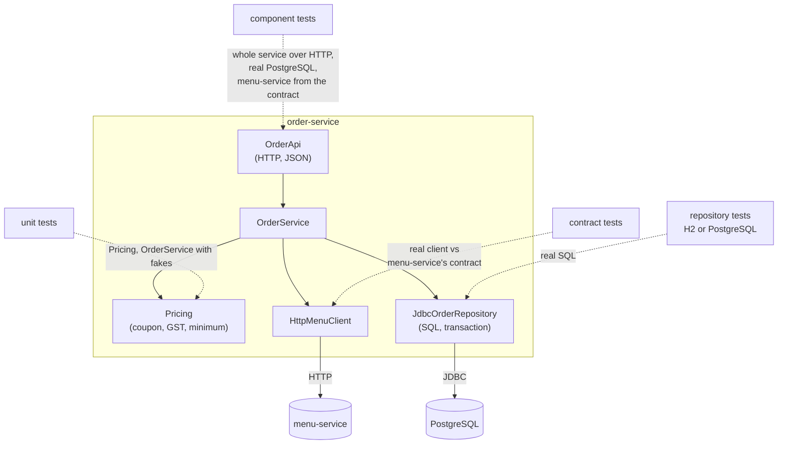

# 61. Test Pyramid & Honeycomb

<div class="badges" markdown><span class="badge badge-l1">L1 · Foundation</span><span class="badge badge-l2">L2 · Practitioner</span><span class="badge badge-l3">L3 · Senior/Lead</span><span class="badge badge-meta">test pyramid · testing honeycomb · unit · integration · contract · component · mutation analysis · JUnit 6 tags · H2 vs PostgreSQL</span></div>

<div class="grid two" markdown>

!!! info "Prerequisites"
    - [Chapter 28](../communication/ch28-idempotency-correlation.md): the idempotent insert order-service relies on
    - [Chapter 21](../communication/ch21-rest-api-design.md): the HTTP API under test
    - Some JUnit; chapter 62 goes deeper into each kind of test

!!! abstract "What you'll learn"
    - **Measured, not argued**: 20 bugs of the kinds that reach production (pricing rules, SQL, transactions, API shape, a client of another service) compiled into order-service one at a time, against five suites.
    - **Each suite catches one kind of bug**: unit tests caught **7 of 7 logic bugs and nothing else**; PostgreSQL repository tests caught **6 of 7 SQL bugs**; contract tests **3 of 3 client bugs**; the component suite, the whole service over HTTP, caught **12** across every kind.
    - **Together: 19 of 20.** A pyramid without component tests caught 16, a honeycomb without unit tests 15. The one bug nobody caught (lines returned in no defined order) was a missing assertion, not a missing layer.
    - **The H2 suite caught nothing**: it failed 3 of 4 tests on correct code, because H2 can't parse the production `ON CONFLICT` statement, and its fourth test passed for the wrong reason.

</div>

---

## 1 · Introduction & Context

### Two thousand green tests

order-service had 2,100 tests, 1,900 of them unit tests with mocks, and a build that took four minutes. In one quarter it shipped three incidents: an order total wrong by the coupon cap, a retry that created a second order because a SQL clause had been "simplified", and a release that renamed a JSON field the app depended on. The unit tests were green each time. The first bug was in code they covered but never at the cap; the other two were in code they couldn't reach: SQL, and the shape of the API.

The team then argued for a month about shapes. One half wanted the classic pyramid: many unit tests, fewer integration tests, very few end-to-end ones. The other wanted Spotify's "honeycomb": few tests of implementation details, mostly tests of each service through its API, very few tests that need other services running. Both sides had blog posts and neither had data.

This chapter gets the data for one service. It takes order-service, writes the five suites a team would, and then plants 20 realistic bugs one at a time to see which suites catch which bugs: mutation analysis by hand. The answer isn't a shape; it's that each kind of test sees a different kind of bug, and the right mix follows where a service's bugs are.

### Where it comes from

<ul class="mh-timeline">
<li><span class="when">2009 · The test pyramid</span><span class="what">Mike Cohn's <em>Succeeding with Agile</em>: many unit tests, fewer service tests, few UI tests, because UI tests were slow and brittle.</span></li>
<li><span class="when">2012–2014 · Pyramids for services</span><span class="what">Martin Fowler's TestPyramid; Toby Clemson's microservice testing strategies add component and contract tests.</span></li>
<li><span class="when">2015–2018 · Real dependencies get cheap</span><span class="what">Testcontainers starts databases in seconds; consumer-driven contracts (Pact, Spring Cloud Contract) spread.</span></li>
<li><span class="when">2018 · Honeycomb and trophy</span><span class="what">Spotify's testing honeycomb for microservices and Kent C. Dodds' testing trophy both shift weight from unit tests to tests of a service through its API.</span></li>
<li><span class="when">2025–2026 · JUnit 6</span><span class="what">JUnit 6 (Java 17+) with tag expressions for selecting suites; JUnit 6.1.3 is used here, with Spring Boot 4.1's test starter as the usual entry point.</span></li>
</ul>

---

## 2 · Core Concepts & Terminology



Unit test
:   Tests one class or a few, in memory, with fakes for anything across a process boundary. Milliseconds each.

Integration test
:   Tests code against a real dependency it talks to: here, the repository against a database. Against an in-memory stand-in (H2) or the real engine (PostgreSQL in a container, chapter 62).

Contract test
:   Tests a client against a recorded description of the other service's API (a "contract"), and, on the provider's side, the provider against the same contract. Chapter 63 covers both sides.

Component test
:   Tests one service as a black box through its API, with its own database real and other services replaced by stubs built from their contracts. Spotify's honeycomb calls these integration tests, and reserves "integrated tests" for tests that need another service running.

Pyramid, honeycomb, trophy
:   Shapes describing how many tests of each kind to write. The pyramid puts weight on unit tests, the honeycomb on component (integrated) tests, the trophy on integration tests with static analysis as a base.

Mutation analysis
:   Planting a bug (a "mutant") in working code and running the tests. If a test fails, the suite "killed" the mutant. Tools such as PIT generate small mutants automatically; here, 20 realistic ones were written by hand.

---

## 3 · How It Works Internally

### The code under test

order-service prices an order, checks it against menu-service, and stores it idempotently. The pricing rules are the kind that unit tests exist for:

```java title="order/Pricing.java"
--8<-- "code/chapters/ch61-test-strategy/src/main/java/dev/foodfleet/ch61/order/Pricing.java:24:39"
```

### Five suites, one tag each

Each suite is a set of JUnit 6 test classes with a tag, so a build can run `unit` on every commit and the rest before merge (`mvn test -Dgroups=unit`, or a tag expression such as `unit | contract`).

| Tag | Classes | Tests | What it exercises |
|---|---|---|---|
| `unit` | `PricingTest`, `OrderServiceTest` | 8 | pricing rules; the service with an in-memory repository and a fake menu client |
| `h2` | `H2RepositoryTest` | 4 | the repository's SQL on H2 in PostgreSQL mode |
| `postgres` | `PostgresRepositoryTest` | 4 | the same tests on PostgreSQL 16 |
| `contract` | `MenuClientContractTest` | 3 | the real HTTP client against menu-service's contract |
| `component` | `OrderApiComponentTest` | 4 | the whole service over HTTP, PostgreSQL, menu-service stubbed from the contract |

The two repository suites share their tests and differ only in the database:

```java title="RepositoryContract.java (shared by H2RepositoryTest and PostgresRepositoryTest)"
--8<-- "code/chapters/ch61-test-strategy/src/test/java/dev/foodfleet/ch61/RepositoryContract.java:46:70"
```

The component tests start the real service on a random port and talk to it like the app would:

```java title="OrderApiComponentTest.java"
--8<-- "code/chapters/ch61-test-strategy/src/test/java/dev/foodfleet/ch61/OrderApiComponentTest.java:30:60"
```

### Planting bugs

`verify/mutants.tsv` holds 20 bugs, each a find-and-replace on the source, of the kinds FoodFleet's incident reviews had found: logic (P, S), SQL and transactions (R), the HTTP API (A), and the client of menu-service (C). `Mutate` applies one, recompiles the main code, and runs every suite against it, with the test classes compiled against the correct code, as in CI. It runs the correct code first: a suite that fails on correct code catches a bug only if more of its tests fail.

```java title="verify/tools/Mutate.java"
--8<-- "code/chapters/ch61-test-strategy/verify/tools/Mutate.java:95:105"
```

---

## 4 · Design Considerations & Trade-offs

### Test setup

All runs used:

- JDK 25.0.4, JUnit 6.1.3 (platform launcher, Jupiter), PostgreSQL JDBC driver 42.7.14, H2 2.5.252.
- PostgreSQL 16.13 on the same machine, a new database per test class; H2 in memory with `MODE=PostgreSQL;DATABASE_TO_LOWER=TRUE;DEFAULT_NULL_ORDERING=HIGH`, the settings H2 recommends for PostgreSQL compatibility.
- One 2-vCPU VM. Each bug: recompile, then all five suites in one JVM.

There were two runs. The matrix was identical in both; run times are shown as ranges. `check_apis.sh` checks **11 behaviours** in JUnit's, Spring Boot's and H2's sources, and all were found.

### Measured: which suite caught which bug

| Bug | Kind | unit | h2 | postgres | contract | component |
|---|---|---|---|---|---|---|
| P1 coupon cap removed | logic | **caught** | | | | |
| P2 tax charged before the discount | logic | **caught** | | | | **caught** |
| P3 rounding half-up | logic | **caught** | | | | |
| P4 minimum order exclusive | logic | **caught** | | | | |
| S1 no upper limit on quantity | logic | **caught** | | | | **caught** |
| S2 sold-out items accepted | logic | **caught** | | | | |
| S3 coupon ignored | logic | **caught** | | | | **caught** |
| R1 discount and tax swapped on insert | SQL | | | **caught** | | **caught** |
| R2 idempotency clause dropped | SQL | | | **caught** | | **caught** |
| R3 replay looked up by customer | SQL | | | **caught** | | **caught** |
| R4 recent orders oldest first | SQL | | | **caught** | | |
| R5 restaurant id bound as text | SQL | | | **caught** | | |
| R6 no transaction around header and lines | transaction | | | **caught** | | **caught** |
| R7 lines read in no particular order | SQL | | | | | |
| A1 201 answered as 200 | API | | | | | **caught** |
| A2 JSON field renamed | API | | | | | **caught** |
| A3 validation errors answered 500 | API | | | | | **caught** |
| C1 wrong path to menu-service | client | | | | **caught** | **caught** |
| C2 price parsed as a whole number | client | | | | **caught** | **caught** |
| C3 availability read from the wrong field | client | | | | **caught** | |
| **Caught (of 20)** | | **7** | **0** | **6** | **3** | **12** |
| **Tests** | | 8 | 4 | 4 | 3 | 4 |
| **Run time** | | 868–897 ms | 386–443 ms | 657–1,032 ms | 387–391 ms | 494–999 ms |

On correct code, every suite passed except `h2`: **3 of its 4 tests failed** with a syntax error on `INSERT … ON CONFLICT (idempotency_key) DO NOTHING`. Run times are each suite's wall time in one JVM, in the order shown, so `unit` also paid for JUnit's startup.

| Combination | Bugs caught (of 20) |
|---|---|
| unit alone | 7 |
| component alone | 12 |
| pyramid without component tests (unit + postgres + contract) | 16 |
| unit + component | 16 |
| honeycomb without unit tests (component + postgres + contract) | 15 |
| all five | **19** |

What the tables show:

- **Unit tests caught every logic bug and nothing else.** All seven pricing and validation bugs failed a unit test; none of the 13 bugs in SQL, the API or the client did. That's not a weakness of these unit tests: with a fake repository and a fake client, there's no SQL or HTTP for them to see.
- **The component suite caught the most with the fewest tests.** Four tests through HTTP caught 12 bugs of every kind, because each test drives pricing, SQL, the client and the API at once. But it missed four logic bugs (the coupon cap, rounding, the minimum's boundary, sold-out items) because nobody writes a component test for every edge of a rule.
- **Edges belong in unit tests; wiring belongs in integrated tests.** The bugs only unit tests caught were all boundaries (P1, P3, P4) and branches (S2). The bugs only integrated tests caught were all about how pieces fit: SQL, transactions, status codes, field names, paths.
- **Neither shape alone was enough.** Dropping the component layer from the pyramid lost the three API bugs; dropping unit tests from the honeycomb lost four logic bugs. A service whose bugs are mostly in integration (13 of 20 here) needs the honeycomb's middle, and its rules still need unit tests.
- **The bug nobody caught was a missing assertion.** R7 removed `ORDER BY item_id` from the lines query. PostgreSQL returned rows in insertion order on a small table, every test that read lines checked only how many there were, and no suite failed. No layer of tests fixes an assertion that isn't there.

### Measured: the H2 suite

The H2 suite was the "fast integration test" many teams write: the repository's tests, on an in-memory database in PostgreSQL mode, so no Docker is needed.

- **It couldn't run the production SQL.** H2 2.5.252 in PostgreSQL mode accepts `ON CONFLICT DO NOTHING` only without a conflict target; order-service's idempotent insert names one. Three tests failed on correct code.
- **Its fourth test passed for the wrong reason.** `aFailedLineLeavesNoHalfOrder` expects the insert to throw. It threw, with a syntax error, before reaching the constraint the test was about.
- **So it caught nothing.** With three tests failing on every build, a bug could only show by failing the fourth, and none did.

A team in this position has two options, and both are worse than PostgreSQL in a container: rewrite production SQL into what H2 understands (chapter 62 measures what the portable rewrite of `ON CONFLICT` does under concurrency), or skip the failing tests and trust the rest.

### Choosing

| Bugs live in… | Test with… | Why (measured) |
|---|---|---|
| Rules and edges (caps, rounding, boundaries, branches) | Unit tests, many and fast | 7 of 7 logic bugs; component tests missed 4 of them |
| SQL and transactions | Repository tests on the real database engine | PostgreSQL caught 6 of 7; H2 couldn't run the SQL |
| HTTP API shape (status codes, fields) | Component tests through HTTP | Only they caught A1–A3 |
| Calls to other services | Contract tests, plus component tests with contract stubs | Contract caught 3 of 3; component 2 of 3 |
| Data returned in an order | An assertion on the order | R7 escaped everything |
| Whole-system flows | A few end-to-end tests (chapter 64) | Not measured here |

---

## 5 · Hands-on Implementation

```text
ch61-test-strategy/
├── src/main/java/dev/foodfleet/ch61/order/
│   ├── Pricing, OrderService, Order          rules and the use case
│   ├── JdbcOrderRepository, OrderRepository  SQL, idempotent insert, a transaction
│   ├── HttpMenuClient, MenuClient            the call to menu-service
│   └── OrderApi, Json                        the HTTP API
├── src/main/resources/db/schema.sql
├── src/test/java/dev/foodfleet/ch61/       five suites by tag; MenuStub, TestDatabases
├── src/test/resources/contracts/menu-service.json
└── verify/   build-libs.sh, run.sh, check_apis.sh, mutants.tsv, tools/ (RunSuites, Mutate)
```

### 🟢 Level 1: tag your suites

<div class="badges" markdown><span class="badge badge-l1">L1 · Foundation</span></div>

- Give every test class a tag for its kind (`@Tag("unit")`, `@Tag("component")`…).
- Run `unit` on every commit and everything before merge.
- Write unit tests at the edges of every rule: the cap, the boundary, the rounding case.

### 🟡 Level 2: test against what production runs

<div class="badges" markdown><span class="badge badge-l2">L2 · Practitioner</span></div>

- Run repository tests on the production database engine (chapter 62 shows how, fast), not an in-memory stand-in.
- Add a handful of component tests per service through its real API, with the database real and other services stubbed from their contracts.
- Assert on what callers depend on: status codes, field names, ordering.

### 🟣 Level 3: measure your suites

<div class="badges" markdown><span class="badge badge-l3">L3 · Senior/Lead</span></div>

- Take the last year's incidents, plant each bug back into the code, and see which suite would have caught it.
- Run a mutation tool (PIT) on the rule-heavy modules; read the survivors.
- Choose the mix per service from where its bugs are, not from a shape.

```bash
FF_PG_URL=jdbc:postgresql://127.0.0.1:5432/ verify/run.sh   # or with docker: a postgres:16 container is started
```

### Run and verify

```text
$ verify/run.sh
openjdk version "25.0.4" 2026-07-21 LTS
bug  kind         description                                unit       h2         postgres   contract   component
-                 no bug (baseline)                          pass       FAILS 3/4  pass       pass       pass
P1   logic        coupon cap removed                         caught     -          -          -          -
P2   logic        tax charged before the discount            caught     -          -          -          caught
…
R7   sql          lines read in no particular order          -          -          -          -          -
A1   api          201 answered as 200                        -          -          -          -          caught
…
suite       tests  run time  bugs caught (of 20)
unit        8      868 ms    7
h2          4      386 ms    0
postgres    4      1032 ms   6
contract    3      391 ms    3
component   4      999 ms    12
```

!!! question "Try it"
    1. Add an assertion on line order to `storesAndReadsBackEveryField`. Does R7 get caught now, and by which suites?
    2. Add a component test at the coupon cap. Which unit-only bugs does it catch?
    3. Rewrite the insert in `JdbcOrderRepository` with `ON CONFLICT DO NOTHING` and no target, so H2 parses it. What does the H2 suite catch now, and what does the change do to correctness?
    4. Add a mutant of your own from an incident you remember. Which suite catches it?

---

## 6 · Production Readiness

- [x] **Suites tagged by kind**, each runnable alone (`-Dgroups=…`)
- [x] **Fast suites on every commit**, the rest before merge, all before release
- [x] **Rules tested at their edges** in unit tests
- [x] **Repository tests on the production database engine**
- [x] **Component tests through the real API** for each service, with contract stubs for its dependencies
- [x] **Contract tests** for every client of another service (chapter 63)
- [x] **No suite that fails on correct code** stays in the build; skipped tests reviewed
- [x] **Incidents replayed** as tests, and mutation analysis on rule-heavy code

---

## 7 · Anti-patterns & Pitfalls

!!! pitfall "Incident 1: the coupon cap"
    **Context.** order-service's tests were mostly component tests, written per user story. A refactoring of `Pricing` dropped the cap on FIRST20.

    **Symptoms.** Large orders got 20% off with no limit for two days before finance noticed.

    **Root cause.** No test priced an order above the cap. Measured: the component suite missed P1, as it missed every boundary bug; only unit tests caught it.

    **Fix.** Unit tests at every edge of every rule; a review checklist item for new rules.

!!! pitfall "Incident 2: the green H2 build"
    **Context.** Repository tests ran on H2 so the build needed no Docker. When idempotency moved into SQL (`ON CONFLICT`), the H2 tests failed, and were marked `@Disabled` "until H2 supports it".

    **Symptoms.** A later change dropped the conflict clause; retries created duplicate orders in production.

    **Root cause.** The only tests of the SQL couldn't run it. Measured: H2 failed 3 of 4 tests on correct code and caught 0 of 20 bugs; PostgreSQL caught R2, the dropped clause.

    **Fix.** Repository tests on PostgreSQL in a container (chapter 62); no disabled test without an owner and a date.

!!! pitfall "Incident 3: the renamed field"
    **Context.** A developer renamed `total` to `orderTotal` in the response, updated the unit tests that built the JSON, and shipped.

    **Symptoms.** The app showed blank totals for an hour.

    **Root cause.** Only a test that reads the HTTP response as a client would could catch it. Measured: A1–A3 were caught by the component suite and nothing else.

    **Fix.** Component tests that assert on the response a client sees; a provider contract test for every consumer (chapter 63).

| Anti-pattern | Symptom | Fix |
|---|---|---|
| Arguing shapes instead of measuring | A mix that misses the service's bugs | Replay incidents; mutation analysis |
| Unit tests with mocks for SQL and HTTP | Green builds, broken queries and APIs | Integration and component tests |
| Component tests for every rule's edge | Slow suites that still miss boundaries | Edges in unit tests |
| H2 standing in for PostgreSQL | Production SQL that can't be tested | The real engine in a container |
| `assertThrows` with a broad exception type | Passes on the wrong error | Assert the cause or the message |
| Assertions on counts only | Ordering and content bugs escape | Assert what callers depend on |
| Disabled tests without an owner | Coverage quietly disappears | Owner and date, or delete |

---

## 8 · Enterprise Case Study

### FoodFleet: a mix per service, measured

!!! decision "ADR-061: every service has unit tests for its rules, repository tests on its production database engine, contract tests for its clients, and component tests through its API; H2 is not used to test SQL; suites are tagged and run in stages; incidents are replayed as planted bugs"
    **Status:** Accepted · **Date:** 2025-12-22

    **Context.** Three incidents in a quarter passed 2,100 green tests. Measured on order-service with 20 planted bugs:

    - Unit tests caught 7 of 7 logic bugs and none of the 13 others; the component suite caught 12 across every kind; all five suites together, 19.
    - H2 failed 3 of 4 tests on correct code and caught nothing.
    - The one bug that escaped every suite lacked an assertion, not a layer.

    **Decision.**

    - **Every service:** unit tests for rules at their edges; repository tests on PostgreSQL in a container; contract tests for each client; three to ten component tests through the API.
    - **No H2** for SQL tests; Docker is required for the `postgres` and `component` suites.
    - **Stages:** `unit` and `contract` on every commit (under a minute); everything before merge; end-to-end tests (chapter 64) before release.
    - **Incidents:** each postmortem adds a planted bug to the service's mutant list, and the test that catches it.

    **Consequences:**

    - ✅ Each kind of bug has a suite that sees it.
    - ✅ The mix follows each service's bugs, not a diagram.
    - ⚠️ Builds need Docker; chapter 62 keeps the cost down.
    - ⚠️ Mutant lists need maintenance as code changes.

### Fintech analogue: rules-heavy services

A payments ledger's bugs are mostly rules: rounding, currency, fee tiers, limits. Such teams keep large unit suites, often property-based, and run mutation testing on the ledger module in CI, failing the build if the mutation score drops.

### E-commerce analogue: integration-heavy services

A catalog or checkout service spends most of its code on calling others and storing results. Such teams lean on component tests with contract stubs and keep unit tests for the few real rules: closer to Spotify's honeycomb.

---

## 9 · Interview Q&A + Summary

#### Q1. What is the test pyramid? · <span class="badge badge-l1">L1</span> · TCS · Infosys

**Short answer:** Mike Cohn's guideline: many fast unit tests, fewer service or integration tests, and few slow UI or end-to-end tests, because cost and brittleness grow toward the top.

#### Q2. What is the testing honeycomb and why was it proposed? · <span class="badge badge-l2">L2</span> · Swiggy · Zomato

**Short answer:** Spotify's shape for microservices: few "implementation detail" tests, mostly "integration" tests of each service in isolation through its API, and few "integrated" tests that depend on other services running. Because a microservice is small and most of its complexity is in how it talks to others, so that's where the bugs are.

#### Q3. Unit, integration, contract, component: what's the difference? · <span class="badge badge-l2">L2</span> · Wipro

**Short answer:** Unit: a class in memory with fakes. Integration: code against a real dependency (a database). Contract: a client against the other service's recorded API. Component: one whole service through its API, with its own database real and other services stubbed.

#### Q4. Which tests catch which bugs? · <span class="badge badge-l3">L3</span> · Atlassian

**Short answer:** Measured on order-service with 20 planted bugs: unit tests caught all 7 logic bugs and nothing else; PostgreSQL repository tests 6 of 7 SQL bugs; contract tests 3 of 3 client bugs; component tests 12 across every kind, including the only catches of API bugs. Together, 19 of 20.

#### Q5. Pyramid or honeycomb for a microservice? · <span class="badge badge-l3">L3</span> · Flipkart · Uber

**Short answer:** Measure where the service's bugs are. In the experiment, a pyramid without component tests caught 16 of 20 and a honeycomb without unit tests 15; each lost a different kind. Rules need unit tests at their edges; wiring needs integrated tests. Most microservices need a strong middle and unit tests for the rules they have.

#### Q6. Why not test the repository on H2? · <span class="badge badge-l2">L2</span> · Razorpay

**Short answer:** Because it isn't the database production runs. Measured: H2 2.5 in PostgreSQL mode couldn't parse the service's `ON CONFLICT (key) DO NOTHING`, failed 3 of 4 tests on correct code, and caught none of 20 bugs. PostgreSQL in a container caught 6 (chapter 62 makes it fast).

#### Q7. What is mutation testing? · <span class="badge badge-l3">L3</span> · Thoughtworks

**Short answer:** Planting bugs in working code and checking that tests fail. The share killed is a far better measure of a suite than line coverage. Tools like PIT generate small mutants automatically; hand-written realistic ones, from incidents, show which layer catches what.

#### Q8. Your coverage is 90%. Is the suite good? · <span class="badge badge-l3">L3</span> · Goldman Sachs

**Short answer:** Not necessarily. Coverage says code ran, not that anything was checked. Measured: R7 (rows returned in no defined order) ran under several tests and escaped all of them because they asserted only counts. Mutation analysis finds those gaps.

#### Q9. How do you keep a growing test suite fast? · <span class="badge badge-l2">L2</span> · PhonePe

**Short answer:** Tag suites and run them in stages; keep unit tests in memory; share expensive fixtures such as one database container per run (chapter 62); run in parallel; delete tests that never catch anything and duplicate others.

#### Q10. A test passed for the wrong reason. How does that happen? · <span class="badge badge-l3">L3</span> · Microsoft

**Short answer:** Broad assertions. In the H2 suite, a test expecting a constraint failure used `assertThrows(IllegalStateException.class, …)` and passed because the insert failed earlier with a syntax error. Assert the specific cause or message.

#### Q11. What should run on every commit, and what before release? · <span class="badge badge-l3">L3</span> · Walmart

**Short answer:** Every commit: unit and contract tests, in under a minute or two. Before merge: repository and component tests. Before release: a few end-to-end tests and performance checks (chapters 64–65). The point is fast feedback for most bugs and full coverage before users see a change.

#### Q12. Design FoodFleet's test strategy. · <span class="badge badge-l4">L4</span> · architecture rounds

**Short answer:**

- **Per service:** unit tests at rule edges; repository tests on PostgreSQL in a container; contract tests per client (and provider verification); a handful of component tests through the API.
- **Across services:** a few end-to-end journeys; performance and chaos tests on a schedule.
- **Pipeline:** tagged suites in stages; Docker available in CI.
- **Feedback loop:** incidents replayed as planted bugs; mutation analysis on rule-heavy modules; suites that never catch anything reviewed.

### Key takeaways

- **Each kind of test sees one kind of bug**: unit tests the rules, integration tests the SQL, contract tests the calls, component tests the wiring and the API.
- **Mix by where your bugs are**, measured with planted bugs, not by a shape.
- **Test against what production runs**: H2 couldn't run the service's SQL.
- **Assertions matter as much as layers**: the only bug that escaped had no assertion to fail.

### Further reading

- Martin Fowler, [TestPyramid](https://martinfowler.com/bliki/TestPyramid.html); Ham Vocke, [The Practical Test Pyramid](https://martinfowler.com/articles/practical-test-pyramid.html)
- Toby Clemson, [Testing Strategies in a Microservice Architecture](https://martinfowler.com/articles/microservice-testing/)
- André Schaffer, [Testing of Microservices](https://engineering.atspotify.com/2018/01/testing-of-microservices) (Spotify's honeycomb)
- JUnit, [User Guide: tagging and filtering](https://docs.junit.org/current/user-guide/#writing-tests-tagging-and-filtering)
- PIT, [mutation testing for Java](https://pitest.org/)

---

**Previous:** [← 60. Native Images, CRaC & Startup Optimization](../deployment/ch60-native-images-startup.md) · **Next:** [62. Unit, Slice & Testcontainers Tests →](ch62-unit-slice-integration-tests.md)
