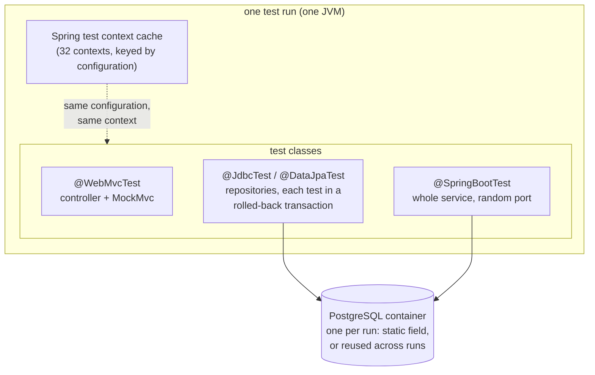

# 62. Unit, Slice & Testcontainers Tests

<div class="badges" markdown><span class="badge badge-l2">L2 · Practitioner</span><span class="badge badge-l3">L3 · Senior/Lead</span><span class="badge badge-meta">unit tests · Spring Boot test slices · @JdbcTest · @DataJpaTest · @WebMvcTest · Testcontainers · @ServiceConnection · container reuse · test isolation · context cache · H2 vs PostgreSQL · concurrency tests</span></div>

<div class="grid two" markdown>

!!! info "Prerequisites"
    - [Chapter 61](ch61-test-strategy.md): which kinds of tests catch which bugs
    - [Chapter 28](../communication/ch28-idempotency-correlation.md): idempotent writes with `ON CONFLICT`
    - Docker on the machine that runs the tests

!!! abstract "What you'll learn"
    - **A container per test class is the slow way**: 8 classes of database tests took **18.0–22.9 s** with a PostgreSQL container each, **4.0–4.7 s** with one container for the run, and **1.5–2.5 s** on a reused container. H2 took 0.4–0.7 s and couldn't run the production SQL.
    - **Rollback isolation is fast and leaky**: rolling back each test cost **0.30–0.34 ms**, against 7.8–7.9 ms to truncate and 51–73 ms to clone a database. But when the code under test committed on its own connection, **299 of 300 tests failed** on the previous test's row.
    - **H2 isn't PostgreSQL**: of 19 PostgreSQL features and behaviours, 8 failed or differed on H2 2.5 in PostgreSQL mode, among them `ON CONFLICT (…)`, upserts, `jsonb`, partial indexes, arrays and `RETURNING`.
    - **The portable rewrite fails under concurrency**: replacing `ON CONFLICT` with check-then-insert passed every single-threaded test. Under 16 concurrent requests it raised **421–449 errors** in 300 rounds on PostgreSQL; without the primary key, **172–186 rounds redeemed the coupon twice**.

</div>

---

## 1 · Introduction & Context

### The rule that passed every test

FoodFleet's FIRST20 coupon may be used once per customer. order-service enforced it in SQL: `INSERT … ON CONFLICT (customer_id, coupon) DO NOTHING`, and a redemption counted if a row was inserted. Then a developer moved the repository tests to H2 to get Docker out of the build. H2 rejected the statement, so the code was rewritten the "portable" way: look for an existing redemption, insert if there isn't one. Every test passed, on H2 and on PostgreSQL.

On the next sale day, the app's double-tap protection failed for a few hundred users, and support tickets arrived of two kinds: "I got a 500 when I applied my coupon" and, from a staging environment whose schema had lost its primary key in a migration, "customers are redeeming FIRST20 twice".

Chapter 61 showed which kinds of tests catch which bugs. This chapter is about writing them well: unit tests that stay unit tests, Spring Boot's slices, PostgreSQL in containers without slow builds, isolation between tests that actually isolates, and the test no single-threaded suite runs.

### Where it comes from

<ul class="mh-timeline">
<li><span class="when">2000s · In-memory databases for tests</span><span class="what">HSQLDB, then H2, become the default "integration" database: fast, embedded, and only approximately the production engine.</span></li>
<li><span class="when">2014–2016 · Spring Boot test slices; Testcontainers</span><span class="what"><code>@DataJpaTest</code> and <code>@WebMvcTest</code> load part of the application; Testcontainers starts real databases from JUnit.</span></li>
<li><span class="when">2019–2023 · Containers become the default</span><span class="what">Reusable containers; Spring Boot 3.1's <code>@ServiceConnection</code> wires a container into the application with no properties.</span></li>
<li><span class="when">2025–2026 · Spring Boot 4, JUnit 6, Testcontainers 2</span><span class="what">Test slices move into per-technology modules (<code>spring-boot-jdbc-test</code>, <code>spring-boot-webmvc-test</code>); the test context cache pauses unused contexts. Boot 4.1.1, Spring Framework 7.0.9, Testcontainers 2.0.5 and JUnit 6.1.3 are checked here.</span></li>
</ul>

---

## 2 · Core Concepts & Terminology



Unit test
:   A class or a few, in memory, constructed directly, with fakes for anything across a process boundary. No Spring context, no container.

Test slice
:   A Spring Boot test that starts only the part of the application one layer needs. `@WebMvcTest` loads controllers, filters and MockMvc; `@JdbcTest` and `@DataJpaTest` load data access, run each test in a transaction rolled back at the end, and by default replace the DataSource with an embedded database unless it's already a test database (a `@ServiceConnection` container counts).

Testcontainers
:   A library that starts Docker containers from tests, waits until they're ready, and removes them afterwards (with a reaper container, Ryuk, for crashed runs). `PostgreSQLContainer` runs PostgreSQL with `fsync=off`.

`@ServiceConnection`
:   Spring Boot's link from a container field to the application's connection details: the DataSource points at the container, with no properties to write.

Container lifecycle
:   An instance `@Container` field restarts per test; a static one lives for a test class; a singleton started once (a static initialiser, or JUnit's root store) lives for the whole run; a reusable container (`withReuse(true)` and `testcontainers.reuse.enable=true`) outlives the run and is found again by a hash of its configuration.

Test isolation
:   Keeping one test's data from another's: roll back each test's transaction, truncate tables after each test, or give each test a fresh database.

Context cache
:   Spring keeps up to 32 application contexts per JVM (`spring.test.context.cache.maxSize`), keyed by the test's configuration. Tests with identical configuration share one; every `@MockitoBean` or property difference makes a new one.

---

## 3 · How It Works Internally

### The rule, two ways

```java title="coupon/CouponRedemptions.java"
--8<-- "code/chapters/ch62-unit-slice-integration-tests/src/main/java/dev/foodfleet/ch62/coupon/CouponRedemptions.java:22:53"
```

`ON CONFLICT` is one statement: PostgreSQL checks the primary key and inserts atomically, so of any number of concurrent callers, exactly one inserts. Check-then-insert is two statements with a gap between them, and every caller that checks in the gap goes on to insert.

### What a container library does

`PostgresContainer` does with the Docker CLI what Testcontainers' `PostgreSQLContainer` does through the Docker API: run the image on a random host port, wait until it accepts connections, hand out a JDBC URL, remove it afterwards, and, when asked, find a running reusable container instead of starting one:

```java title="testing/PostgresContainer.java"
--8<-- "code/chapters/ch62-unit-slice-integration-tests/src/main/java/dev/foodfleet/ch62/testing/PostgresContainer.java:32:52"
```

Testcontainers waits for the log line "database system is ready to accept connections" to appear **twice**, because the official image's first start runs `initdb`, starts a temporary server, stops it and starts the real one. Waiting for a successful connection, as here, avoids the question.

### One container per run, a database per test

The JUnit extension keeps the container in the root context's store, so it starts once per run and JUnit closes it after the last test (store values that are `AutoCloseable` are closed with their context). Each test gets its own database, cloned from a template that already has the schema:

```java title="PostgresExtension.java"
--8<-- "code/chapters/ch62-unit-slice-integration-tests/src/test/java/dev/foodfleet/ch62/PostgresExtension.java:43:62"
```

```java title="testing/Isolation.java"
--8<-- "code/chapters/ch62-unit-slice-integration-tests/src/main/java/dev/foodfleet/ch62/testing/Isolation.java:23:30"
```

With Spring Boot the same shape is a static container with `@ServiceConnection` in a shared base class or a `@TestConfiguration`, so that every test class sees the same configuration and reuses one context and one container:

```java
@Testcontainers
abstract class PostgresTestBase {
    @Container
    @ServiceConnection
    static PostgreSQLContainer postgres = new PostgreSQLContainer("postgres:16");
}

@JdbcTest   // repositories only; each test rolled back; the container is kept (it's a test database)
class CouponRepositoryTest extends PostgresTestBase { … }
```

### Rollback isolation and its leak

`@JdbcTest`, `@DataJpaTest` and `@Transactional` tests run each test inside a transaction and roll it back. That only covers work done on the test's own connection. The lab reproduces it by handing the code the test's connection with `close()` disabled, as Spring's transaction synchronisation does:

```java title="verify/tools/Lab.java"
--8<-- "code/chapters/ch62-unit-slice-integration-tests/verify/tools/Lab.java:215:218"
```

When the code under test gets its own connection instead (`REQUIRES_NEW`, an `@Async` method, a second DataSource, a message listener, an HTTP call into the same service), its commits aren't part of the test's transaction and survive the rollback.

---

## 4 · Design Considerations & Trade-offs

### Test setup

All runs used:

- PostgreSQL 16.13 in Docker 29.4 (an image built from the host's PostgreSQL binaries, which runs `initdb` on first start like the official one), with `fsync=off` as Testcontainers sets it; H2 2.5.252 in memory with `MODE=PostgreSQL;DATABASE_TO_LOWER=TRUE;DEFAULT_NULL_ORDERING=HIGH`.
- JDK 25.0.4, JUnit 6.1.3, the PostgreSQL JDBC driver 42.7.14, on one 2-vCPU VM.

There were two runs. Where they differed, both values are shown. `check_apis.sh` checks **20 behaviours** in Spring Boot's, Spring Framework's, Testcontainers', JUnit's and H2's sources, and all were found.

### Measured: container lifecycles

A suite of 8 test classes with 6 tests each; each class creates the schema, and each test redeems coupons and reads them back:

| Database for the suite | Suite time | Containers started | Setup (time outside tests) | Per test |
|---|---|---|---|---|
| PostgreSQL container per test class | **17,981–22,866 ms** | 8 | 16,678–21,521 ms | 27–28 ms |
| One PostgreSQL container for the run | 4,046–4,748 ms | 1 | 2,925–3,645 ms | 23 ms |
| Reused container, first run | 3,458–3,765 ms | 1 | 2,377–2,770 ms | 21–23 ms |
| Reused container, next run | **1,497–2,508 ms** | 0 | 574–1,468 ms | 19–22 ms |
| H2 in memory, PostgreSQL mode | 405–734 ms | 0 | 228–573 ms | **3.4–3.7 ms** |

What the table shows:

- **Starting containers is the cost, not running tests.** Each container took about 2–2.7 s to start and accept connections (most of it `initdb`); the tests themselves took 19–28 ms each on PostgreSQL. Eight containers made the suite four to six times slower than one.
- **One container per run is the default to aim for.** Static `@Container` fields give one per class, which is the slow row; a singleton (a static initialiser in a shared base class, or JUnit's root store) gives one per run.
- **Reuse saves the last start, locally.** The next run found the running container and skipped startup entirely. It's for developers' machines: a reused container isn't removed, keeps its data between runs (so tests must create their own databases or clean up), and Testcontainers only reuses it when `testcontainers.reuse.enable=true` is set for the user, not the project.
- **H2 is fast per test** (3.4–3.7 ms, against 19–28 ms) because there's no network and no disk, but it ran the portable SQL only; it can't run the production statement (below).

### Measured: isolation between tests

300 tests on one container; every test redeems FIRST20 for the same customer and expects to be the first:

| Between tests | Failed tests | Cleanup per test | Rows left |
|---|---|---|---|
| Nothing | **299** | none | 1 |
| Roll back the test's transaction | 0 | **0.30–0.34 ms** | 0 |
| Roll back, but the code commits on its own connection | **299** | 0.01–0.02 ms | 1 |
| Truncate the table | 0 | 7.8–7.9 ms | 0 |
| A new database from a template per test | 0 | 51–73 ms (and 15–16 s to drop the 300 afterwards) | 1 (in the last test's own database) |

What the table shows:

- **Rollback is the cheapest isolation by far,** a third of a millisecond, which is why Spring's data slices use it.
- **It isolates only what the test's connection did.** When the code under test committed on its own connection, the rollback undid nothing, and every test after the first failed on its predecessor's row. In a real suite the symptom is worse: tests that pass alone and fail together, depending on order.
- **Truncating is the safe default for integrated tests.** At 8 ms per test it works whatever the code does with connections, which is what `@SpringBootTest` tests through HTTP need.
- **A database per test is the strongest and slowest.** PostgreSQL copies the template's files, so it suits tests that change the schema or run in parallel, not every test.

### Measured: what H2 can stand in for

Each statement on PostgreSQL 16 and H2 2.5 in PostgreSQL mode:

| Feature | PostgreSQL 16 | H2 2.5, PostgreSQL mode |
|---|---|---|
| `INSERT … ON CONFLICT (cols) DO NOTHING` | ok | **syntax error** |
| `INSERT … ON CONFLICT DO NOTHING` (no target) | ok | ok |
| `ON CONFLICT … DO UPDATE` (upsert) | ok | **syntax error** |
| `SELECT … FOR UPDATE SKIP LOCKED` | ok | ok |
| `jsonb` column and `->>` | ok | **syntax error** |
| `DISTINCT ON` | ok | ok |
| Partial unique index (`… WHERE active`) | ok | **syntax error** |
| `text[]` column and `= ANY(…)` | ok | **syntax error** |
| `generate_series`, `ILIKE`, `gen_random_uuid()` | ok | ok |
| `INSERT … RETURNING` | ok | **syntax error** |
| `timestamptz + interval '15 minutes'` | ok | **error** (22007) |
| `pg_try_advisory_lock` | ok | **function not found** |
| `date_trunc`, `string_agg` | ok | ok (booleans print as `TRUE`, not `t`) |
| `NULL`s in `ORDER BY`, date arithmetic, integer division | same | same (with `DEFAULT_NULL_ORDERING=HIGH`) |
| `varchar(5)` given seven characters | error 22001 | error 22001 |

Both runs gave the same results. 8 of 19 failed on H2; a ninth differed only in how a boolean printed.

- **H2 handles the SQL every database has.** The things it failed on are why teams choose PostgreSQL: upserts, JSON, arrays, partial indexes, `RETURNING`, advisory locks.
- **Its compatibility mode is a list of features, not an emulation.** H2 parses `ON CONFLICT DO NOTHING` only without a target; the code is in its parser, and `check_apis.sh` checks it.

### Measured: the portable rewrite under concurrency

One customer, FIRST20, 16 requests at the same moment (a double-tap plus client retries), 300 rounds:

| Code | Database | Rounds with 1 winner / 2+ winners | Errors (500s to users) |
|---|---|---|---|
| `ON CONFLICT DO NOTHING` | PostgreSQL | **300 / 0** | **0** |
| check, then insert | PostgreSQL | 300 / 0 | **421–449** |
| check, then insert | H2 | 300 / 0 | 33–45 |
| check, then insert | PostgreSQL, primary key missing | 114–128 / **172–186** | 0 |
| check, then insert | H2, primary key missing | 278–284 / 16–22 | 0 |

The single-threaded test (redeem twice, expect `true` then `false`) passed in every row.

- **The primary key saved correctness, not the user.** With the key, check-then-insert never redeemed twice, but every caller that lost the race got a unique-violation exception: 421–449 errors in 300 rounds, which an API turns into 500s.
- **Without the key, the rule simply broke.** More than half the rounds on PostgreSQL redeemed the coupon twice or more. A test schema created by an ORM's `ddl-auto`, or a migration that dropped a constraint, is enough.
- **H2 hid most of the race.** It produced a tenth as many errors and doubles as PostgreSQL for the same code, because its locking and timing differ: a concurrency test on H2 says little about production.
- **Only a concurrent test on the real database shows any of this.** `CouponRedemptionsPostgresTest` runs 8 threads × 20 rounds against PostgreSQL and asserts exactly one winner and no exception.

### Choosing

| Question | Do | Why (measured) |
|---|---|---|
| Rules and calculations | Plain unit tests, no Spring, no container | Chapter 61: they catch every logic bug, in milliseconds |
| Controllers: status codes, validation, JSON | `@WebMvcTest` with the service mocked | Loads the web layer only |
| Repositories and SQL | `@JdbcTest` / `@DataJpaTest` on a PostgreSQL container with `@ServiceConnection` | H2 failed 8 of 19 PostgreSQL features |
| The whole service | `@SpringBootTest(webEnvironment = RANDOM_PORT)`, same container, truncate between tests | Rollback doesn't cover the server's own transactions |
| Container lifecycle | One per run (singleton); reuse on developer machines | 4.0–4.7 s against 18.0–22.9 s; 1.5–2.5 s reused |
| Isolation | Rollback in slices; truncate in integrated tests; a database per test for schema changes or parallel runs | 0.3 ms, 8 ms, 51–73 ms |
| Races | A concurrent test on the real database | Check-then-insert passed every single-threaded test |

---

## 5 · Hands-on Implementation

```text
ch62-unit-slice-integration-tests/
├── src/main/java/dev/foodfleet/ch62/
│   ├── coupon/CouponRedemptions.java      ON CONFLICT, and check-then-insert
│   └── testing/                           PostgresContainer, Isolation
├── src/main/resources/db/schema.sql
├── src/test/java/dev/foodfleet/ch62/      PostgresExtension, CouponRedemptionsPostgresTest, H2CompatibilityTest
└── verify/   build-libs.sh, run.sh, check_apis.sh, postgres-image/, tools/ (Lab, RunSuites)
```

### 🔵 Level 2: real database, one container

<div class="badges" markdown><span class="badge badge-l2">L2 · Practitioner</span></div>

- Repository tests on PostgreSQL in a container with `@ServiceConnection`; delete the H2 test dependency.
- One container for the whole run: a static field in a shared base class, not one per class.
- Rules in plain unit tests, without Spring.

### 🟣 Level 3: fast, isolated, concurrent

<div class="badges" markdown><span class="badge badge-l3">L3 · Senior/Lead</span></div>

- Keep test configurations identical so the context cache reuses contexts; replace per-class `@MockitoBean`s with shared test configuration.
- Truncate between `@SpringBootTest` tests; never rely on rollback when the code opens its own transactions.
- Write a concurrent test for every rule that must hold "once": coupons, idempotency keys, inventory.
- Enable container reuse on developer machines (`~/.testcontainers.properties`), never in CI.

```bash
JAVA_HOME=/path/to/jdk-25 verify/run.sh           # about 6 minutes; Docker needed
JAVA_HOME=/path/to/jdk-25 verify/run.sh h2gap     # one experiment
```

### Run and verify

```text
$ verify/run.sh lifecycle isolation
== lifecycle
database per suite run                         suite time   containers started   database setup   per test (avg)
PostgreSQL container per test class               17981 ms   8                       16678 ms        27.1 ms
one PostgreSQL container for the run               4748 ms   1                        3645 ms        23.0 ms
reused container (testcontainers.reuse), first run     3765 ms   1                        2770 ms        20.7 ms
reused container (testcontainers.reuse), second run     2508 ms   0                        1468 ms        21.7 ms
H2 in memory, PostgreSQL mode                       405 ms   0                         228 ms         3.7 ms

== isolation
between tests                                        failed tests   cleanup per test   rows left at the end
nothing                                              299                0.00 ms        1
rollback                                             0                  0.34 ms        0
rollback, code commits on its own connection         299                0.01 ms        1
truncate                                             0                  7.93 ms        0
new database from a template                         0                 72.92 ms        1
```

!!! question "Try it"
    1. Change `PostgresExtension` to start a container per test class. How long does the suite take?
    2. Run the race with `SERIALIZABLE` isolation around check-then-insert. What happens to the errors?
    3. Add a unique index on `(customer_id, coupon)` to the "no primary key" schema. Which row of the race table does it turn into?
    4. Find a `@Transactional` test in your own code base whose code under test uses `REQUIRES_NEW`. Does it clean up?

---

## 6 · Production Readiness

(For a test suite, production is the CI pipeline.)

- [x] **Rules in unit tests** without Spring or containers
- [x] **Repositories tested on the production engine**; no H2 for SQL
- [x] **One container per run** in CI; reuse only locally
- [x] **Isolation chosen per kind of test**: rollback in slices, truncate in integrated tests
- [x] **Concurrent tests** for every once-only rule, on the real database
- [x] **Test schema from the same migrations** as production (Flyway or Liquibase), never `ddl-auto`
- [x] **Context cache watched**: few distinct configurations; `spring.test.context.cache.maxSize` not raised to hide them
- [x] **Docker available in CI**, with the images cached

---

## 7 · Anti-patterns & Pitfalls

!!! pitfall "Incident 1: the 500s on sale day"
    **Context.** The coupon rule was rewritten as check-then-insert so the H2 tests would pass.

    **Symptoms.** Users who double-tapped "apply coupon" got an error; support saw a spike of 500s.

    **Root cause.** Concurrent requests both passed the check and both inserted; the primary key rejected the second. Measured: 421–449 errors in 300 rounds of 16 concurrent requests, and none with `ON CONFLICT`.

    **Fix.** `ON CONFLICT` back in the code; repository tests on PostgreSQL; a concurrent test that asserts one winner and no exceptions.

!!! pitfall "Incident 2: the tests that passed alone"
    **Context.** order-service's tests were `@Transactional` and rolled back. The code under test saved an audit record in a `REQUIRES_NEW` transaction.

    **Symptoms.** Tests passed one by one in the IDE and failed in CI in a different order, each time a different one.

    **Root cause.** The audit records were committed on their own connection, survived the rollback, and leaked into later tests. Measured: 299 of 300 tests failed once the code committed on its own connection.

    **Fix.** Truncate after each integrated test; assert on an empty database at the start of tests that depend on it.

!!! pitfall "Incident 3: the twelve-minute build"
    **Context.** Each repository test class declared its own static `@Container`, and many had a `@MockitoBean` or two.

    **Symptoms.** The build took twelve minutes; most of it was containers starting and contexts loading.

    **Root cause.** A container per class: measured, 18.0–22.9 s for 8 classes against 4.0–4.7 s with one. And a context per distinct configuration.

    **Fix.** One container in a shared base class; mocks moved into shared test configuration; the suite went from dozens of contexts to a handful.

| Anti-pattern | Symptom | Fix |
|---|---|---|
| H2 standing in for PostgreSQL | Production SQL rewritten to fit the test database | PostgreSQL in a container |
| A container per test class | Minutes of container starts | One per run |
| Reuse enabled in CI | Data from previous runs; nothing removes it | Reuse only locally |
| Rollback with code that opens its own transactions | Order-dependent failures | Truncate |
| Schema from `ddl-auto` in tests | Constraints missing; races invisible | The production migrations |
| Only single-threaded tests for once-only rules | Doubles and 500s in production | Concurrent tests on the real database |
| A new `@MockitoBean` per class | A new Spring context per class | Shared test configuration |
| `assertThrows(Exception.class, …)` | Passes on the wrong error | Assert the specific cause |

---

## 8 · Enterprise Case Study

### FoodFleet: real databases, fast suites

!!! decision "ADR-062: repository and integrated tests run on PostgreSQL in a container started once per test run with @ServiceConnection; H2 removed; rollback isolation in data slices, truncation in @SpringBootTest tests; concurrent tests for every once-only rule; test schemas from Flyway migrations; container reuse allowed on developer machines only"
    **Status:** Accepted · **Date:** 2025-12-29

    **Context.** A coupon rule rewritten for H2 failed under concurrency in production. Measured:

    - Check-then-insert raised 421–449 errors in 300 concurrent rounds and, without the primary key, redeemed twice in 172–186; `ON CONFLICT` had neither. Every single-threaded test passed.
    - H2 failed 8 of 19 PostgreSQL features the services use.
    - A container per class cost 18.0–22.9 s for 8 classes; one per run 4.0–4.7 s; a reused one 1.5–2.5 s.
    - Rollback isolation cost 0.3 ms per test but leaked when code committed on its own connection; truncation cost 8 ms and didn't.

    **Decision.**

    - **Database tests:** PostgreSQL 16 (the production major version) via Testcontainers, one container per run from a shared base class, wired with `@ServiceConnection`; `fsync=off` as Testcontainers sets it.
    - **H2:** removed from every service.
    - **Isolation:** `@JdbcTest`/`@DataJpaTest` keep their rollback; `@SpringBootTest` tests truncate after each test.
    - **Concurrency:** every once-only rule has a test with concurrent callers asserting one winner and no errors.
    - **Schema:** tests apply the Flyway migrations; `ddl-auto` is off.
    - **Reuse:** allowed locally; CI always starts fresh containers.

    **Consequences:**

    - ✅ Tests run the SQL production runs, races included.
    - ✅ Database suites in seconds per service rather than minutes.
    - ⚠️ Docker is a hard requirement for builds.
    - ⚠️ Concurrent tests are slower and need care to stay deterministic.

### Fintech analogue: the ledger's constraints are the tests' subject

Payment ledgers rely on database constraints, `SERIALIZABLE` transactions and advisory locks for correctness. Their teams test those on the production engine with concurrent callers, because a ledger that's right single-threaded and wrong under load is the worst kind of bug.

### E-commerce analogue: inventory reservations

Retailers' inventory services reserve stock with conditional updates (`UPDATE … SET available = available - 1 WHERE available > 0`). The tests that matter fire many reservations at the last unit at once and assert that exactly one succeeds, on the real database.

---

## 9 · Interview Q&A + Summary

#### Q1. What's the difference between a unit test and a slice test? · <span class="badge badge-l2">L2</span> · TCS · Cognizant

**Short answer:** A unit test constructs classes directly, in memory, with no framework. A slice test starts part of a Spring application: `@WebMvcTest` the web layer with MockMvc, `@JdbcTest`/`@DataJpaTest` the data layer. Slices test how your code works with the framework; unit tests test your logic.

#### Q2. What does `@DataJpaTest` do by default? · <span class="badge badge-l2">L2</span> · Infosys

**Short answer:** Loads JPA repositories and their configuration only, runs each test in a transaction that's rolled back, and replaces the DataSource with an embedded database unless it's already a test database. In Spring Boot 4.1 the default is `Replace.NON_TEST`, and a `@ServiceConnection` container counts as a test database, so it's kept.

#### Q3. Why Testcontainers instead of H2? · <span class="badge badge-l2">L2</span> · Razorpay · Swiggy

**Short answer:** Because H2 isn't the database you run. Measured: H2 2.5 in PostgreSQL mode failed 8 of 19 PostgreSQL features, including `ON CONFLICT (…)`, upserts, `jsonb`, arrays, partial indexes and `RETURNING`, and it hid most of a race that PostgreSQL showed.

#### Q4. How do you keep Testcontainers tests fast? · <span class="badge badge-l3">L3</span> · Atlassian

**Short answer:** One container per test run, not per class (measured: 4.0–4.7 s against 18.0–22.9 s for 8 classes); identical test configurations so Spring reuses contexts; rollback or truncation instead of new databases; reuse on developer machines (1.5–2.5 s). Testcontainers' PostgreSQL module already turns off `fsync`.

#### Q5. What does `@ServiceConnection` do? · <span class="badge badge-l3">L3</span> · VMware

**Short answer:** It tells Spring Boot to derive connection details (URL, user, password) from a container bean or field, so the application's DataSource points at the container without `@DynamicPropertySource` or properties. It also marks the DataSource as a test database for `@AutoConfigureTestDatabase`.

#### Q6. Your `@Transactional` tests pass alone and fail together. Why? · <span class="badge badge-l3">L3</span> · Goldman Sachs

**Short answer:** Something commits outside the test's transaction (a `REQUIRES_NEW`, an async method, another DataSource, a message listener) and the rollback doesn't undo it. Measured: with the code committing on its own connection, 299 of 300 tests failed on the previous test's row. Truncate between tests instead.

#### Q7. Rollback, truncate or a new database per test? · <span class="badge badge-l3">L3</span> · Flipkart

**Short answer:** Rollback for data slices (0.30–0.34 ms per test) when everything happens on the test's connection; truncate for integrated tests (7.8–7.9 ms), which works whatever the code does; a database per test from a template (51–73 ms) for schema changes or parallel tests.

#### Q8. How do you test a "once per customer" rule? · <span class="badge badge-l3">L3</span> · Zomato · PhonePe

**Short answer:** With concurrent callers on the real database, asserting exactly one winner and no errors. Measured: check-then-insert passed every single-threaded test and raised 421–449 errors in 300 concurrent rounds; without the key, 172–186 rounds redeemed twice. `ON CONFLICT` had neither.

#### Q9. What is the Spring test context cache, and how do you break it? · <span class="badge badge-l3">L3</span> · Microsoft

**Short answer:** Spring keeps up to 32 application contexts per JVM, keyed by the test's full configuration, and pauses ones not in use. Any difference (a `@MockitoBean`, a property, a profile, `@DirtiesContext`) makes a new context. Too many configurations mean slow suites and evictions.

#### Q10. Should container reuse be on in CI? · <span class="badge badge-l3">L3</span> · Uber

**Short answer:** No. A reused container isn't removed and keeps data between runs; CI should start clean. Testcontainers only reuses when `testcontainers.reuse.enable=true` is set in the user's environment, which is meant for developers' machines.

#### Q11. When is mocking the database acceptable? · <span class="badge badge-l2">L2</span> · Wipro

**Short answer:** In unit tests of logic that uses a repository: a fake or mock keeps them fast and focused. Never as the test of the repository itself, whose SQL only the real database can check.

#### Q12. Design FoodFleet's database testing setup. · <span class="badge badge-l4">L4</span> · architecture rounds

**Short answer:**

- **Layers:** unit tests for rules; `@WebMvcTest` for controllers; `@JdbcTest`/`@DataJpaTest` on PostgreSQL for repositories; a few `@SpringBootTest` component tests.
- **Containers:** one PostgreSQL per run via a shared base class and `@ServiceConnection`; reuse locally.
- **Schema and isolation:** Flyway migrations; rollback in slices, truncation in component tests.
- **Correctness:** concurrent tests for once-only rules; no H2.

### Key takeaways

- **Start containers once**: the container, not the test, is the cost.
- **Test the SQL on the engine that runs it**: H2 failed 8 of 19 PostgreSQL features.
- **Rollback isolates only the test's own connection**: truncate for integrated tests.
- **Once-only rules need concurrent tests**: the portable rewrite passed every single-threaded test and failed under load.

### Further reading

- Testcontainers, [Singleton containers](https://java.testcontainers.org/test_framework_integration/manual_lifecycle_control/) and [JUnit 5 integration](https://java.testcontainers.org/test_framework_integration/junit_5/)
- Spring Boot, [Testing](https://docs.spring.io/spring-boot/reference/testing/index.html), including test slices and Testcontainers service connections
- Spring Framework, [Context caching](https://docs.spring.io/spring-framework/reference/testing/testcontext-framework/ctx-management/caching.html)
- PostgreSQL, [INSERT … ON CONFLICT](https://www.postgresql.org/docs/16/sql-insert.html#SQL-ON-CONFLICT)
- H2, [Compatibility](https://www.h2database.com/html/features.html#compatibility)

---

**Previous:** [← 61. Test Pyramid & Honeycomb](ch61-test-strategy.md) · **Next:** [63. Contract Testing →](ch63-contract-testing.md)
