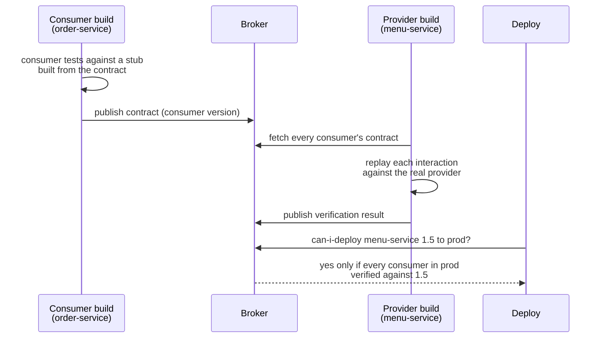

# 63. Contract Testing

<div class="badges" markdown><span class="badge badge-l2">L2 · Practitioner</span><span class="badge badge-l3">L3 · Senior/Lead</span><span class="badge badge-meta">consumer-driven contracts · Pact · Spring Cloud Contract · provider verification · matchers · provider states · can-i-deploy · OpenAPI breaking-change diff · oasdiff</span></div>

<div class="grid two" markdown>

!!! info "Prerequisites"
    - [Chapter 27](../communication/ch27-api-contracts.md): OpenAPI-first, tolerant readers and why contracts exist
    - [Chapter 61](ch61-test-strategy.md): where contract tests sit among the other kinds
    - [Chapter 58](../deployment/ch58-cicd-gitops.md): the pipeline a can-i-deploy check gates

!!! abstract "What you'll learn"
    - **Four checks against twelve provider changes**, nine of which broke a consumer on production data:
        - An **OpenAPI diff** caught **5**, with **2 false alarms**.
        - **order-service's contract** caught **6**, and **app-bff's** caught **5**. Neither raised a false alarm, and each named the consumer it would break.
        - An **E2E suite** caught **7**.
    - **The contracts and the E2E suite caught the same 7.** Both checked only the data their tests used: a new enum value and pagination only showed up on a restaurant neither touched.
    - **Matchers decide a contract's value**:
        - **Examples recorded from the provider** flagged **all 5 harmless data changes**, such as a new price or a reordered menu.
        - **Type matchers** missed the price silently moving to paise.
        - **Type matchers plus formats** caught 7 of 9 with no false alarms.

</div>

---

## 1 · Introduction & Context

### Green builds, broken app

menu-service had three consumers and a good test suite. In one month it shipped three releases that each passed every test and each broke someone:

- **Rename:** `available` became `inStock`, a tidier name, and order-service treated every item as sold out.
- **Units:** prices moved to paise "for precision", and the app showed a ₹12,950 paneer tikka.
- **Paging:** the menu endpoint got pagination, and the app silently showed the first 20 of 45 dishes at FoodFleet's biggest restaurant.

The provider's tests were green because they tested the provider. Nobody tested what the consumers relied on, except the end-to-end suite, which ran nightly on a shared environment and was red so often that nobody looked.

Chapter 27 introduced contracts as an idea and compared a structural diff with consumer-driven contracts on a year of API history. This chapter is the practice: writing the contracts, verifying them in the provider's build, choosing matchers, and deciding whether a release can go out. And it measures each check against what actually breaks.

### Where it comes from

<ul class="mh-timeline">
<li><span class="when">2006 · Consumer-driven contracts</span><span class="what">Ian Robinson's article: a provider's obligations are the union of what its consumers expect.</span></li>
<li><span class="when">2013–2015 · Pact and Spring Cloud Contract</span><span class="what">Pact (from realestate.com.au) records consumer expectations from consumer tests; Spring Cloud Contract (from Accurest) generates provider tests and stubs from contracts.</span></li>
<li><span class="when">2016–2019 · The broker and can-i-deploy</span><span class="what">The Pact Broker keeps contracts and verification results per version; <code>can-i-deploy</code> asks it whether a version is safe to release.</span></li>
<li><span class="when">2020s · Bi-directional and schema diffs</span><span class="what">OpenAPI breaking-change tools (oasdiff, openapi-diff) gate builds; Pact adds provider-driven OpenAPI comparison.</span></li>
<li><span class="when">2026 · This chapter</span><span class="what">Pact JVM 4.7.5's matching rules, Spring Cloud Contract 5.0.3, the Pact Broker 2.122.0 and oasdiff 1.34.0's rules, checked in their sources.</span></li>
</ul>

---

## 2 · Core Concepts & Terminology



Contract
:   A file of interactions: a request a consumer makes and the response it needs, with matching rules. Pact files are JSON; Spring Cloud Contract uses Groovy, YAML, Java or Kotlin, and generates the same kind of thing.

Consumer-driven
:   The consumer writes the contract from its own tests, so it lists only what the consumer actually uses. The provider's obligation is the union of its consumers' contracts.

Provider verification
:   The provider's build replays every interaction against the running provider and checks the responses. **Provider states** ("restaurant 7's kulfi is sold out") tell the provider which test data to set up.

Matchers
:   How strictly a response is compared. With no matcher a value must equal the example. **Type** matchers accept any value of the same JSON type, and cascade to everything below. **Regex** matchers check a format. **eachLike/min** matchers accept arrays of at least N elements shaped like the example. Pact always allows keys the contract doesn't mention in responses.

can-i-deploy
:   A query to the broker: has this version been verified against every version of its partners in the target environment? Deployable only if all of them succeeded.

Breaking-change diff
:   A tool such as oasdiff compares two OpenAPI documents and classifies each change as ERR (breaking), WARN or INFO, from the schema alone.

---

## 3 · How It Works Internally

### A consumer's contract

app-bff's contract says what its menu screen needs, and nothing else:

```json title="contracts/app-bff-menu-service.json"
--8<-- "code/chapters/ch63-contract-testing/src/test/resources/contracts/app-bff-menu-service.json"
```

- `$.items` uses type matching with `min: 1`: at least one item, each shaped like the example.
- `price` must look like rupees with two decimals.
- `spice` must be one of the three values the app's enum knows; every other field only needs the right type.

The consumer's own test runs its real client against a stub that answers only these interactions, so a client that calls something it hasn't declared fails in the consumer's build.

### Matching, the Pact way

`Matching` implements the rules these contracts use. Expected keys must be present, unexpected ones are allowed, and an array with a `min` rule is matched element by element against the first example:

```java title="contract/Matching.java"
--8<-- "code/chapters/ch63-contract-testing/src/main/java/dev/foodfleet/ch63/contract/Matching.java:29:67"
```

Pact JVM does the same, with two details that matter for the results below:

- Response bodies are matched with `allowUnexpectedKeys` set to true.
- A regex is applied to the value's **string form**, so `"129.50"` and `129.50` both match `^\d+\.\d{2}$`, and `null` never matches.

### Verification in the provider's build

```java title="contract/Verifier.java"
--8<-- "code/chapters/ch63-contract-testing/src/main/java/dev/foodfleet/ch63/contract/Verifier.java:28:65"
```

With Spring Cloud Contract the same step is a generated JUnit test per interaction, run by the provider's build. The consumer gets stubs through the stub runner, from the classpath, a local Maven repository or a remote one.

### The experiment

`verify/changes.tsv` holds twelve changes. Each one edits menu-service's code, and edits its OpenAPI document the way an honest developer would. For each change, `Lab` compiles the new provider, starts it, and asks four questions:

1. **OpenAPI diff:** does the old-vs-new document contain an ERR, by oasdiff 1.34's rules?
2. **order-service's contract:** does it still verify?
3. **app-bff's contract:** does it still verify?
4. **E2E:** do both real clients still get the same answers for the journeys the suite covers? Those journeys are on restaurant 7, the test restaurant.

The answer it checks them against: both real clients, run against **every** restaurant and item in menu-service's data, compared with the old provider.

---

## 4 · Design Considerations & Trade-offs

### Test setup

All runs used:

- JDK 25.0.4 and JUnit 6.1.3 on one 2-vCPU VM, with each provider version in its own JVM.
- menu-service's data: restaurant 7 (6 items, the one tests use) and restaurant 9 (45 items).
- Two consumers: order-service (one item's price and availability; an unknown item is unavailable) and app-bff (the whole menu, with a strict spice enum).

There were two runs, with identical results; only the timings differed. `check_apis.sh` checks **18 behaviours** in Pact JVM's, Spring Cloud Contract's, oasdiff's and the Pact Broker's sources, and all were found.

### Measured: which check catches which change

| Change | OpenAPI diff | order-service contract | app-bff contract | E2E (restaurant 7) | Actually breaks |
|---|---|---|---|---|---|
| C1 field renamed: `available` → `inStock` | ERR | **fails** | **fails** | **fails** | both |
| C2 optional field removed: `description` | INFO | passes | **fails** | **fails** | app-bff |
| C3 unused field removed: `calories` | **ERR** | passes | passes | passes | nothing |
| C4 price sent as a number, not a string | **ERR** | passes | passes | passes | nothing |
| C5 enum value added: spice `EXTRA_HOT` | ERR | passes | passes | passes | **app-bff** |
| C6 price `null` when sold out | ERR | **fails** | **fails** | **fails** | both |
| C7 unknown item: 200 unavailable instead of 404 | INFO | **fails** | passes | **fails** | order-service |
| C8 path renamed: `/items/` → `/menu-items/` | ERR | **fails** | passes | **fails** | order-service |
| C9 new required header `X-Client-Version` | ERR | **fails** | **fails** | **fails** | both |
| C10 field added: `allergens` | INFO | passes | passes | passes | nothing |
| C11 price in paise, still a string | no change | **fails** | **fails** | **fails** | both |
| C12 menu paged: 20 items and a `next` link | INFO | passes | passes | passes | **app-bff** |

| Check | Breaking changes caught (of 9) | False alarms (of 3 harmless) | Time per change |
|---|---|---|---|
| OpenAPI diff | 5 | **2** | 1.1–1.8 ms |
| order-service contract | 6 | 0 | 16.0–16.5 ms |
| app-bff contract | 5 | 0 | 9.3–9.4 ms |
| Both contracts | **7** | 0 | |
| E2E on restaurant 7 | **7** | 0 | 19.2–20.4 ms |
| All four | 8 | 2 | |

The timings are for checks against a provider already running on the same machine. An E2E suite also needs every service deployed together, which chapter 64 measures.

What the tables show:

- **The diff judges the schema, not the consumers.** It flagged removing `calories`, which nobody read, and sending the price as a number, which both clients parsed happily: two false alarms. And it rated removing an optional field and the 404 change as INFO, though app-bff showed blank descriptions and order-service crashed on unknown items.
- **No schema rule sees a change of meaning.** Moving prices to paise kept the type, the name and the document. Only a check with a format (the contracts' regex) or real values (E2E) noticed.
- **Each contract caught exactly its consumer's breaks, and said whose.** order-service's contract failed on the path rename and the 404 change, which only order-service cared about. app-bff's failed on the description, which only app-bff read. That's what lets the broker answer "can menu-service 1.5 go to production?" per consumer, without running anyone else's code.
- **Contracts and E2E caught the same seven,** because both verified the same data: restaurant 7. The new enum value only appeared on restaurant 9's menu, and pagination only matters above 20 items. Provider states with realistic data, and a consumer contract with an item at each spice level, would have caught C5; nothing in the test data would have caught C12.
- **The cheap check for what contracts miss is the diff.** It was the only one to flag C5. Running both, contracts gating the release and the diff's ERRs reviewed by a person, caught 8 of 9.

### Measured: how strict a contract should be

The same two contracts, written three ways. Each version was checked against the 12 API changes and against 5 changes to menu-service's **data** that no consumer should care about:

- D1: a new price.
- D2: an added item.
- D3: a reworded description.
- D4: the menu in another order.
- D5: an item selling out.

| Contracts | Breaking changes caught (of 9) | Harmless API changes flagged (of 3) | Data changes flagged (of 5) |
|---|---|---|---|
| Examples recorded from the provider, no matchers | 7 | **2** (C3, C4) | **5** |
| Type matchers only | 6 | 1 (C4) | 0 |
| Type matchers + formats (as written) | **7** | **0** | **0** |

What the table shows:

- **Recorded contracts are snapshot tests, and fail like them.** Every data change failed them: a new price, a new dish, a rewritten description, a reordered menu. Teams that start with recorded examples learn to ignore contract failures, which defeats the point.
- **Type matchers alone are too loose for meaning.** They stopped every false alarm from data, but lost C11: a price of `"12950"` is still a string.
- **Formats are where a consumer states what it really depends on.** Two regexes, a price with two decimals and one of three spice levels, caught C11, didn't trip on any data change, and accepted the number-typed price both clients handled.

### Choosing

| Question | Do | Why (measured) |
|---|---|---|
| Who writes contracts? | Each consumer, from its own tests (Pact), or together with the provider (Spring Cloud Contract) | Each consumer's contract caught exactly its own breaks |
| How strict? | Type matchers everywhere, formats and enums where meaning lives | Recorded examples flagged 5 of 5 harmless data changes; types alone missed paise |
| What test data? | Provider states with realistic data, including edge values (every enum value, long lists, sold-out items) | Contracts and E2E both missed what only another restaurant's data showed |
| Gate the release on? | can-i-deploy against the target environment | Per-consumer verdicts, no false alarms |
| Also run? | An OpenAPI diff, reviewed rather than blocking | The only check that caught the new enum value; 2 false alarms |
| Keep E2E? | A few journeys (chapter 64) | Caught nothing the contracts didn't, at the cost of a shared environment |

---

## 5 · Hands-on Implementation

```text
ch63-contract-testing/
├── src/main/java/dev/foodfleet/ch63/
│   ├── contract/   Contract (Pact v3 files), Matching, Verifier, StubServer
│   ├── openapi/    SchemaDiff (oasdiff's rules for the parts menu-service uses)
│   ├── menu/       MenuService, the provider
│   ├── consumer/   OrderMenuClient, AppMenuClient
│   └── json/       Json
├── src/main/resources/openapi/menu-service.json
├── src/test/resources/contracts/   order-service-menu-service.json, app-bff-menu-service.json
├── src/test/java/…                 9 tests: consumer side, provider verification, matching and diff
└── verify/   build-libs.sh, run.sh, check_apis.sh, changes.tsv, data-changes.tsv, tools/ (Lab, RunSuites)
```

### 🔵 Level 2: write and verify a contract

<div class="badges" markdown><span class="badge badge-l2">L2 · Practitioner</span></div>

- In the consumer, test the real client against a Pact mock server (or a Spring Cloud Contract stub), and publish the contract.
- In the provider, verify every consumer's contract in the build, with provider states for the data each interaction needs.
- Use type matchers by default, and formats where the value's meaning matters.

### 🟣 Level 3: gate releases on it

<div class="badges" markdown><span class="badge badge-l3">L3 · Senior/Lead</span></div>

- Run a broker; publish contracts and verification results with versions and branches; record deployments per environment.
- Make `can-i-deploy --to-environment production` a required pipeline step for providers and consumers.
- Add an OpenAPI diff to provider pull requests; review its ERRs instead of blocking on them.

```bash
JAVA_HOME=/path/to/jdk-25 verify/run.sh   # under a minute
```

### Run and verify

```text
$ verify/run.sh
    change                                     OpenAPI    contract:  contract:  E2E        | actually breaks
                                               diff       order-svc  app-bff    (rest. 7)  | (all data)
C1  field renamed: available -> inStock        FLAGS      FLAGS      FLAGS      FLAGS      | order-service, app-bff
C2  optional field removed: description        passes     passes     FLAGS      FLAGS      | app-bff
C3  unused field removed: calories             FLAGS      passes     passes     passes     | nothing
…
C11 price in paise, still a string             passes     FLAGS      FLAGS      FLAGS      | order-service, app-bff
C12 menu paged: 20 items and a next link       passes     passes     passes     passes     | app-bff

9 of 12 changes break a consumer
   OpenAPI diff             caught  5 of 9, false alarms 2,    1.1 ms per change
   order-service contract   caught  6 of 9, false alarms 0,   16.5 ms per change
   app-bff contract         caught  5 of 9, false alarms 0,    9.4 ms per change
   E2E on restaurant 7      caught  7 of 9, false alarms 0,   19.2 ms per change
```

!!! question "Try it"
    1. Add an item with spice `HIGH` to restaurant 7's data and a provider state for it. Does a new enum value get caught now?
    2. Give app-bff's contract an interaction for restaurant 9's menu with `"min": 45`. Which change does it catch, and what's the cost?
    3. Write order-service's contract with the recorded examples. How many of the five data changes fail it?
    4. Change `AppMenuClient` to map unknown spice values to `MEDIUM` (a tolerant reader, chapter 27). Which change stops breaking it?

---

## 6 · Production Readiness

- [x] **Every consumer of an API has a contract**, written from its own tests and published with its version
- [x] **Provider verification in the provider's build**, against every consumer's latest and deployed contracts
- [x] **Matchers by intent**: types by default, formats and enums for meaning, no recorded examples
- [x] **Provider states with realistic data**: every enum value, long lists, nulls the API allows
- [x] **can-i-deploy** required before every deployment, against the target environment
- [x] **Deployments recorded** in the broker, so it knows what runs where
- [x] **OpenAPI diff** on provider pull requests, reviewed
- [x] **Tolerant readers** in consumers, so additive changes stay additive

---

## 7 · Anti-patterns & Pitfalls

!!! pitfall "Incident 1: the price in paise"
    **Context.** menu-service moved prices to paise for precision, kept the field a string, and updated its OpenAPI description.

    **Symptoms.** The app showed dishes at a hundred times their price for the hour before the release was rolled back.

    **Root cause.** No schema rule sees meaning. Measured: the OpenAPI diff reported no breaking change; contracts with type matchers only passed; contracts with a two-decimal format failed.

    **Fix.** Formats in consumer contracts where the value's meaning matters; a new field (`pricePaise`) instead of a new meaning for an old one.

!!! pitfall "Incident 2: the contracts nobody trusted"
    **Context.** A team generated consumer contracts by recording the provider's responses in staging.

    **Symptoms.** The provider's build failed whenever a restaurant changed a price, and the team turned contract verification into a warning.

    **Root cause.** Recorded examples with no matchers are snapshots. Measured: they flagged all 5 harmless data changes and 2 harmless API changes.

    **Fix.** Contracts written by consumers with type matchers and a few formats; measured, no false alarms and 7 of 9 breaks caught.

!!! pitfall "Incident 3: the spice level nobody tested"
    **Context.** menu-service added `EXTRA_HOT`. All contracts passed; the OpenAPI diff reported an ERR, which the team overrode as "additive".

    **Symptoms.** The app's menu screen failed for one restaurant.

    **Root cause.** The contracts verified restaurant 7, which had no extra-hot dish. Measured: only the diff caught C5.

    **Fix.** Provider states that include every enum value; tolerant enum parsing in consumers; diff ERRs reviewed, not overridden by default.

| Anti-pattern | Symptom | Fix |
|---|---|---|
| Provider-written contracts of the whole API | Every change "breaks" a contract | Consumer-driven: only what's used |
| Recorded examples, no matchers | Failures on every data change | Type matchers and formats |
| Type matchers only | Changes of meaning pass | Formats where meaning lives |
| Test data with one of everything | Enum values, long lists, nulls never verified | Provider states with edge data |
| Contracts verified but not gating | Breaks shipped with a red check | can-i-deploy as a required step |
| Schema diff as the only gate | False alarms and missed meaning | Diff for review, contracts for gating |
| Contracts instead of tolerant readers | Every additive change is a negotiation | Both |

---

## 8 · Enterprise Case Study

### FoodFleet: contracts as the release gate

!!! decision "ADR-063: every HTTP consumer publishes Pact contracts to a Pact Broker; providers verify them in their builds with realistic provider states; can-i-deploy gates every deployment; contracts use type matchers with formats for meaning; OpenAPI diffs run on provider pull requests for review; E2E reduced to a few journeys"
    **Status:** Accepted · **Date:** 2026-01-05

    **Context.** Three releases in a month broke consumers with green builds. Measured on twelve menu-service changes:

    - Consumer contracts caught 7 of 9 breaking changes with no false alarms, each naming the consumer affected.
    - An OpenAPI diff caught 5, with 2 false alarms. It was the only check to catch a new enum value, and it missed a change of units.
    - An E2E suite caught the same 7 as the contracts.
    - Recorded examples as contracts flagged all 5 harmless data changes.

    **Decision.**

    - **Contracts:** Pact for HTTP between FoodFleet services; Spring Cloud Contract stays where teams already use it. Consumers write them from their client tests, using type matchers and formats.
    - **Provider builds:** verify all consumers' contracts for the main branch and for each deployed version, with provider states covering every enum value and long lists.
    - **Gate:** `can-i-deploy --to-environment` before every deployment; deployments recorded in the broker.
    - **Diff:** oasdiff on provider pull requests; ERRs need a reviewer's sign-off.
    - **E2E:** a handful of journeys (chapter 64), not the main safety net.

    **Consequences:**

    - ✅ Breaking changes stop in the provider's build, with the affected consumer named.
    - ✅ Releases no longer wait for a shared environment.
    - ⚠️ A broker to run, and contracts to keep current as consumers change.
    - ⚠️ Contracts only check the data they're verified against; provider states need care.

### Fintech analogue: contracts with partners

Payment companies use the same idea across organisations: partners' integration tests run against stubs generated from the payment API's published contracts, and the API team verifies those contracts before each release, so a partner's checkout doesn't learn about a change from production.

### E-commerce analogue: many consumers, one catalog

A large retailer's product catalog has dozens of consumers. Consumer contracts tell the catalog team, for every field, who reads it, so removing an unused field is a quick change and removing a used one starts a conversation with named teams.

---

## 9 · Interview Q&A + Summary

#### Q1. What is a consumer-driven contract? · <span class="badge badge-l2">L2</span> · TCS · Infosys

**Short answer:** A test artefact written by a consumer, listing the requests it makes and the parts of each response it relies on. The provider verifies every consumer's contract in its build, so its obligations are exactly what its consumers use, not everything it could return.

#### Q2. How does Pact work end to end? · <span class="badge badge-l2">L2</span> · Thoughtworks

**Short answer:** The consumer's test runs its real client against Pact's mock server, which records the interactions into a pact file. The file is published to a broker. The provider's build fetches it, replays each request against the real provider (after setting up the named provider state), and checks the responses with the pact's matchers. The result goes back to the broker, which answers can-i-deploy.

#### Q3. Pact or Spring Cloud Contract? · <span class="badge badge-l2">L2</span> · Wipro

**Short answer:** Pact is consumer-driven and polyglot, with a broker and can-i-deploy. Spring Cloud Contract keeps contracts with the provider (Groovy, YAML, Java, Kotlin), generates provider tests and WireMock stubs, and suits teams that are all on the JVM and agree contracts together. Both verify the same thing.

#### Q4. Why not just diff the OpenAPI document? · <span class="badge badge-l3">L3</span> · Razorpay

**Short answer:** Because it judges the schema, not the consumers. Measured on twelve changes: the diff caught 5 of 9 real breaks with 2 false alarms, missed a change of units entirely, and rated two real breaks as INFO. But it was the only check that caught a new enum value, so run it too, for review.

#### Q5. What are matchers, and how strict should they be? · <span class="badge badge-l3">L3</span> · Atlassian

**Short answer:** They say how a response is compared: equal to the example, same type, matching a format, or an array of at least N like the example. Measured: recorded examples with no matchers flagged all 5 harmless data changes; type matchers alone missed prices moving to paise; types plus formats caught 7 of 9 with no false alarms.

#### Q6. What are provider states? · <span class="badge badge-l2">L2</span> · Cognizant

**Short answer:** Named preconditions in a contract ("kulfi is sold out") that the provider's verification sets up before replaying the interaction, usually by seeding test data. They're also the limit of what contracts check: in the experiment, a new enum value and pagination appeared only in data no provider state covered, and no contract caught them.

#### Q7. What is can-i-deploy? · <span class="badge badge-l3">L3</span> · Swiggy

**Short answer:** A broker query: has this version of a service been successfully verified against the versions of its partners deployed in the target environment? The Pact Broker answers yes only if every considered verification succeeded, and "unknown" if a required one is missing. It replaces "deploy and see" with a per-consumer answer.

#### Q8. Can contract tests replace end-to-end tests? · <span class="badge badge-l3">L3</span> · Flipkart

**Short answer:** For API compatibility, mostly. Measured: contracts caught the same 7 of 9 breaks as an E2E suite, without deploying anything together. Keep a few E2E journeys for what contracts can't see: whole flows, configuration and infrastructure (chapter 64).

#### Q9. A provider wants to remove a field. How do you know it's safe? · <span class="badge badge-l3">L3</span> · Zomato

**Short answer:** Check the contracts: if no consumer's contract mentions the field, verification passes and it's safe. Measured: removing an unused field passed both contracts (correctly) while the OpenAPI diff called it breaking. If a consumer uses it, its contract fails and names the team to talk to.

#### Q10. How do you change the meaning of a field safely? · <span class="badge badge-l3">L3</span> · PhonePe

**Short answer:** Don't. Add a new field (`pricePaise`), migrate consumers, then remove the old one when no contract uses it. Measured: prices moved to paise passed the schema diff and type-only contracts, and only formats and real values caught it.

#### Q11. Contracts for asynchronous messages? · <span class="badge badge-l3">L3</span> · Uber

**Short answer:** The same idea: Pact message pacts and Spring Cloud Contract messaging contracts describe the message a consumer expects, and the producer verifies that its code produces it. Combine with a schema registry's compatibility rules (chapter 27) for the format.

#### Q12. Design FoodFleet's contract-testing setup. · <span class="badge badge-l4">L4</span> · architecture rounds

**Short answer:**

- **Contracts:** Pact for HTTP and messages between FoodFleet services, written by consumers with type matchers and formats.
- **Broker:** versions, branches, environments and deployments recorded; webhooks trigger provider verification when a contract changes.
- **Provider builds:** verify main and deployed consumers' contracts, with provider states that cover edge data.
- **Pipeline:** can-i-deploy before each deployment; OpenAPI diff on pull requests for review; a few E2E journeys.

### Key takeaways

- **Contracts check what consumers use, and say who breaks**: 7 of 9 breaks, no false alarms.
- **Schema diffs check the schema**: useful for review, noisy as a gate, blind to meaning.
- **Matchers carry intent**: types by default, formats for meaning, never recorded examples.
- **Contracts only see their test data**: provider states need the edge values production has.

### Further reading

- Ian Robinson, [Consumer-Driven Contracts: A Service Evolution Pattern](https://martinfowler.com/articles/consumerDrivenContracts.html)
- Pact, [documentation](https://docs.pact.io/), including [matching](https://docs.pact.io/getting_started/matching) and [can-i-deploy](https://docs.pact.io/pact_broker/can_i_deploy)
- Spring Cloud Contract, [reference documentation](https://docs.spring.io/spring-cloud-contract/reference/)
- oasdiff, [breaking changes](https://github.com/oasdiff/oasdiff/blob/main/docs/BREAKING-CHANGES.md)

---

**Previous:** [← 62. Unit, Slice & Testcontainers Tests](ch62-unit-slice-integration-tests.md) · **Next:** [64. Component & End-to-End Testing →](ch64-component-e2e-testing.md)
