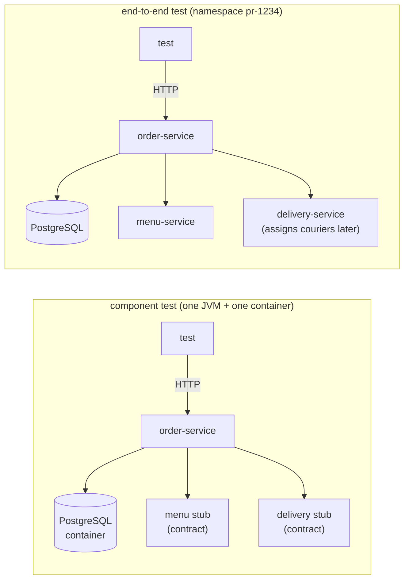

# 64. Component & End-to-End Testing

<div class="badges" markdown><span class="badge badge-l2">L2 · Practitioner</span><span class="badge badge-l3">L3 · Senior/Lead</span><span class="badge badge-meta">component tests · end-to-end tests · ephemeral (preview) environments · shared staging · test data isolation · asynchronous assertions · Awaitility · flaky tests · Argo CD ApplicationSets</span></div>

<div class="grid two" markdown>

!!! info "Prerequisites"
    - [Chapter 61](ch61-test-strategy.md): what component tests catch that other kinds don't
    - [Chapter 63](ch63-contract-testing.md): contracts, which the stubs here follow
    - [Chapter 54](../deployment/ch54-kubernetes-for-spring.md): namespaces, Deployments and Services

!!! abstract "What you'll learn"
    - **A whole environment per namespace is cheap**: PostgreSQL and three Java services were ready and answering in **6.8–7.5 s** alone and **14.1–19.5 s** four at once on a 2-vCPU node, and gone in about 11 s.
    - **Shared staging fails for reasons unrelated to the code under test**: four pipelines against one environment passed **1 of 12** suite runs with fixed test data and **5 of 12** with unique data, since the dish's stock is shared too. With a fresh environment each, **12 of 12** passed.
    - **Sleeps are a flake rate you choose**: waiting a fixed 0.5, 1 and 2 s for a courier failed **27–28%**, **9.5–12.5%** and **1–3.5%** of runs. Polling every 100 ms for up to 10 s failed **none of 400**, and finished in **580–678 ms** on average.
    - **Component tests were ten times faster**: the same five journeys took **1.9–2.3 s** as component tests and **19–28 s** as E2E, including creating and deleting the environment.

</div>

---

## 1 · Introduction & Context

### Red, again

FoodFleet's end-to-end suite ran in one shared staging environment. Every team's pipeline deployed there and ran its journeys, and on a busy afternoon the suite was red more often than green. The failures were real, but mostly not bugs:

- One pipeline's test customer had already used FIRST20.
- Another pipeline had ordered the last biryani of the day.
- A courier took 1.2 s to be assigned, and the test waited one.

The team's response was to rerun until green, and then to stop looking. When a real regression arrived, the red build looked exactly like every other red build.

Chapters 61–63 moved most checks into fast, isolated tests: unit, repository, contract. This chapter is about the tests that remain whole:

- **Component tests:** one service, with its own database real and everything else stubbed.
- **End-to-end tests:** everything deployed together.

Both are worth having only if they're reliable and the environment doesn't fail them. Each part of that is measured on a real cluster.

### Where it comes from

<ul class="mh-timeline">
<li><span class="when">2000s · The staging environment</span><span class="what">One production-like environment where everything is integrated and tested before release; shared by everyone.</span></li>
<li><span class="when">2014 · Component tests</span><span class="what">Toby Clemson's microservice testing strategies define component tests: a service in isolation, through its API, with test doubles for collaborators.</span></li>
<li><span class="when">2015–2020 · Asynchronous assertions</span><span class="what">Awaitility makes "poll until true" the standard way to test asynchronous systems; flaky-test studies at Google and elsewhere name timing as a top cause.</span></li>
<li><span class="when">2019–2023 · Preview environments</span><span class="what">Namespaces per pull request: Argo CD ApplicationSets' pull-request generator, Jenkins X, Okteto, Vercel-style previews for backends.</span></li>
<li><span class="when">2026 · This chapter</span><span class="what">k3s 1.37 as the cluster; Awaitility 4.3.0, Argo CD 3.5.5 and Spring Boot 4.1.1 checked in their sources.</span></li>
</ul>

---

## 2 · Core Concepts & Terminology



Component test
:   One service, started for real (with Spring Boot: `@SpringBootTest(webEnvironment = RANDOM_PORT)`), its own database in a container, and its collaborators replaced by stubs that behave as their contracts say. Tests talk to it through its API.

End-to-end (E2E) test
:   A user journey through every service, deployed together the way production is. It's the only test that sees the system as one, and the most expensive and fragile.

Ephemeral (preview) environment
:   A complete environment created for one pipeline run or pull request, typically a namespace, and deleted afterwards. Argo CD's ApplicationSet pull-request generator creates one per open pull request, named from its number or branch.

Shared staging
:   One long-lived environment that many pipelines deploy to and test against. Its data accumulates, and its state is whatever the last test left.

Test data isolation
:   Each test creates the data it needs (its own customer, its own restaurant) instead of relying on fixtures others can consume.

Asynchronous assertion
:   Waiting for something that happens later: a courier being assigned, an event being processed. Either sleep a fixed time and check once, or poll until true or a timeout (Awaitility polls every 100 ms for up to 10 s by default).

---

## 3 · How It Works Internally

### The system under test

Three services in one image, configured by environment variables:

- **menu-service:** prices, and five portions of the biryani of the day per instance.
- **order-service:** reserves the dish, applies FIRST20 once per customer (in PostgreSQL), stores the order and asks for a courier.
- **delivery-service:** accepts at once and assigns a courier after a log-normal delay with a median of 300 ms, like courier matching at lunch: usually quick, occasionally slow.

An environment is one manifest with the namespace filled in:

```yaml title="k8s/environment.yaml (order-service)"
--8<-- "code/chapters/ch64-component-e2e-testing/src/main/resources/k8s/environment.yaml:74:98"
```

### The journeys, and how they wait

The E2E suite has five journeys: the first order with FIRST20 gets 20% off; a second gets none; the biryani of the day can be ordered; the order gets a courier; the order can be read back. The courier journey is asynchronous, and how it waits is a parameter:

```java title="e2e/Journeys.java"
--8<-- "code/chapters/ch64-component-e2e-testing/src/main/java/dev/foodfleet/ch64/e2e/Journeys.java:21:46"
```

### The same journeys as component tests

The component tests start order-service in-process, with PostgreSQL in a container and stubs for menu- and delivery-service:

```java title="OrderComponentTest.java"
--8<-- "code/chapters/ch64-component-e2e-testing/src/test/java/dev/foodfleet/ch64/OrderComponentTest.java:35:61"
```

With Spring Boot this is `@SpringBootTest(webEnvironment = RANDOM_PORT)` with a `@ServiceConnection` PostgreSQL container (chapter 62), and WireMock or Spring Cloud Contract stubs (chapter 63) for the collaborators.

---

## 4 · Design Considerations & Trade-offs

### Test setup

All runs used:

- k3s v1.37.1+k3s1 on one 2-vCPU node. Each environment ran PostgreSQL 16 plus menu-, delivery- and order-service on Java 25: four Deployments and four Services in a namespace, with CPU requests of 50m and no limits.
- The test runner on the node, calling order-service's cluster IP.
- For component tests, PostgreSQL in Docker and order-service in the test's JVM.

There were two runs. Where they differed, both values are shown. `check_apis.sh` checks **7 behaviours** in Awaitility's, Argo CD's and Spring Boot's sources, and all were found.

### Measured: what an environment costs

| Environments created at once | All Deployments available | order-service answering | Deleted (namespace gone) |
|---|---|---|---|
| 1 | 5.9–6.9 s | **6.8–7.5 s** | 10.7–10.8 s |
| 4 | 13.3–19.0 s | **14.1–19.5 s** | 10.7–13.5 s |

The very first environment after the images were imported took 16 s; the numbers above are with images already on the node.

What the table shows:

- **An environment is seconds, not hours.** Four Deployments with readiness probes, in a namespace, from one manifest. Most of the time is three JVMs starting and PostgreSQL's `initdb`.
- **Parallel environments share the node's CPU.** Four at once took two to three times as long, because twelve JVMs started on two vCPUs. On a real cluster, the autoscaler (chapter 56) and node size decide this.
- **Deletion is a fixed cost too**, about 11 s for the namespace to finish terminating. A pipeline doesn't need to wait for it.

### Measured: shared staging against fresh environments

Four pipelines at once, each running the five-journey suite three times in a row, with polling for the courier:

| Environment | Suite runs passed | Journeys failed | Which |
|---|---|---|---|
| One shared staging, fixed test data | **1 of 12** | 18 of 60 | FIRST20 already used (11), biryani sold out (7) |
| One shared staging, unique test data per run | **5 of 12** | 7 of 60 | biryani sold out (7) |
| A fresh environment per run, fixed test data | **12 of 12** | 0 of 60 | |

Both runs gave the same results. Creating the fresh environments, four at a time, took 12.3–21.7 s each.

What the table shows:

- **Fixed test data in a shared environment is a race no one wins.** The fixed customer could use FIRST20 once, so only the first suite run of the day passed that journey.
- **Unique test data fixes what's yours, not what's shared.** A new customer per run removed the coupon failures, but the dish's stock belonged to the environment: after five portions, every pipeline's biryani journey failed. Shared state isn't only test data; it's whatever the system counts.
- **An environment per run removed every failure that wasn't about the code.** Each run started from the same state, so the suite could use simple fixed data again. The price was 12–22 s per run to create it.

### Measured: waiting for asynchronous work

The courier journey, 200 times per strategy, 8 at a time. Courier assignment took a log-normal delay with a median of 300 ms:

| Wait strategy | Failed | Time per test (mean / max) |
|---|---|---|
| Sleep 500 ms, then check | **54–56 of 200 (27–28%)** | 582–608 / 1,033–1,165 ms |
| Sleep 1 s, then check | 19–25 of 200 (9.5–12.5%) | 1,044–1,046 / 1,134–1,151 ms |
| Sleep 2 s, then check | 2–7 of 200 (1–3.5%) | 2,038 / 2,122–2,126 ms |
| Poll every 100 ms, up to 10 s | **0 of 200** | **580–678** / 3,004–9,980 ms |

What the table shows:

- **A sleep is a flake rate chosen in advance.** The failures follow the delay's distribution: about 30%, 12% and 3% of assignments take longer than 0.5, 1 and 2 s. Doubling the sleep halves the flakiness and doubles the time, forever.
- **Polling is both faster and more reliable.** It returned as soon as the courier was assigned (580–678 ms on average, less than the 1 s sleep), and waited longer only when it had to. One assignment in run 2 took 9.98 s; polling caught it, and every sleep would have failed it.
- **The timeout is for failures, not for success.** Set it well above the slowest legitimate case, because a passing test never waits for it.

### Measured: component tests against E2E

The same five journeys, three times each:

| | Set-up | Suite | Total (with tear-down) | Journeys passed |
|---|---|---|---|---|
| Component tests (order-service, stubs, PostgreSQL in Docker) | 1.3–1.7 s | 0.11–0.22 s | **1.9–2.3 s** | 5 of 5 |
| E2E in a fresh environment | 7.0–16.4 s | 0.59–1.67 s | **19.0–28.1 s** | 5 of 5 |

What the table shows:

- **Component tests are an order of magnitude cheaper** and need only Docker, so they run on every commit. E2E's cost is mostly the environment, not the journeys.
- **They answer different questions.** The component tests used stubs that assign couriers at once and never run out of biryani; they checked order-service's logic and wiring. E2E found what only the deployed system has: real delays, real stock, real configuration between the services.

### Choosing

| Question | Do | Why (measured) |
|---|---|---|
| Test one service through its API | Component tests, on every commit | 1.9–2.3 s for five journeys |
| Test services together | A few E2E journeys, before merge or release | 19–28 s including the environment |
| Where E2E runs | A fresh environment per pipeline run or pull request | 12 of 12 passed against 1–5 of 12 in shared staging |
| Test data | Created by each test, unique where state is shared | Fixed data failed 11 coupon journeys in shared staging |
| Shared counters (stock, quotas) | Reset per environment, or avoided in E2E | Unique data still failed 7 biryani journeys |
| Waiting for async work | Poll with a generous timeout (Awaitility) | 0 of 400 failed; sleeps failed 1–28% |
| Keep staging? | For manual checks and long-running data, not as every pipeline's gate | |

---

## 5 · Hands-on Implementation

```text
ch64-component-e2e-testing/
├── src/main/java/dev/foodfleet/ch64/
│   ├── app/    MenuApp, OrderApp, DeliveryApp, Main (one image, three services), Web
│   ├── e2e/    Journeys: the five journeys, and Wait (sleep or poll)
│   └── json/   Json
├── src/main/resources/k8s/environment.yaml
├── src/test/java/…   OrderComponentTest (5, tag component), UnitTest (4, tag unit)
└── verify/   build-libs.sh, run.sh, check_apis.sh, tools/ (Lab, RunSuites)
```

### 🔵 Level 2: reliable component tests

<div class="badges" markdown><span class="badge badge-l2">L2 · Practitioner</span></div>

- One component test class per service: the service on a random port, its database in a container, stubs from its dependencies' contracts.
- Each test creates its own data: a new customer, a new restaurant.
- Never `Thread.sleep` in a test; use Awaitility's `await().atMost(...).until(...)`.

### 🟣 Level 3: an environment per pull request

<div class="badges" markdown><span class="badge badge-l3">L3 · Senior/Lead</span></div>

- One manifest (or Helm chart, chapter 55) that deploys a whole environment into a namespace.
- An ApplicationSet with the pull-request generator, or a pipeline step, creates `pr-<number>`, runs the E2E journeys, and deletes it.
- Track flaky tests: rerun-to-green hides them; quarantine, fix or delete.

```bash
../../ch52-health-checks-actuator/verify/k3s-lab.sh   # a cluster
JAVA_HOME=/path/to/jdk-25 verify/run.sh               # about 15 minutes
```

### Run and verify

```text
$ verify/run.sh staging waits
== staging
environment                                     suites passed   journeys failed   failures by journey
one shared staging, fixed test data             1 of 12         18 of 60          {first order with FIRST20 gets 20% off=11, the biryani of the day can be ordered=7}
one shared staging, unique test data per run    5 of 12         7 of 60           {the biryani of the day can be ordered=7}
a fresh environment per run, fixed test data    12 of 12        0 of 60           -

== waits
wait strategy                    failed           time per test (mean / max)
sleep 500 ms, then check         54 of 200 (27.0%) 582 / 1033 ms
sleep 1 s, then check            19 of 200 (9.5%) 1044 / 1151 ms
sleep 2 s, then check            2 of 200 (1.0%)  2038 / 2122 ms
poll every 100 ms, up to 10 s    0 of 200 (0.0%)  580 / 3004 ms
```

!!! question "Try it"
    1. Set `ASSIGN_SIGMA` to 0.3 (less variable couriers). Which sleep stops failing?
    2. Give staging `DAILY_STOCK: "1000"`. What fails with unique test data now?
    3. Create eight environments at once. How long do they take on your node?
    4. Break order-service's coupon logic. Which of the component and E2E suites fails, and which tells you why?

---

## 6 · Production Readiness

(For tests, production is the pipeline.)

- [x] **Component tests for every service**, on every commit, with contract-based stubs
- [x] **E2E journeys few and named**, each covering a flow nothing smaller can
- [x] **An environment per pull request or pipeline run**, created from the same manifests as production, and deleted after
- [x] **Tests create their own data**; shared counters reset per environment
- [x] **No sleeps in tests**; polling with timeouts above the slowest legitimate case
- [x] **Flaky tests tracked and quarantined**, never rerun to green silently
- [x] **Environment cost watched**: creation time, node capacity, clean-up of leaked namespaces

---

## 7 · Anti-patterns & Pitfalls

!!! pitfall "Incident 1: the coupon that only worked once a day"
    **Context.** The E2E suite used a fixed customer, `e2e-customer`, in shared staging.

    **Symptoms.** The FIRST20 journey passed for the first pipeline each morning and failed for everyone else.

    **Root cause.** The rule worked: once per customer. Measured: 11 of 12 suite runs failed that journey in shared staging.

    **Fix.** A new customer per test run, and an environment per pipeline run.

!!! pitfall "Incident 2: the biryani that sold out in CI"
    **Context.** After moving to unique customers, the suite was still red in staging every afternoon.

    **Symptoms.** "The biryani of the day can be ordered" failed with 409.

    **Root cause.** Stock is shared by the environment, not owned by a test. Measured: with unique test data, 7 of 12 runs still failed that journey; with fresh environments, none did.

    **Fix.** Fresh environments for E2E; staging's daily stock raised and reset nightly for manual testing.

!!! pitfall "Incident 3: the sleep that was long enough on a laptop"
    **Context.** The courier journey slept 1 s before checking; it always passed locally.

    **Symptoms.** About one CI run in ten failed, then passed on rerun.

    **Root cause.** Courier assignment has a long tail. Measured: a 1 s sleep failed 9.5–12.5% of runs, 2 s still 1–3.5%.

    **Fix.** Polling with a 10 s timeout: measured, no failures, and faster on average than the 1 s sleep.

| Anti-pattern | Symptom | Fix |
|---|---|---|
| One shared staging as every pipeline's gate | Red builds from other people's tests | An environment per run |
| Fixed test data | Passes once, then fails | Each test creates its own |
| Shared counters in E2E | Sells out, rate-limits, fills up | Fresh environments, or avoid them |
| `Thread.sleep` in tests | Flaky and slow at once | Poll with a timeout |
| Rerun until green | Real failures ignored | Quarantine and fix flaky tests |
| E2E for every rule | Slow suites that still miss edges | Unit and component tests |
| Environments never deleted | A cluster full of old namespaces | Delete on merge; a reaper for leftovers |

---

## 8 · Enterprise Case Study

### FoodFleet: component tests on every commit, previews per pull request

!!! decision "ADR-064: every service has component tests run on every commit; E2E journeys run in a fresh environment per pull request, created by an Argo CD ApplicationSet from the production manifests and deleted on merge; tests create their own data and never sleep; shared staging remains for manual and exploratory testing only"
    **Status:** Accepted · **Date:** 2026-01-12

    **Context.** The shared staging E2E suite was red most afternoons, and the team had stopped reading it. Measured on k3s:

    - An environment (PostgreSQL and three services) was answering in 6.8–7.5 s, 14–20 s four at once.
    - Four pipelines on one shared staging passed 1–5 of 12 suite runs; with fresh environments, 12 of 12.
    - Fixed sleeps failed 1–28% of asynchronous checks; polling none of 400, faster on average.
    - Five journeys took 1.9–2.3 s as component tests and 19–28 s as E2E.

    **Decision.**

    - **Component tests:** per service, on every commit, with contract stubs (chapter 63) and PostgreSQL in a container (chapter 62).
    - **Preview environments:** an ApplicationSet pull-request generator deploys `pr-<number>` from the shared chart (chapter 55), with the pull request's image digests.
    - **E2E:** at most a dozen journeys per domain, run in the preview environment before merge.
    - **Tests:** create their own data; Awaitility for asynchronous checks, 10 s or more; flaky tests quarantined within a day.
    - **Staging:** kept for manual testing and demos; no pipeline gates on it.

    **Consequences:**

    - ✅ E2E failures are about the pull request, so people read them again.
    - ✅ Most behaviour is checked in seconds, on every commit.
    - ⚠️ Cluster capacity for preview environments at peak (about one per open pull request).
    - ⚠️ Preview environments need seed data and secrets of their own.

### Fintech analogue: sandboxes per partner

Payment platforms give each integration partner a sandbox environment with its own data, for the same reason: shared test environments let one partner's tests consume another's balances and limits.

### E-commerce analogue: stock in tests

Large retailers learned the biryani lesson with inventory: E2E tests reserving real stock in shared environments sold out test products. Their tests create their own products with effectively unlimited stock, and test sell-out behaviour in component tests where stock is a stub.

---

## 9 · Interview Q&A + Summary

#### Q1. What's a component test, and how is it different from an E2E test? · <span class="badge badge-l2">L2</span> · TCS · Infosys

**Short answer:** A component test runs one service for real, with its database in a container and its collaborators stubbed, and tests it through its API. An E2E test deploys every service and tests a user journey across them. Measured: five journeys took 1.9–2.3 s as component tests and 19–28 s as E2E.

#### Q2. Why are E2E tests flaky? · <span class="badge badge-l2">L2</span> · Swiggy

**Short answer:** Shared environments, shared data and timing. Measured: in a shared staging environment, 1–5 of 12 suite runs passed because of other pipelines' data and stock; fixed sleeps failed 1–28% of asynchronous checks.

#### Q3. How do you test something asynchronous? · <span class="badge badge-l2">L2</span> · Wipro

**Short answer:** Poll until it's true or a timeout passes (Awaitility: every 100 ms, up to 10 s by default), never a fixed sleep. Measured: polling failed none of 400 checks and averaged 580–678 ms; a 1 s sleep failed 9.5–12.5% and took longer.

#### Q4. What's a preview (ephemeral) environment? · <span class="badge badge-l3">L3</span> · Atlassian

**Short answer:** A complete environment created for one pull request or pipeline run, usually a namespace from the production manifests, and deleted afterwards. Argo CD's ApplicationSet pull-request generator creates one per open pull request. Measured: a four-service environment was answering in about 7 s, 14–20 s four at once on a small node.

#### Q5. Shared staging or preview environments? · <span class="badge badge-l3">L3</span> · Flipkart

**Short answer:** Preview environments for automated tests; staging, if kept, for people. Measured: four pipelines sharing staging passed 1 of 12 suite runs with fixed data and 5 of 12 with unique data; fresh environments passed 12 of 12.

#### Q6. Unique test data fixed the coupon failures. Why not the stock? · <span class="badge badge-l3">L3</span> · Zomato

**Short answer:** Because stock isn't the test's data, it's the environment's state, shared by every test that orders that dish. Unique customers isolate what tests own; shared counters (stock, quotas, rate limits) need a fresh environment or a test design that avoids them.

#### Q7. How many E2E tests should a system have? · <span class="badge badge-l3">L3</span> · Uber

**Short answer:** Few: the journeys that matter most and that nothing smaller can check (whole flows across services, real configuration, real infrastructure). Everything else belongs in unit, contract and component tests, which are faster and say where the problem is.

#### Q8. What do you do with a flaky test? · <span class="badge badge-l3">L3</span> · Google

**Short answer:** Quarantine it (it stops gating), find the cause (usually timing, shared state or order dependence), fix it, then restore it. Never rerun to green silently: a suite that's sometimes red trains everyone to ignore red.

#### Q9. How do you make component tests realistic? · <span class="badge badge-l3">L3</span> · Thoughtworks

**Short answer:** The real service binary (`@SpringBootTest` on a random port), the real database engine in a container, and stubs generated from or verified against the collaborators' contracts, so a stub can't drift from the real service.

#### Q10. What does a preview environment cost? · <span class="badge badge-l3">L3</span> · PhonePe

**Short answer:** Seconds to create and delete (measured: about 7 s and 11 s for four services), plus node capacity while it runs: with many open pull requests, enough nodes, or scale-to-zero for idle previews. Seed data and secrets per environment are the operational work.

#### Q11. Where do E2E tests run in the pipeline? · <span class="badge badge-l3">L3</span> · Amazon

**Short answer:** After unit, contract and component tests pass, in the pull request's preview environment, before merge. A smaller smoke set runs again after each production deployment (chapter 58's canary analysis covers the rest).

#### Q12. Design FoodFleet's E2E setup. · <span class="badge badge-l4">L4</span> · architecture rounds

**Short answer:**

- **Per commit:** unit, contract and component tests, minutes in total.
- **Per pull request:** an ApplicationSet creates `pr-<n>` from the shared chart with the pull request's digests; a dozen journeys run; the namespace is deleted on merge.
- **Test design:** each test creates its own data; Awaitility for async; flaky tests quarantined.
- **After deploy:** smoke journeys and canary analysis in production.

### Key takeaways

- **Component tests are the workhorse**: whole service, real database, contract stubs, seconds.
- **E2E belongs in fresh environments**: shared staging fails for other people's reasons.
- **Tests own their data; environments own their counters**.
- **Poll, don't sleep**: faster on average and reliable.

### Further reading

- Toby Clemson, [Testing Strategies in a Microservice Architecture](https://martinfowler.com/articles/microservice-testing/) (component and end-to-end tests)
- Awaitility, [usage](https://github.com/awaitility/awaitility/wiki/Usage)
- Argo CD, [ApplicationSet pull request generator](https://argo-cd.readthedocs.io/en/stable/operator-manual/applicationset/Generators-Pull-Request/)
- Google Testing Blog, [Flaky tests at Google and how we mitigate them](https://testing.googleblog.com/2016/05/flaky-tests-at-google-and-how-we.html)
- Martin Fowler, [Eradicating non-determinism in tests](https://martinfowler.com/articles/nonDeterminism.html)

---

**Previous:** [← 63. Contract Testing](ch63-contract-testing.md) · **Next:** [65. Performance, Chaos & Architecture Tests →](ch65-performance-chaos-arch-tests.md)
