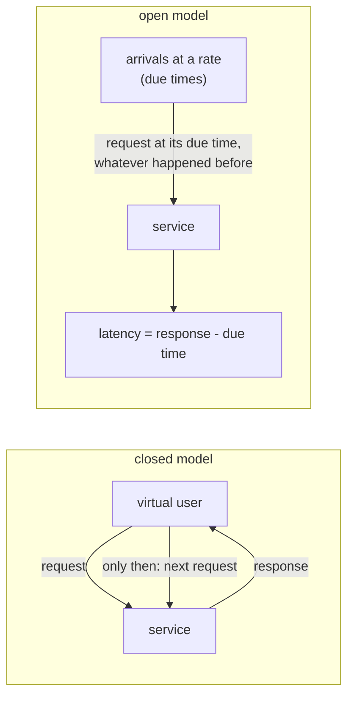

# 65. Performance, Chaos & Architecture Tests

<div class="badges" markdown><span class="badge badge-l3">L3 · Senior/Lead</span><span class="badge badge-l4">L4 · Architect</span><span class="badge badge-meta">load testing · closed vs open models · coordinated omission · capacity · k6 · Gatling · chaos engineering · steady-state hypothesis · abort conditions · fault injection · ArchUnit · fitness functions · freezing</span></div>

<div class="grid two" markdown>

!!! info "Prerequisites"
    - [Chapter 44](../resilience/ch44-timeouts-retries-backpressure.md): timeouts, retries and fallbacks, which the chaos experiment tests
    - [Chapter 48](../observability/ch48-metrics-micrometer.md): percentiles and histograms
    - [Chapter 61](ch61-test-strategy.md): where these tests sit among the others

!!! abstract "What you'll learn"
    - **The load model decides what you measure.** Against a service that froze for 1 s every 10 s:
        - **Closed model** (2 virtual users, back to back): p99 **15.3–15.7 ms**.
        - **Open model** (150 requests a second, timed from when each was due): p99 **942–943 ms**.
        - **The closed model, corrected** for coordinated omission: p99 **898–901 ms**.
    - **A closed model can't overload a service**: 32 virtual users got 387–389 requests a second and a steady 86 ms p99. An open model at 420 a second, just past capacity, built a queue with a p99 of **1.5–1.7 s** within 20 s.
    - **A chaos experiment with an abort condition**: menu-service either slowed (2 s on half the calls) or hung.
        - With **no timeout**, order-service passed every order through at a 2 s p99, or had 13% succeed when menu-service hung.
        - A **timeout with one retry** got 81% or 16% of orders through.
        - A **timeout with the last known price** kept **100% at a 302–307 ms p99**, and was the only set-up that never had to be aborted.
    - **Fitness functions caught 8 of 10 planted violations** in 0.2–0.3 ms. They missed a dependency on an inlined constant (`jdeps` saw it) and one made by reflection (nothing did).

</div>

---

## 1 · Introduction & Context

### The test that said 15 milliseconds

Before the Diwali sale, FoodFleet load-tested menu-service with 50 virtual users looping for an hour. The p99 was 15 ms, comfortably inside the 200 ms objective. On the day, users saw multi-second menus every few minutes, and the SLO burned (chapter 51).

The cause turned out to be a nightly cache rebuild, run hourly by mistake, that froze the service for a second at a time. The load test had seen those freezes too, but a closed model that waits for each response before sending the next sends almost nothing while the service is frozen, so the freezes left a handful of slow samples among a hundred thousand fast ones.

That incident started three practices, which this chapter measures:

- **Load tests that model real arrivals.**
- **Chaos experiments** that check, deliberately and safely, how the system behaves when a dependency misbehaves.
- **Architecture tests** that keep the code shaped the way the design says.

### Where it comes from

<ul class="mh-timeline">
<li><span class="when">1998–2010 · Load testing tools</span><span class="what">LoadRunner and JMeter thread groups: virtual users in loops, the closed model, became the default.</span></li>
<li><span class="when">2011–2013 · Coordinated omission</span><span class="what">Gil Tene names the problem and ships HdrHistogram's corrected recording; Gatling separates open and closed injection.</span></li>
<li><span class="when">2011–2017 · Chaos engineering</span><span class="what">Netflix's Chaos Monkey (2011), then the Principles of Chaos Engineering: steady state, hypotheses, real-world events, minimal blast radius.</span></li>
<li><span class="when">2017 · Fitness functions and ArchUnit</span><span class="what"><em>Building Evolutionary Architectures</em> names architectural fitness functions; ArchUnit makes them JUnit tests over bytecode.</span></li>
<li><span class="when">2020–2026 · Arrival-rate executors everywhere</span><span class="what">k6's <code>constant-arrival-rate</code>; Toxiproxy, Chaos Mesh and service-mesh fault injection. k6 2.3.0, Gatling 3.16.0, Toxiproxy 2.13.0 and ArchUnit 1.5.1 are checked here.</span></li>
</ul>

---

## 2 · Core Concepts & Terminology



Closed model
:   A fixed number of virtual users, each sending its next request when the previous one returns (k6's `constant-vus`, Gatling's `constantConcurrentUsers`, JMeter thread groups). Throughput follows the service: when it slows, the users slow.

Open model
:   Requests arrive at a rate regardless of earlier ones, the way independent users do (k6's `constant-arrival-rate`, Gatling's `constantUsersPerSec`). Latency is measured from when each request was due.

Coordinated omission
:   A closed-model load generator "coordinates" with the service: during a stall it stops sending, so the samples that would have shown the stall are never taken. HdrHistogram's `recordValueWithExpectedInterval` adds them back.

Steady-state hypothesis
:   A measurable statement of normal behaviour ("99% of orders succeed, p99 under 500 ms") that a chaos experiment expects to hold while a fault is injected.

Blast radius and abort conditions
:   How much of the system and its users an experiment can hurt, and the rule that ends the fault early when the hypothesis breaks badly.

Fitness function
:   An automated check of an architectural characteristic: layering, absence of cycles, allowed dependencies, naming. ArchUnit evaluates such rules over compiled classes in a unit test.

Freezing
:   Recording a rule's existing violations and failing only on new ones, so a rule can be introduced into a codebase that doesn't yet satisfy it.

---

## 3 · How It Works Internally

### Two load generators

The closed generator is a loop per virtual user. The open one schedules each request at its due time, on its own virtual thread, and measures from that due time:

```java title="load/LoadModels.java"
--8<-- "code/chapters/ch65-performance-chaos-arch-tests/src/main/java/dev/foodfleet/ch65/load/LoadModels.java:70:96"
```

The service under test has four worker threads, takes 10 ms per request, and can be told to freeze for 1 s every 10 s, as a stop-the-world pause, a failover or a cache rebuild would.

### A chaos experiment

order-service prices each order at menu-service, through a fault proxy like Toxiproxy's latency toxic or a mesh's fault injection. Three versions of its client:

- No timeout.
- A 300 ms timeout with one retry.
- A 300 ms timeout with the last known price as a fallback.

The experiment sends 50 orders a second:

- **10 s** of steady state.
- **30 s** with the fault injected.
- **10 s** after it.

Every 2-second window is checked against the hypothesis (≥ 99% success, p99 < 500 ms). If a window falls below 90% success, the fault is removed:

```java title="chaos/Experiment.java"
--8<-- "code/chapters/ch65-performance-chaos-arch-tests/src/main/java/dev/foodfleet/ch65/chaos/Experiment.java:80:89"
```

The abort check waits for a window's users to have given up (5 s), so it acts on complete data. With 2-second windows that means about 7 s after the fault starts.

### Fitness functions over bytecode

FoodFleet's rules for a service laid out as `api`, `application`, `domain` (with `order` and `money` inside), `infrastructure` and `config`:

```java title="arch/FoodFleetRules.java"
--8<-- "code/chapters/ch65-performance-chaos-arch-tests/src/main/java/dev/foodfleet/ch65/arch/FoodFleetRules.java:15:28"
```

`ClassGraph` reads compiled classes with the JDK's ClassFile API and builds dependencies from what an ASM visitor sees in ArchUnit's importer:

- Supertypes.
- Field and method types.
- Generic signatures.
- The classes the code uses: field accesses, calls, `new`, casts and class literals.

```java title="arch/ClassGraph.java"
--8<-- "code/chapters/ch65-performance-chaos-arch-tests/src/main/java/dev/foodfleet/ch65/arch/ClassGraph.java:118:138"
```

With ArchUnit itself, the same rules read as `layeredArchitecture().consideringAllDependencies().layer("Domain").definedBy("..domain..")…`, `slices().matching("..sample.(*)..").should().beFreeOfCycles()` and `GeneralCodingRules.NO_CLASSES_SHOULD_ACCESS_STANDARD_STREAMS`, each in a `@ArchTest` field.

---

## 4 · Design Considerations & Trade-offs

### Test setup

All runs used:

- JDK 25.0.4 on one 2-vCPU VM, with load generator and service in separate threads of one process, over loopback HTTP.
- For the load tests, the service described above.
- For the chaos experiment, menu-service at 5 ms per call, behind the fault proxy.
- For the fitness functions, a 10-class sample service compiled ten times, once with each planted violation.

There were two runs. Where they differed, both values are shown. `check_apis.sh` checks **14 behaviours** in k6's, Gatling's, HdrHistogram's, Toxiproxy's and ArchUnit's sources, and all were found.

### Measured: a freezing service under two load models

60 s of load; the service froze for 1 s every 10 s:

| Load model | Requests/s | p50 | p90 | p99 | p99.9 | max |
|---|---|---|---|---|---|---|
| Closed: 2 virtual users, back to back | 159–160 | 11.0–11.1 ms | 11.9–12.1 ms | **15.3–15.7 ms** | 1,005–1,007 ms | 1,012–1,020 ms |
| Closed, corrected (HdrHistogram's expected interval) | 159–160 | 11.0–11.1 ms | 14.4–14.9 ms | **898–901 ms** | 1,003–1,007 ms | 1,012–1,020 ms |
| Open: 150 requests/s, timed from when due | 150 | 10.9–11.0 ms | **392–393 ms** | **942–943 ms** | 1,001–1,005 ms | 1,008–1,012 ms |

What the table shows:

- **The closed model reported a p99 60 times too good.** Six freezes of a second each delayed only the two requests in flight each time: 12 slow samples among about 9,600, visible at the 99.9th percentile and the max but nowhere near the p99.
- **Real users don't wait for each other.** At 150 arrivals a second, every freeze delayed about 150 requests by up to a second: 10% of all requests. The open model's p90 was 392 ms; the closed model's was 12 ms.
- **The correction recovers most of it,** if the expected interval is right. Both models saw the same maximum, so a closed-model max that is far above its p99 is a sign that coordinated omission is hiding something.

### Measured: towards capacity

The same service, no freezes, about 390 requests a second at most (4 workers × 10 ms, less overhead); 20 s per step:

| Load model | Requests/s achieved | p50 | p99 |
|---|---|---|---|
| Closed: 4 virtual users | 362–367 | 10.7–10.9 ms | 14.1–14.8 ms |
| Closed: 8 virtual users | 386–388 | 20.5–20.6 ms | 22.9–23.8 ms |
| Closed: 16 virtual users | 386–389 | 41.0–41.4 ms | 43.5–44.3 ms |
| Closed: 32 virtual users | 387–389 | 82.1–82.5 ms | 85.6–86.6 ms |
| Open: 200 requests/s | 200 | 10.6–10.8 ms | 12.4–13.2 ms |
| Open: 320 requests/s | 320 | 10.6–10.7 ms | 13.3–14.3 ms |
| Open: 380 requests/s | 380 | 10.7–10.8 ms | 18.4–45.9 ms |
| Open: 420 requests/s | **388–391** | **747–842 ms** | **1,495–1,654 ms** |

What the table shows:

- **A closed model can't push past capacity.** Doubling the users doubled the latency (Little's law: 32 users ÷ 389/s ≈ 82 ms) at a steady throughput. Nothing broke, because the load generator slowed down with the service.
- **An open model finds the knee.** Up to 320 a second, latency stayed at the service time. At 380, close to capacity, the tail grew. At 420, the service fell behind by about 30 requests every second, and the queue made the median request wait most of a second within 20 s. A sale-day spike looks like this.
- **Capacity tests need arrival rates.** Run the open model in steps until p99 leaves the objective; that rate, with headroom, is the number for chapter 56's autoscaling.

### Measured: a chaos experiment

Steady state: at least 99% of orders succeed and p99 is under 500 ms per 2-second window. The fault is aborted when a window falls below 90% success.

| Fault | order-service's client | Fault aborted | Orders OK during the fault | p99 during the fault | Windows out of steady state (of 25) |
|---|---|---|---|---|---|
| 2 s latency on half the calls | no timeout | no | 1,500 of 1,500 (100%) | **2,011–2,013 ms** | **15** |
| 2 s latency on half the calls | 300 ms timeout, 1 retry | after 7 s | 323 of 400 (81%) | 602–603 ms | 4 |
| 2 s latency on half the calls | 300 ms timeout, last price | no | **1,500 of 1,500 (100%)** | **302–303 ms** | **0** |
| menu-service hangs | no timeout | after 7 s | 50 of 400 (13%) | 5,001–5,002 ms | 4 |
| menu-service hangs | 300 ms timeout, 1 retry | after 7 s | 65 of 400 (16%) | 604–612 ms | 4 |
| menu-service hangs | 300 ms timeout, last price | no | **1,500 of 1,500 (100%)** | **304–307 ms** | **0** |

The success and abort figures were identical in both runs.

What the table shows:

- **"No errors" isn't steady state.** With no timeout, every order succeeded during the slowdown, but half took two seconds, and 15 of 25 windows broke the latency objective. A hypothesis that only counted errors would have called that a pass.
- **The abort condition limited the damage to 7 seconds.** Three set-ups fell below 90% success; each time the fault was removed after the first complete bad window. Without it, the hang would have failed about 950 more orders.
- **Retries didn't help against a dependency that is slow or gone.** A second 300 ms attempt at a coin-flip dependency got 81% through, and nothing against a hung one. It also doubled the calls to a struggling service (chapter 44).
- **Only a fallback held the hypothesis.** The last known price is a business decision: acceptable for a menu price for a few minutes, not for a payment. The experiment is how FoodFleet found out the decision was needed.

### Measured: fitness functions against planted violations

| Planted violation | layered architecture | no cycles between slices | domain free of I/O | naming in api | no standard streams |
|---|---|---|---|---|---|
| V1 domain uses an API type | caught | caught | caught | | |
| V2 use case uses the JDBC class, not its port | caught | caught | | | |
| V3 money depends on order (a cycle inside domain) | | **caught** | | | |
| V4 controller reaches into infrastructure | **caught** | | | | |
| V5 domain uses `java.sql` | | | **caught** | | |
| V6 `System.out` in a use case | | | | | **caught** |
| V7 a helper class in the API package | | | | **caught** | |
| V8 domain uses an infrastructure **constant** | | | | | |
| V9 domain calls an infrastructure method | caught | caught | caught | | |
| V10 domain loads an infrastructure class **by name** | | | | | |

The clean service had no violations, and both runs gave the same results.

| Codebase | Classes | Reading the classes | Evaluating |
|---|---|---|---|
| The sample service | 10 | 2.0 ms | all 5 rules: 0.2–0.3 ms |
| The JDK's `java.base` module | 3,655 | 1.67–1.69 s | cycles between packages: 33–41 ms (stopped at 100 cycles, ArchUnit's default) |

What the tables show:

- **Each rule caught its own kind of violation, and several were caught by only one rule.** The layer rule alone saw a controller skipping the application layer; only the cycle rule saw a cycle inside one layer; only the general coding rule saw `System.out`. Five small rules covered eight violations.
- **An inlined constant is invisible to rules that read code.** `OrderTable.MAX_LINES` is a compile-time constant, so javac copied its value into `Order` and the code never mentions `OrderTable`. javac does leave the class's name in the constant pool (since JDK 9), and `jdeps` reported the dependency from it. Reading the whole constant pool, the same five rules found 4 violations.
- **Reflection is invisible to everything.** `Class.forName("…JdbcOrderRepository")` is a string. No bytecode rule and no `jdeps` saw it; only a review, or a rule that forbids `Class.forName` outside configuration, would.
- **Freezing lets rules start in old code.** A legacy version with V1 and V5 had 5 violations, all stored. Adding V2 made 8, and only the 3 new ones were reported: the build failed on the new debt, not the old.
- **The cost is the class reading.** Rules on a service took well under a millisecond; reading all of `java.base` took under 2 s. ArchUnit caches imported classes across tests for the same reason.

### Choosing

| Question | Do | Why (measured) |
|---|---|---|
| Latency under load | Open model (arrival rate), latency from the due time | The closed model's p99 was 15 ms; the open model's 942 ms |
| Already have closed-model tests | Correct with HdrHistogram's expected interval; compare max with p99 | Corrected p99 898–901 ms |
| Capacity | Open model in rising steps until p99 breaks the objective | Closed models plateau and never overload |
| Resilience to a dependency | Chaos experiments with a latency-and-errors hypothesis and an abort condition | No-timeout passed "no errors" with a 2 s p99 |
| Blast radius | Abort on the first bad window; start in staging, then a fraction of production | Damage limited to 7 s |
| Architecture drift | Fitness functions in every build: layers, cycles, allowed dependencies, coding rules | 8 of 10 caught in under a millisecond |
| Existing violations | Freeze them; fail on new ones | 3 new of 8 reported |
| What bytecode can't see | A ban on `Class.forName` outside config; `jdeps` for constants | V8 and V10 missed |

---

## 5 · Hands-on Implementation

```text
ch65-performance-chaos-arch-tests/
├── src/main/java/dev/foodfleet/ch65/
│   ├── load/     LoadModels (closed, open), Latencies (with correction), StallingServer
│   ├── chaos/    FaultProxy, Services (order-service, three client set-ups), Experiment
│   ├── arch/     ClassGraph (ClassFile API), Rules, FoodFleetRules, Freeze
│   └── sample/   the service the rules guard (api, application, domain, infrastructure, config)
├── src/test/java/…   ArchitectureTest (tag arch), UnitTest (4, tag unit)
└── verify/   build-libs.sh, run.sh, check_apis.sh, violations.tsv, tools/ (Lab, RunSuites)
```

### 🟣 Level 3: trustworthy numbers

<div class="badges" markdown><span class="badge badge-l3">L3 · Senior/Lead</span></div>

- Load tests with k6's `constant-arrival-rate` or Gatling's `constantUsersPerSec`, sized with enough pre-allocated VUs; watch k6's `dropped_iterations`.
- Record latencies in HdrHistogram (or Micrometer's percentile histograms) and report p99, p99.9 and max.
- ArchUnit tests in every service's build: layers, cycles, `GeneralCodingRules`, and a freeze store committed to the repository.

### 🔴 Level 4: experiments as a practice

<div class="badges" markdown><span class="badge badge-l4">L4 · Architect</span></div>

- A chaos experiment template: hypothesis from the service's SLOs, fault, abort condition, owner, rollback.
- Game days per quarter, starting in staging, then a fraction of production traffic with automatic abort.
- Capacity tests per release for services on the critical path; their results feed autoscaling and sale-day plans.

```bash
JAVA_HOME=/path/to/jdk-25 verify/run.sh   # about 10 minutes
```

### Run and verify

```text
$ verify/run.sh stall
== stall
menu-service: 4 workers, 10 ms per request, frozen for 1 s every 10 s; 60 s of load
load model                                        samples   requests   p50 ms      p90      p99    p99.9      max
closed: 2 virtual users, back to back                9628      160/s     11.0     11.9     15.3   1004.7   1012.0
closed, corrected for coordinated omission          10519      160/s     11.0     14.4    898.1   1003.0   1012.0
open: 150 requests/s, timed from when due            9000      150/s     10.9    392.6    943.1   1005.0   1011.7
```

!!! question "Try it"
    1. Run the closed model with 20 users instead of 2. What happens to its p99, and why?
    2. Change the chaos fallback to fail when the last known price is older than 60 s. How does the hang experiment change?
    3. Add a rule that forbids `Class.forName` outside `config`. Does it catch V10?
    4. Point `ClassGraph` at your own service's `target/classes` with your package layout. What does it find?

---

## 6 · Production Readiness

- [x] **Load tests with an open model** for latency and capacity; closed-model results corrected or retired
- [x] **p99, p99.9 and max reported**, with the load model stated
- [x] **Capacity per service** known from stepped arrival rates, and fed into autoscaling
- [x] **Chaos experiments with hypotheses from SLOs**, both errors and latency, and automatic abort
- [x] **Blast radius controlled**: staging first, then a small share of production, never without an owner watching
- [x] **Fitness functions in every build**, with frozen violations committed and shrinking
- [x] **Reflection confined** to configuration, by a rule

---

## 7 · Anti-patterns & Pitfalls

!!! pitfall "Incident 1: the 15-millisecond p99"
    **Context.** menu-service's load test used 50 looping virtual users.

    **Symptoms.** The test passed with a p99 of 15 ms; on sale day, menus took seconds every few minutes.

    **Root cause.** Coordinated omission. Measured: against a service freezing 1 s every 10 s, a closed model reported a 15 ms p99 where the open model measured 942 ms.

    **Fix.** Arrival-rate load tests; HdrHistogram correction for old closed-model scripts; max always reported.

!!! pitfall "Incident 2: the chaos experiment that passed"
    **Context.** A chaos experiment injected 2 s of latency into menu-service with the hypothesis "order errors stay under 1%".

    **Symptoms.** It passed. Users still complained about checkout taking seconds.

    **Root cause.** The hypothesis counted errors, not latency. Measured: with no timeout, every order succeeded and 15 of 25 windows broke the latency objective.

    **Fix.** Hypotheses from the SLOs, latency included; a 300 ms timeout and a last-known-price fallback, measured at 100% success and a 302–303 ms p99.

!!! pitfall "Incident 3: the constant that crossed a layer"
    **Context.** ArchUnit's layer rules passed; a review found the domain using an infrastructure class's constant for a table limit.

    **Symptoms.** None until the infrastructure class was moved to another module, and the domain module stopped compiling.

    **Root cause.** Inlined constants leave no trace in the code. Measured: no rule caught V8; `jdeps` did, from the constant-pool entry javac leaves.

    **Fix.** Constants that belong to the domain live in the domain; a `jdeps`-based check between modules in the build.

| Anti-pattern | Symptom | Fix |
|---|---|---|
| Looping virtual users for latency | p99 that ignores stalls | Arrival-rate model |
| Reporting averages or p95 only | Stalls and queues invisible | p99, p99.9, max |
| Capacity from a closed model | "It never breaks" | Stepped open model |
| Chaos without an abort condition | An experiment becomes an incident | Abort on the first bad window |
| Hypotheses about errors only | Slow passes as healthy | Latency in the hypothesis |
| Retries as the resilience plan | More load on a failing dependency | Timeouts, fallbacks, breakers |
| Architecture rules written once, ignored | Violations accumulate | Freeze, and fail on new ones |
| Trusting bytecode rules completely | Constants and reflection slip past | `jdeps`, a reflection rule, reviews |

---

## 8 · Enterprise Case Study

### FoodFleet: qualities tested like features

!!! decision "ADR-065: load tests use open (arrival-rate) models with latency from due time and report p99, p99.9 and max; capacity is measured per release by stepped arrival rates; chaos experiments run with SLO-based hypotheses and automatic abort, in staging then on a small share of production; every service has ArchUnit fitness functions with a committed freeze store and a rule against reflection outside configuration"
    **Status:** Accepted · **Date:** 2026-01-19

    **Context.** A sale-day slowdown passed a load test, a chaos experiment passed while checkout slowed, and a layer violation hid in a constant. Measured:

    - Against a periodically freezing service, a closed model reported a p99 of 15 ms; the open model 942 ms; the corrected closed model 898–901 ms.
    - A closed model never overloaded the service; an open model at 108% of capacity built a 1.5–1.7 s p99 in 20 s.
    - With a dependency slow or hung, only a timeout with a fallback kept the hypothesis; the abort condition limited bad experiments to 7 s.
    - Five fitness functions caught 8 of 10 planted violations in under a millisecond; an inlined constant and reflection escaped.

    **Decision.**

    - **Load:** k6 with `constant-arrival-rate` (and `ramping-arrival-rate` for capacity) in the release pipeline for critical services.
    - **Chaos:** monthly experiments per critical dependency: hypotheses from SLOs, faults through the mesh (chapter 57), abort on one bad window, an owner present.
    - **Architecture:** ArchUnit layers, cycles and coding rules in every build; freeze stores committed; `Class.forName` allowed only in configuration; `jdeps` checks between modules.

    **Consequences:**

    - ✅ Load-test numbers mean what users will see.
    - ✅ Resilience decisions (fallbacks, timeouts) come from experiments, not assumptions.
    - ⚠️ Open-model tests need generators sized for the rate, and they do overload things.
    - ⚠️ Freeze stores must shrink over time, or they become permanent exceptions.

### Fintech analogue: chaos with money

Payment companies run chaos experiments with stricter abort conditions and in narrower blast radii: a single region, a share of synthetic transactions, and automatic abort on any increase in failed payments. The fallback question ("what do we do when the risk service is slow?") gets a business answer before the experiment, not after.

### E-commerce analogue: capacity for the sale

Retailers' sale preparation is a capacity test with an open model, run weeks ahead at the forecast arrival rate and beyond, until the knee appears; autoscaling minimums and pre-warmed capacity are set from it, and the test is repeated after every significant change.

---

## 9 · Interview Q&A + Summary

#### Q1. What's the difference between a closed and an open load model? · <span class="badge badge-l3">L3</span> · Flipkart · Swiggy

**Short answer:** A closed model has a fixed number of users who each wait for a response before sending again; an open model sends requests at a rate regardless. Real users of a web service are open. Measured: against a freezing service, the closed model's p99 was 15 ms and the open model's 942 ms.

#### Q2. What is coordinated omission? · <span class="badge badge-l3">L3</span> · Azul · Uber

**Short answer:** A load generator that waits for responses stops sending during a stall, so it never records the requests that would have waited. Its percentiles are far too good. Fix it with an open model, or correct closed-model samples with HdrHistogram's expected interval (measured: p99 898–901 ms instead of 15 ms).

#### Q3. How do you find a service's capacity? · <span class="badge badge-l3">L3</span> · Amazon

**Short answer:** Step an arrival rate up until the latency objective breaks, and note the rate. Measured: p99 stayed at 13–14 ms up to 320 requests a second, rose near 380, and reached 1.5–1.7 s at 420, past the service's 390. A closed model just plateaus at capacity and never shows the knee.

#### Q4. Which percentiles should a load test report? · <span class="badge badge-l2">L2</span> · TCS

**Short answer:** p50, p99, p99.9 and max, plus the load model and the throughput achieved. Averages and p95 hide stalls; a max far above the p99 in a closed-model test is a sign of coordinated omission.

#### Q5. What is chaos engineering, and how is it different from testing? · <span class="badge badge-l3">L3</span> · Netflix · Atlassian

**Short answer:** Running experiments that inject real-world faults (latency, errors, outages) to check a hypothesis about steady-state behaviour, ideally in production, with a controlled blast radius. A test checks known behaviour; an experiment looks for unknown weaknesses.

#### Q6. What makes a good steady-state hypothesis? · <span class="badge badge-l3">L3</span> · Razorpay

**Short answer:** User-visible measures taken from the SLOs, errors and latency, per short window. Measured: with no timeout, every order succeeded while half took 2 s; an errors-only hypothesis would have passed.

#### Q7. How do you keep a chaos experiment from becoming an incident? · <span class="badge badge-l3">L3</span> · PhonePe

**Short answer:** Abort conditions checked automatically (here: below 90% success in a window removes the fault), a small blast radius (staging, then a fraction of traffic), an owner watching, and a tested rollback. Measured: the abort ended bad experiments 7 s after they started.

#### Q8. A dependency is slow. Retry or fall back? · <span class="badge badge-l3">L3</span> · Zomato

**Short answer:** Time out quickly, then fall back if the business allows. Measured: one retry after a 300 ms timeout got 81% of orders through a half-slow dependency and 16% through a hung one; the last known price kept 100% at a 302–307 ms p99.

#### Q9. What is a fitness function? · <span class="badge badge-l3">L3</span> · Thoughtworks

**Short answer:** An automated check that an architectural characteristic holds, run continuously: layer dependencies, no cycles, allowed libraries, naming, or measured qualities like latency. With ArchUnit they're JUnit tests over compiled classes.

#### Q10. What can't ArchUnit see? · <span class="badge badge-l3">L3</span> · Red Hat

**Short answer:** Anything not in the code's bytecode: compile-time constants that javac inlined (measured: a domain-to-infrastructure constant passed every rule, while `jdeps` saw the constant-pool entry) and dependencies by reflection (nothing saw `Class.forName`). Ban reflection outside configuration with a rule.

#### Q11. How do you introduce architecture rules into a legacy codebase? · <span class="badge badge-l3">L3</span> · Infosys

**Short answer:** Freeze: record existing violations in a store committed with the code, and fail only on new ones (ArchUnit's `FreezingArchRule`; store creation must be allowed explicitly). Measured: of 8 violations, the 3 new ones were reported. Shrink the store as code is fixed.

#### Q12. Design FoodFleet's quality testing. · <span class="badge badge-l4">L4</span> · architecture rounds

**Short answer:**

- **Performance:** k6 open-model tests in the release pipeline; stepped capacity tests before sales; p99, p99.9 and max against SLOs.
- **Resilience:** monthly chaos experiments per critical dependency, with SLO hypotheses and automatic abort; mesh fault injection.
- **Architecture:** ArchUnit fitness functions in every build, frozen debt, a reflection rule, `jdeps` between modules.
- **Feedback:** results feed autoscaling (chapter 56), timeouts and fallbacks (chapter 44) and the next design review.

### Key takeaways

- **Load arrives at a rate**: test with an open model, or the stalls disappear from the numbers.
- **Capacity is where the open model's latency turns up**: closed models never find it.
- **Chaos experiments need a latency-aware hypothesis and an automatic abort**.
- **Fitness functions are cheap and specific**: freeze old debt, and know what bytecode can't show.

### Further reading

- Gil Tene, [How NOT to Measure Latency](https://www.infoq.com/presentations/latency-response-time/) and [HdrHistogram](http://hdrhistogram.org/)
- k6, [Open and closed models](https://grafana.com/docs/k6/latest/using-k6/scenarios/concepts/open-vs-closed/); Gatling, [Injection](https://docs.gatling.io/reference/script/core/injection/)
- [Principles of Chaos Engineering](https://principlesofchaos.org/); Toxiproxy, [README](https://github.com/Shopify/toxiproxy)
- ArchUnit, [User Guide](https://www.archunit.org/userguide/html/000_Index.html)
- Neal Ford, Rebecca Parsons, Patrick Kua, Pramod Sadalage, *Building Evolutionary Architectures* (2nd ed., 2022)

---

**Previous:** [← 64. Component & End-to-End Testing](ch64-component-e2e-testing.md) · **Next:** [66. Latency, Tail Latency, Virtual Threads vs Reactive →](../performance-scalability/ch66-latency-virtual-threads-reactive.md)
